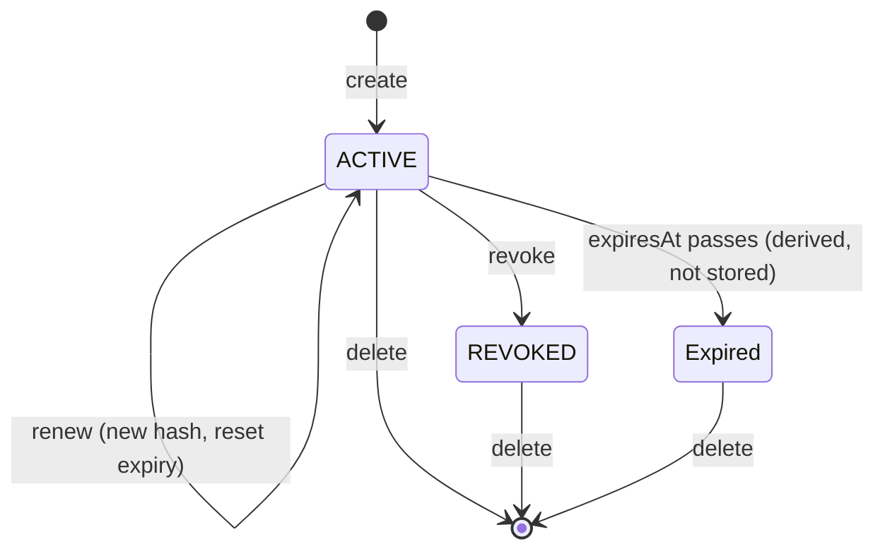
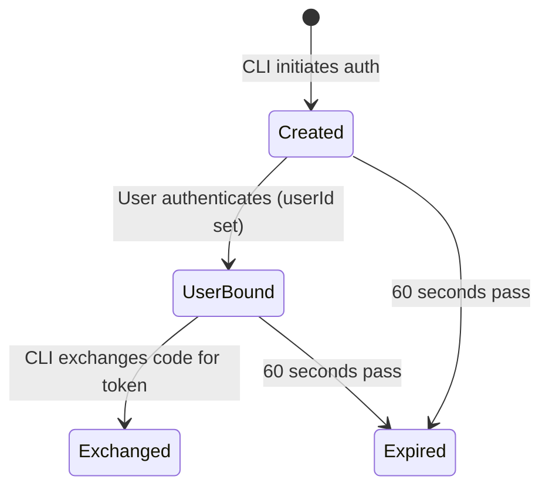
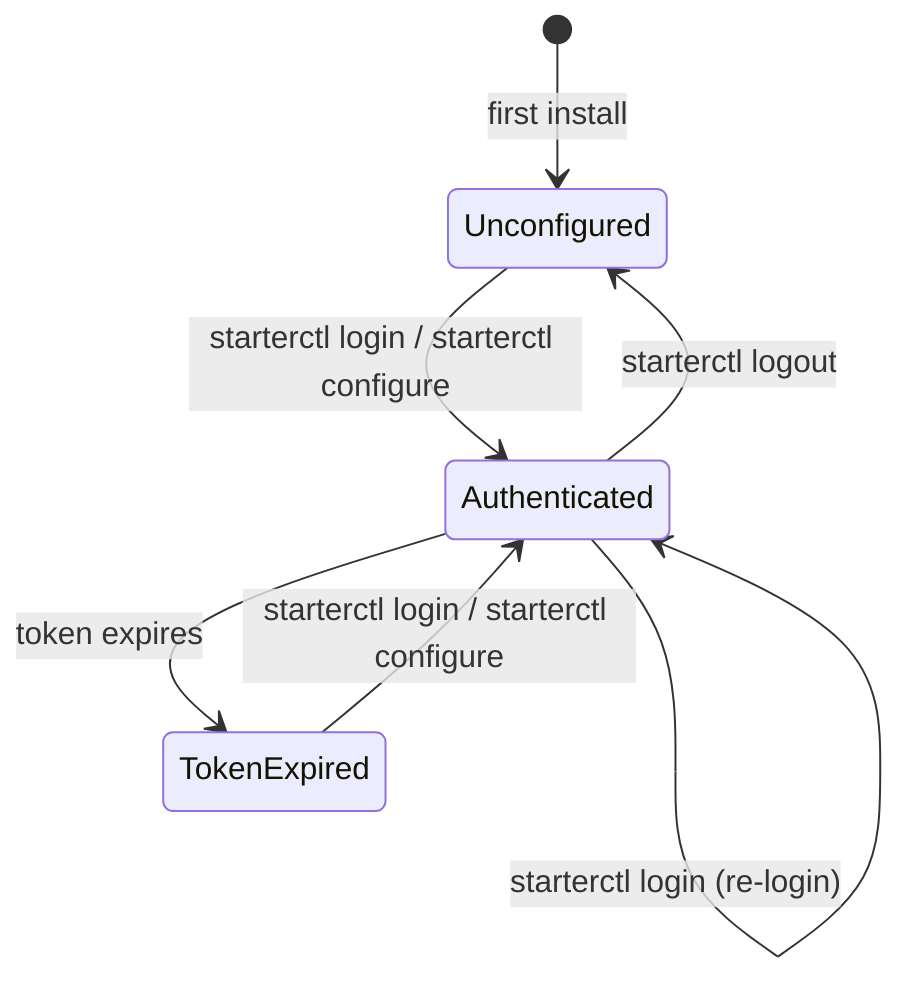

# Main Project Specification

> **Revision**: 2026-10-29 — User-approved follow-up review of all 15 Joern advisory paths; clarified trusted redirect destinations under FR-038 and acceptance evidence in `specs/base/auth-and-rbac.md` and `specs/base/testing-and-quality.md`. Original feature sources and IDs remain unchanged; unfinished 014 remains deferred.

> **Revision**: 2026-10-15 — Bootstrapped project memory from completed deployment smoke verification for an archive extension trial.
> **Revision**: 2026-10-15 — Consolidated completed Azure infrastructure feature 018; retained newer deployment verification, folded shared Azure target and permission-failure context, and allocated fresh IDs.
> **Revision**: 2026-10-15 — Archived completed auth hardening 010 after implementation alignment; preserved existing IDs and added source-linked stories, requirements, entities, edge cases, outcomes and assumptions.
> **Revision**: 2026-10-15 — Consolidated completed route refactor 011; folded compatible audit fields into the nullable audit entity, retained existing IDs and marked future domain contracts explicitly.
> **Revision**: 2026-10-15 — Archived completed PAT/OpenAPI feature 012; extended User/AuditAction and browser-session assumptions, preserved all token lifecycle clauses including letter-suffixed source IDs.
> **Revision**: 2026-10-15 — Archived completed CLI feature 013 after the approved localization exception and Windows ACL correction; folded shared login/health goals and API projections without retiring IDs.
> **Revision**: 2026-10-15 — Archived reconciled Teams feature 015; added delegated-send/read-only-intake contracts and folded supported Teams job types into the existing background-job model without retiring IDs.
> **Revision**: 2026-10-15 — Archived specs/016-runtime-credential-separation; consolidated compatible entries and retained original sources and stable IDs.
> **Revision**: 2026-10-15 — Archived specs/017-deepsec-remediation; consolidated compatible entries and retained original sources and stable IDs.
> **Revision**: 2026-10-15 — Archived specs/019-logging-standardization; consolidated compatible entries and retained original sources and stable IDs.
> **Revision**: 2026-10-15 — Archived specs/021-ops-health-dashboard; consolidated compatible entries and retained original sources and stable IDs.
> **Revision**: 2026-10-15 — Archived specs/022-postgresql-only; consolidated compatible entries and retained original sources and stable IDs.

## User Scenarios & Testing

### User Story 1 - Verify The Deployed Application (Priority: P1)

[Source: specs/020-deploy-smoke-verification/spec.md -> User Story 1]
[Source: specs/013-cli-client/spec.md -> User Story 7]

As an operator, I want one repeatable smoke check that confirms the deployed web application is reachable and healthy after deployment, so I can trust that users can access the release before I mark it successful.

A user or monitoring script checks the application health status via the CLI. This is useful for scripted health checks and operational monitoring.

**Why this priority**: A deployment is not useful if the user-facing application cannot be reached. This is the minimum viable safety check. (specs/013-cli-client argued P3) Health checks are simple but useful for ops automation. Low priority because the health endpoint is already accessible via curl.

**Independent Test**: Run the smoke verification against a configured deployed environment and confirm it fails when the application endpoint is unavailable and passes when the endpoint returns a healthy result.

Can be tested by running `cli health` and verifying the output matches the health endpoint response.

**Acceptance Scenarios**:

1. **Given** a deployed environment with a reachable application endpoint, **When** the operator runs smoke verification, **Then** the result reports the application endpoint as healthy.

2. **Given** a deployed environment with an unreachable or unhealthy application endpoint, **When** the operator runs smoke verification, **Then** the result fails with the checked endpoint and reason.

3. **Given** a configured CLI, **When** the user runs `cli health`, **Then** the CLI displays the application health status including process availability and database connectivity.

4. **Given** a configured CLI pointing to an unreachable server, **When** the user runs `cli health`, **Then** the CLI displays a clear connection error with the server URL.

### User Story 2 - Verify Deployment Runtime State (Priority: P2)

[Source: specs/020-deploy-smoke-verification/spec.md -> User Story 2]

As an operator, I want the same smoke process to confirm migration completion, worker readiness, and active container revision health, so deployment success reflects the complete runtime and not only the web endpoint.

**Why this priority**: A deployment can look healthy from the web endpoint while background processing, migrations, or active revisions are broken.

**Independent Test**: Run smoke verification with mocked or test Azure runtime responses and confirm it passes only when migration, worker, and revision states are all acceptable.

**Acceptance Scenarios**:

1. **Given** the latest migration completed successfully, the worker is ready, and active revisions are healthy, **When** smoke verification runs, **Then** the deployment runtime state passes.
2. **Given** any migration, worker, or active revision check fails, **When** smoke verification runs, **Then** the overall result fails and identifies the failed runtime check.

---

### User Story 3 - Preserve Operator Evidence (Priority: P3)

[Source: specs/020-deploy-smoke-verification/spec.md -> User Story 3]

As an operator, I want a concise smoke report in local and CI output, so failures are easy to diagnose and successful deployments have auditable evidence.

**Why this priority**: Verification is more useful when the result can be shared, reviewed, and traced after the deployment finishes.

**Independent Test**: Run smoke verification in success and failure modes and confirm the generated output contains environment identity, checked targets, pass/fail statuses, and remediation-oriented failure details.

**Acceptance Scenarios**:

1. **Given** all checks pass, **When** smoke verification completes, **Then** the operator sees a concise success summary including environment, endpoint, and runtime checks.
2. **Given** one or more checks fail, **When** smoke verification completes, **Then** the operator sees a failure summary that names each failed check and preserves enough context for CI logs or local troubleshooting.

---

### User Story 4 - Provision A Complete Azure Runtime (Priority: P1)

[Source: specs/018-opentofu-azure-infra/spec.md -> User Story 1]

An operator can create a production-ready Azure environment for a downstream app from this template without hand-assembling the core cloud resources.

**Why this priority**: The template is already Docker-first, but hosted deployment still requires repeatable infrastructure for containers, database, secrets, registry access, logging, and network boundaries.

**Independent Test**: Review the generated deployment plan for a new environment and confirm that it includes all required runtime resources, identity links, configuration values, and outputs needed to run the app, worker, and migration flow.

**Acceptance Scenarios**:

1. **Given** an operator has selected an Azure subscription, region, environment name, and domain/base URL values, **When** they review the deployment plan, **Then** they see resources for app runtime, worker runtime, migration execution, PostgreSQL, container image storage, secrets, monitoring, and required identities.
2. **Given** the plan is applied to an empty Azure resource group, **When** provisioning completes, **Then** the operator receives the app endpoint, database connection outputs needed by runtime configuration, registry information, and operational monitoring links.
3. **Given** provisioning fails part way through, **When** the operator reruns the same deployment with the same inputs, **Then** the process can converge without requiring manual cleanup of successfully created resources.

---

### User Story 5 - Deploy App, Worker, And Migrations Safely (Priority: P1)

[Source: specs/018-opentofu-azure-infra/spec.md -> User Story 2]

An operator can deploy container images through a repeatable pipeline that runs database migrations before new app and worker revisions receive production traffic.

**Why this priority**: A cloud environment is only useful if application updates can be released safely and repeatedly without giving long-running services migration-only authority.

**Independent Test**: Execute a dry-run or staged deployment using known image tags and verify that the migration step, app runtime, and worker runtime receive the correct configuration and deployment order.

**Acceptance Scenarios**:

1. **Given** new app and worker image tags are available, **When** the deployment pipeline runs, **Then** the migration step completes successfully before app and worker revisions are promoted.
2. **Given** the migration step fails, **When** the deployment pipeline evaluates the result, **Then** app and worker revisions are not promoted and the failure is visible to operators.
3. **Given** separate runtime database credentials are configured, **When** services start, **Then** app, worker, and migration runtimes each receive only their intended database access path.

---

### User Story 6 - Manage Secrets And Runtime Configuration (Priority: P2)

[Source: specs/018-opentofu-azure-infra/spec.md -> User Story 3]
[Source: specs/016-runtime-credential-separation/spec.md -> User Story 1]
[Source: specs/016-runtime-credential-separation/spec.md -> User Story 3]

An operator can define required secrets and runtime settings once, store sensitive values in a managed secret boundary, and expose only the necessary values to each runtime.

An operator can review each runtime setting and understand whether it belongs to the public app, background worker, migration/provisioning flow, or local development.

An operator can keep app-facing sign-in secrets separate from worker-only background integration secrets where the template already has different responsibilities.

**Why this priority**: The template already separates app, worker, and migration credentials. Azure deployment automation must preserve that separation rather than flattening all secrets into every container.

(specs/016-runtime-credential-separation argued P1) The template currently uses a shared environment block for multiple runtimes. Before changing credentials, the team needs a clear ownership map to avoid breaking Docker and local development.

(specs/016-runtime-credential-separation argued P2) Microsoft Graph mail and Teams credentials are more sensitive when passed to every runtime. The starter should make the intended split visible without over-engineering tenant-specific deployments.

**Independent Test**: Inspect the environment's secret inventory and runtime bindings to confirm each secret has an owner, target runtime, and documented source.

Review the runtime credential contract and confirm every high-risk setting in `.env.example`, `.env.docker.example`, `docker-compose.yml`, app database config, and worker config is classified with an owner and intended scope.

Inspect the Compose and env examples to confirm app, worker, and migration services receive only the integration values they need, with documented exceptions for shared Graph app registrations.

**Acceptance Scenarios**: 1. **Given** authentication, database, mail, Teams, and runtime secrets are supplied, **When** the deployment is planned, **Then** sensitive values are stored in a managed secret service or platform secret store rather than committed files.

2. **Given** a secret is worker-only, **When** app runtime configuration is inspected, **Then** the app runtime does not receive that secret unless an explicit exception is documented.

3. **Given** a secret value must rotate, **When** the operator updates the value and redeploys, **Then** the affected runtime can pick up the new value without rebuilding application images.

4. **Given** a deployment operator is preparing environment values, **When** they review the credential contract, **Then** they can tell which values are required by app, worker, migration/provisioning, and local-development contexts.

5. **Given** a setting is shared today, **When** the contract is reviewed, **Then** the target split or accepted exception is visible.

6. **Given** a local-only convenience value exists, **When** production-style settings are reviewed, **Then** it is clearly excluded from hosted or Docker production defaults.

7. **Given** SSO is configured for the app, **When** the worker runtime starts, **Then** it does not require interactive sign-in secrets unless a documented worker flow needs them.

8. **Given** mail or Teams background polling is enabled, **When** the app runtime starts, **Then** worker-only polling credentials are not required for normal app requests.

9. **Given** a smaller deployment intentionally reuses one app registration, **When** the exception is documented, **Then** operators can still see which runtime receives the shared values and why.

### User Story 7 - Observe And Operate The Deployment (Priority: P2)

[Source: specs/018-opentofu-azure-infra/spec.md -> User Story 4]
[Source: specs/019-logging-standardization/spec.md -> User Story 1]
[Source: specs/019-logging-standardization/spec.md -> User Story 2]
[Source: specs/021-ops-health-dashboard/spec.md -> User Story 2]

An operator can monitor health, logs, revisions, background worker activity, and deployment failures from the provisioned Azure environment.

As an operator investigating an app issue, I want every important application failure to appear as structured, redacted, searchable log events so I can correlate symptoms without reading source code or guessing which console format a subsystem used.

As an operator comparing app and worker behavior, I want worker logs to use the same event naming and metadata conventions as app logs so background job failures can be diagnosed with the same operational playbook.

An administrator checks whether the core runtime, database connectivity, authentication/configuration readiness, worker readiness, and deployment smoke status are healthy, degraded, or unknown.

**Why this priority**: Hosted infrastructure must include enough operational visibility to debug startup issues, failed migrations, application errors, and worker failures.

(specs/019-logging-standardization argued P1) This is the core operational value. The template already has structured request and process logging, but remaining ad hoc error logs reduce consistency and can weaken redaction guarantees.

(specs/019-logging-standardization argued P2) Background jobs are a major operational surface. Logging parity prevents the worker from becoming a separate troubleshooting island.

(specs/021-ops-health-dashboard argued P2) Operators need a single first-stop view before deciding whether to inspect logs, infrastructure, database state, or deployment history.

**Independent Test**: Deploy a smoke environment, trigger an app request and a worker-visible job event, then confirm logs, health state, and deployment status are discoverable from the configured observability resources.

Can be tested by triggering representative app-side failures and confirming emitted log entries have a consistent shape, event name, component context, request correlation when available, and no raw secrets.

Can be tested by running worker job success and failure paths and verifying that worker logs use the shared conventions for event names, severity, job identity, attempt count, and safe metadata.

Can be tested by viewing the dashboard under healthy and intentionally degraded conditions and confirming each health area reports the correct state with concise supporting detail.

**Acceptance Scenarios**: 1. **Given** the app is deployed, **When** an operator opens monitoring, **Then** they can see app revision status, request logs, container logs, and health check outcomes.

2. **Given** the worker is running, **When** jobs are processed, **Then** worker logs and failures are visible in the same operational workspace.

3. **Given** a migration or deployment fails, **When** the operator reviews the deployment, **Then** the failure reason and affected runtime are visible without connecting directly to containers.

4. **Given** a recoverable application operation fails, **When** the failure is logged, **Then** the log entry uses the standard structured format with a stable event name, severity, component, and safe context.

5. **Given** a request-scoped operation logs an event, **When** a request correlation value exists, **Then** the log entry includes that correlation value.

6. **Given** log metadata includes sensitive-looking fields, **When** the event is emitted, **Then** secrets, tokens, credentials, and cookies are redacted.

7. **Given** actor context is available, **When** an operational log includes actor context, **Then** the log uses stable internal identifiers by default and avoids emails or display names unless explicitly justified as safe.

8. **Given** request logging is enabled, **When** a request completes, **Then** the request log includes completion outcome and elapsed duration.

9. **Given** request logs include routing context, **When** the request has query parameters, **Then** the log includes the path and only sanitized or allowlisted query fields.

10. **Given** a worker job starts, completes, or fails, **When** the worker logs the event, **Then** the log entry includes job identity, event name, component, and severity.

11. **Given** a worker failure includes exception details, **When** the log is emitted, **Then** the error summary is useful while sensitive payload fields remain redacted.

12. **Given** all required runtime checks pass, **When** the dashboard loads, **Then** each health area is marked healthy and the overall state is healthy.

13. **Given** one required runtime check fails, **When** the dashboard loads, **Then** that health area is marked degraded, the overall state is degraded, and the dashboard indicates the next area to investigate without exposing secret values.

14. **Given** optional smoke or worker status has no recent recorded result in the current environment, **When** the dashboard loads, **Then** that area is marked unknown or unavailable without causing the whole dashboard to appear failed.

15. **Given** an administrator wants current results after the dashboard is already open, **When** they manually refresh the dashboard status, **Then** the dashboard displays a new point-in-time snapshot rather than continuously updating in the background.

### User Story 8 - Support Multiple Environments (Priority: P3)

[Source: specs/018-opentofu-azure-infra/spec.md -> User Story 5]

An operator can create isolated development, staging, and production environments using consistent inputs while preventing accidental cross-environment resource sharing.

**Why this priority**: The template is intended for downstream apps. Each app needs repeatable environments with clear names, tags, and separation.

**Independent Test**: Plan two environments with different names and confirm resources, databases, secrets, identities, and outputs do not collide.

**Acceptance Scenarios**:

1. **Given** staging and production inputs, **When** plans are generated, **Then** resource names, tags, secrets, database names, and service endpoints are environment-scoped.
2. **Given** an operator attempts to use production secrets in a non-production environment, **When** validation runs, **Then** the mismatch is reported before deployment.
3. **Given** an environment must be removed, **When** teardown is requested, **Then** the operator can identify which persistent data resources need explicit confirmation before deletion.

### User Story 9 - Protect Account Entry Points (Priority: P1)

[Source: specs/010-auth-security-hardening/spec.md -> User Story 1]

As an end user or administrator, I want authentication entry points to resist brute-force and misrouted auth traffic so that accounts cannot be compromised through repeated guessing or unsafe deployment defaults.

**Why this priority**: This directly reduces account takeover risk and deployment-time security mistakes on the highest-risk auth surfaces.

**Independent Test**: Can be fully tested by repeatedly attempting login and password-change actions, and by exercising deployments with missing or untrusted origin settings, while confirming the system blocks or safely constrains those attempts.

**Acceptance Scenarios**:

1. **Given** repeated failed sign-in attempts against the same account or from the same client context, **When** the configured abuse threshold is reached, **Then** further attempts are temporarily rejected with a user-safe response.
2. **Given** repeated password-change attempts against an authenticated account, **When** the configured abuse threshold is reached, **Then** further attempts are temporarily rejected without changing the password.
3. **Given** the application is deployed without an explicit trusted public auth origin, **When** forwarded host or protocol headers are supplied, **Then** the system does not trust them beyond the allowed deployment policy.

---

### User Story 10 - Keep SSO Identity Safe And Predictable (Priority: P2)

[Source: specs/010-auth-security-hardening/spec.md -> User Story 2]

As a user signing in through SSO, I want identity resolution and callback handling to fail safely so that I am either signed in correctly or shown a controlled error, never authenticated from unverifiable identity data.

**Why this priority**: SSO errors and fallback paths affect privileged trust decisions and should fail closed rather than accepting unverifiable user identity claims.

**Independent Test**: Can be tested independently by simulating successful SSO, missing configuration, and user-info fallback conditions, then verifying that only trusted identity information results in a session.

**Acceptance Scenarios**:

1. **Given** SSO configuration is incomplete or invalid, **When** a user starts SSO sign-in, **Then** the user is redirected to a controlled failure state instead of leaving the app in a partial auth flow.
2. **Given** the identity provider cannot supply verified profile information, **When** the app cannot confirm user identity safely, **Then** sign-in is denied and no session is created.
3. **Given** a non-production test-only SSO shortcut exists, **When** the app is running in a production-style environment, **Then** that shortcut cannot be used.

---

### User Story 11 - Keep Admin Actions Auditable And Consistent (Priority: P3)

[Source: specs/010-auth-security-hardening/spec.md -> User Story 3]

As a platform administrator or security reviewer, I want sensitive auth and user-management actions to be validated consistently and recorded in the audit trail so that operational reviews and incident investigations have trustworthy evidence.

**Why this priority**: This improves correctness and traceability for shared admin workflows without blocking the most urgent auth-surface protections above.

**Independent Test**: Can be tested independently by performing user creation, login, password change, approval, reactivation, deactivation, and role change flows, then verifying validation and audit records.

**Acceptance Scenarios**:

1. **Given** an administrator filters users by status, **When** an unsupported status value is supplied, **Then** the request is rejected as invalid input instead of failing internally.
2. **Given** a successful or failed sensitive auth or user-admin action, **When** the action completes, **Then** the system records an audit entry with the actor, action type, target, and timestamp.
3. **Given** the initial admin password is set during setup, **When** the setup process accepts that credential, **Then** it is held to the same password policy expected elsewhere in the product.

### User Story 12 - Safer Route Changes (Priority: P1)

[Source: specs/011-route-refactor/spec.md -> User Story 1]

As a developer, I want common authentication, access, and document-loading logic centralized so that route changes are easier to make without introducing inconsistent authorization or missing guardrails.

**Why this priority**: This gives the most immediate engineering value and reduces the highest-risk source of regressions: repeated security-sensitive route boilerplate.

**Independent Test**: Refactor one representative route family to use the shared helpers, then verify the existing unit and integration tests for that family still pass with unchanged external behavior.

**Acceptance Scenarios**:

1. **Given** a route that currently performs `requireApiUser`, campaign access checks, and document lookup inline, **When** the route is refactored to use shared helpers, **Then** the response shape, status codes, and authorization behavior remain unchanged.
2. **Given** an unauthorized or missing-resource request, **When** the shared helper path is used, **Then** the route returns the same error responses that callers already depend on.

### User Story 13 - Create and Use a Personal Access Token (Priority: P1)

[Source: specs/012-openapi-and-pat/spec.md -> User Story 1]

A user who wants to automate tasks (e.g., via scripts or a CLI tool) opens account settings from the avatar navigation, creates a new personal access token with a descriptive name, and receives the token value once. They copy it and use it in an `Authorization: Bearer <token>` header to call any API endpoint they have permission to access. The token inherits their current role and permissions.

**Why this priority**: Without PATs, there is no programmatic access to the API. This is the foundational capability that enables all automation and CLI usage.

**Independent Test**: Can be fully tested by creating a PAT in the UI, then calling `/api/users` with the token in a Bearer header and verifying the response matches the user's permissions.

**Acceptance Scenarios**:

1. **Given** an active user is logged in, **When** they navigate from the avatar menu to the PAT management section in their profile/account settings and create a new token with name "my-script", **Then** the system displays the full token value exactly once, and the token appears in their token list (with masked value).
2. **Given** a user has a valid PAT, **When** they send a request to `/api/users` with `Authorization: Bearer <token>`, **Then** they receive the same response as if they were logged in via session, consistent with their role.
3. **Given** a user has a valid PAT, **When** they send a request to an admin-only endpoint and they are not an admin, **Then** they receive a 403 Forbidden response.
4. **Given** a user creates a PAT, **When** the creation is complete, **Then** the token value is never retrievable again from the system (only shown once at creation time).

---

### User Story 14 - Manage Personal Access Tokens (Priority: P1)

[Source: specs/012-openapi-and-pat/spec.md -> User Story 2]

A user views their list of tokens (active, revoked, and expired), sees token names, creation dates, last-used dates, expiration dates, and status. They can revoke a token to immediately disable it while keeping a record that it existed. They can delete a token to permanently remove it. They can also renew a token to generate a new secret value with a fresh expiration, keeping the same token name and entry.

**Why this priority**: Token lifecycle management is essential for security. Users must be able to revoke compromised tokens immediately, and renew expiring tokens without disrupting their workflow.

**Independent Test**: Can be tested by creating tokens, revoking one (verifying it stops working but remains visible), renewing another (verifying the old value stops working and a new value is issued), and deleting one (verifying it disappears from the list).

**Acceptance Scenarios**:

1. **Given** a user has 3 active tokens, **When** they view the token management page, **Then** they see all 3 tokens with names, creation dates, last-used dates (or "never"), expiration status, and current status (active/revoked/expired).
2. **Given** a user revokes a token, **When** they attempt to use the revoked token in an API call, **Then** they receive a 401 Unauthorized response. The token remains visible in the list with status "revoked" and the revocation date.
3. **Given** a user deletes a token, **When** they view the token management page, **Then** the token is no longer listed. It is permanently removed.
4. **Given** a user renews an active token, **When** the renewal completes, **Then** the system generates a new token value (displayed once), resets the expiration based on the user's chosen duration, and the previous token value immediately stops working.
5. **Given** a user has reached the active token limit, **When** they attempt to create another token, **Then** the system informs them of the limit and suggests revoking or deleting an existing token. Revoked tokens do not count toward the active token limit.
6. **Given** a token is revoked, **When** the user attempts to renew it, **Then** the system rejects the renewal (only active tokens can be renewed).

---

### User Story 15 - Browse API Documentation (Priority: P2)

[Source: specs/012-openapi-and-pat/spec.md -> User Story 3]

A developer or integrator accesses a documentation page that displays all available API endpoints, their methods, parameters, request/response schemas, and authentication requirements. The documentation is always up to date with the current API surface.

**Why this priority**: API documentation is critical for adoption of the programmatic API, but the API itself (via PATs) must work first.

**Independent Test**: Can be tested by navigating to the documentation page from the avatar menu and verifying all known endpoints are listed with correct methods and descriptions.

**Acceptance Scenarios**:

1. **Given** a user navigates from the avatar menu to the API documentation page, **When** the page loads, **Then** all API endpoint groups (auth, users, audit, background-jobs, health, locale) are listed with their methods and descriptions.
2. **Given** the API documentation page is loaded, **When** a user expands an endpoint, **Then** they see request parameters, request body schema, response schemas, and authentication requirements.
3. **Given** the OpenAPI specification has been updated to include a new endpoint, **When** the documentation page is accessed, **Then** the new endpoint appears with correct method, parameters, and schemas.

---

### User Story 16 - CLI Browser Login Flow (Priority: P2)

[Source: specs/012-openapi-and-pat/spec.md -> User Story 4]
[Source: specs/013-cli-client/spec.md -> User Story 1]

A developer using the CLI runs a login command. The server provides a temporary authorization endpoint that the CLI can redirect to. After the user authenticates in their browser (via the existing login page), the server redirects the browser to a localhost callback URL provided by the CLI, delivering a short-lived authorization code. The CLI exchanges this code for an API token that it stores locally. This enables a seamless "just log in" experience without manually creating and copying PATs.

A developer installs the CLI and runs `cli login --server https://my-app.example.com`. The CLI opens the default browser to the application's login page. After the user authenticates (via local login or SSO), the browser redirects to a localhost callback, and the CLI automatically receives and stores an API token. The user then runs their first command (e.g., `cli users list`) without any manual token copying.

**Why this priority**: This is the primary interactive authentication method for the CLI. It leverages the existing login infrastructure and provides the best developer experience for day-to-day CLI usage. (specs/013-cli-client argued P1) Authentication and basic command execution are the foundation. The browser login flow is the default and most ergonomic path for developers.

**Independent Test**: Can be tested by initiating a CLI auth request, completing browser login, and verifying the CLI receives a valid token that authenticates API requests.

Can be fully tested by running `cli login`, completing browser authentication, then running `cli users list` and verifying the output matches the API response.

**Acceptance Scenarios**:

1. **Given** a CLI sends an authorization request with a localhost callback URL, **When** the server receives it, **Then** the server redirects the user's browser to the existing login page with the callback context preserved.

2. **Given** a user completes authentication in the browser, **When** the login succeeds, **Then** the server redirects the browser to the CLI's localhost callback URL with a temporary authorization code.

3. **Given** a CLI receives an authorization code via its localhost callback, **When** it exchanges the code with the server's token endpoint, **Then** the server returns an API token with the same permissions as the authenticated user.

4. **Given** the authorization code has already been used or has expired (after 60 seconds), **When** a CLI attempts to exchange it, **Then** the server rejects the request.

5. **Given** a user denies or cancels the browser login, **When** the browser redirects back, **Then** the CLI receives an error and displays a clear message.

6. **Given** the application is deployed behind a reverse proxy with a base path, **When** a CLI initiates the browser login flow, **Then** all authorization and callback URLs correctly include the base path.

7. **Given** a user chooses to authenticate via Azure SSO on the login page during the CLI browser flow, **When** the SSO completes, **Then** the server redirects to the CLI's localhost callback with an authorization code, without requiring any Entra-side configuration for localhost.

8. **Given** a user has installed the CLI, **When** they run `cli login --server https://my-app.example.com`, **Then** the CLI opens the browser to the login page and starts a temporary localhost callback server.

9. **Given** the browser login completes successfully, **When** the CLI receives the callback, **Then** it exchanges the authorization code for a token, stores it locally, and displays the authenticated user's name and role.

10. **Given** a configured CLI, **When** the user runs `cli users list`, **Then** the CLI displays a formatted table of users matching what the API returns for that user's permissions.

11. **Given** a configured CLI with an expired token, **When** the user runs any command, **Then** the CLI displays a clear error message indicating the token has expired and suggests running `cli login` again.

12. **Given** a user wants to use a PAT instead, **When** they run `cli configure --server https://my-app.example.com --token <pat>`, **Then** the PAT is stored locally and used for all subsequent requests.

### User Story 17 - Authenticate via API Key Header (Priority: P3)

[Source: specs/012-openapi-and-pat/spec.md -> User Story 5]

A user or system integration sends requests using an `X-API-Key` header as an alternative to the Bearer token format. This supports integrations or tools that prefer API key-style authentication over Bearer tokens.

**Why this priority**: This is a convenience alternative to Bearer auth. Bearer token support is the primary mechanism; API key header support broadens compatibility.

**Independent Test**: Can be tested by sending a request with `X-API-Key: <token>` header and verifying the response is identical to using `Authorization: Bearer <token>`.

**Acceptance Scenarios**:

1. **Given** a user has a valid PAT, **When** they send a request with `X-API-Key: <token>`, **Then** they receive the same response as with `Authorization: Bearer <token>`.
2. **Given** both `Authorization: Bearer` and `X-API-Key` are provided in a request, **When** the system processes the request, **Then** the `Authorization: Bearer` header takes precedence.

---

### User Story 18 - Admin Manages All Tokens (Priority: P3)

[Source: specs/012-openapi-and-pat/spec.md -> User Story 6]

A platform admin can view all tokens (active, revoked, expired) across all users, see which user owns each token, and revoke or delete any token. This supports security incident response and user offboarding.

**Why this priority**: Admin oversight is important for security governance but is not needed for initial adoption.

**Independent Test**: Can be tested by logging in as admin, viewing the admin token list, revoking another user's token, and verifying it stops working but remains visible. Then deleting it and verifying it disappears.

**Acceptance Scenarios**:

1. **Given** a platform admin navigates from the avatar admin navigation to the admin token management page, **When** the page loads, **Then** they see all tokens across all users with owner names, creation dates, last-used dates, and status (active/revoked/expired).
2. **Given** a platform admin revokes another user's token, **When** the affected user attempts to use that token, **Then** they receive a 401 Unauthorized response. The token remains visible with status "revoked".
3. **Given** a platform admin deletes another user's token, **When** the affected user views their token list, **Then** the token is no longer listed.
4. **Given** a user's account is deactivated, **When** any of their tokens are used in an API call, **Then** all requests are rejected with 401 Unauthorized.

### User Story 19 - Manage Users via CLI (Priority: P1)

[Source: specs/013-cli-client/spec.md -> User Story 2]

An administrator uses the CLI to perform user management tasks: listing users, approving pending users, changing roles, deactivating and reactivating users. Each operation maps to the corresponding API endpoint.

**Why this priority**: User management is a core administrative function and demonstrates the CLI's ability to cover the full API surface.

**Independent Test**: Can be tested by running user management commands and verifying the results match the web UI state.

**Acceptance Scenarios**:

1. **Given** an admin user with a configured CLI, **When** they run `cli users list`, **Then** they see all users with their status, role, and email.
2. **Given** a pending user exists, **When** the admin runs `cli users approve <user-id>`, **Then** the user's status changes to active and the CLI confirms the action.
3. **Given** an active user, **When** the admin runs `cli users role <user-id> --role SCOPE_ADMIN`, **Then** the user's role is updated and the CLI confirms.
4. **Given** an active user, **When** the admin runs `cli users deactivate <user-id>`, **Then** the user is deactivated and confirmed. Running `cli users reactivate <user-id>` reverses the action.

### User Story 20 - Shell Autocompletion (Priority: P2)

[Source: specs/013-cli-client/spec.md -> User Story 3]

A user types a partial command and presses Tab to receive completion suggestions. The CLI completes command names, subcommands, flag names, and dynamic values (e.g., user IDs from the server, available roles).

**Why this priority**: Autocompletion dramatically improves usability and discoverability, but the core commands must work first.

**Independent Test**: Can be tested by installing shell completions, typing a partial command, pressing Tab, and verifying suggestions appear.

**Acceptance Scenarios**:

1. **Given** shell completions are installed, **When** the user types `cli us` and presses Tab, **Then** the shell completes to `cli users`.
2. **Given** shell completions are installed, **When** the user types `cli users ` and presses Tab, **Then** available subcommands (list, approve, deactivate, reactivate, role) are shown.
3. **Given** shell completions are installed and the CLI is configured, **When** the user types `cli users approve ` and presses Tab, **Then** the CLI fetches and displays pending user IDs as completion candidates.
4. **Given** a user types `cli users role <id> --role ` and presses Tab, **Then** available roles (PLATFORM_ADMIN, SCOPE_ADMIN, SCOPE_USER) are shown.

### User Story 21 - Export and Query Audit Logs (Priority: P2)

[Source: specs/013-cli-client/spec.md -> User Story 4]

A user queries the audit trail and exports audit data via the CLI. They can filter by date range, user, and event type. They can choose output format (table, JSON, CSV) for further processing.

**Why this priority**: Audit log access is an important operational capability, and output format flexibility demonstrates the CLI's data handling.

**Independent Test**: Can be tested by running `cli audit list` and `cli audit export --format csv` and verifying output correctness.

**Acceptance Scenarios**:

1. **Given** a configured CLI, **When** the user runs `cli audit list`, **Then** recent audit entries are displayed in table format.
2. **Given** a configured CLI, **When** the user runs `cli audit export --format json`, **Then** audit data is output as valid JSON to stdout.
3. **Given** a configured CLI, **When** the user runs `cli audit export --format csv > audit.csv`, **Then** the output is valid CSV that can be opened in a spreadsheet application.

### User Story 22 - Manage Background Jobs (Priority: P2)

[Source: specs/013-cli-client/spec.md -> User Story 5]

A user creates, lists, and monitors background jobs via the CLI. They can submit new jobs with parameters and check job status.

**Why this priority**: Background job management rounds out the API coverage and is useful for automation workflows.

**Independent Test**: Can be tested by creating a job via CLI and verifying it appears in the job list with correct status.

**Acceptance Scenarios**:

1. **Given** a configured CLI, **When** the user runs `cli jobs create --type <jobType> --payload '{"key":"value"}'`, **Then** a new job is created and the CLI displays the job ID and initial status.
2. **Given** existing jobs, **When** the user runs `cli jobs list`, **Then** recent jobs are shown with ID, type, status, and creation time.

### User Story 23 - Install Shell Completions (Priority: P3)

[Source: specs/013-cli-client/spec.md -> User Story 6]

A user runs a setup command to install shell-specific autocompletion scripts for their shell (bash, zsh, PowerShell, fish). The CLI provides instructions or automatic installation.

**Why this priority**: Completion installation is a one-time setup task that enhances the experience but is not required for basic usage.

**Independent Test**: Can be tested by running the completion install command for each supported shell and verifying the completion script is generated correctly.

**Acceptance Scenarios**:

1. **Given** a user is using bash, **When** they run `cli completion bash`, **Then** the CLI outputs a bash completion script that can be sourced.
2. **Given** a user is using PowerShell on Windows, **When** they run `cli completion powershell`, **Then** the CLI outputs a PowerShell completion script.
3. **Given** a user runs `cli completion install`, **Then** the CLI detects the current shell and installs the completion script to the appropriate location, or provides manual instructions if automatic installation is not possible.

### User Story 24 - Send Operational Messages To Teams (Priority: P1)

[Source: specs/015-teams-messaging-skeleton/spec.md -> User Story 1]

A platform administrator can configure a Teams destination and send outbound operational messages from the application to Teams so important events reach collaboration channels without relying only on email.

**Why this priority**: Outbound delivery provides immediate business value and is the least risky first slice for a skeleton rollout.

**Independent Test**: Can be fully tested by configuring one Teams destination, triggering one supported event, and confirming the expected message appears in the configured Teams destination with a delivery record.

**UI Location**: Settings -> Integrations -> Teams, reachable from the avatar admin navigation.

**Acceptance Scenarios**:

1. **Given** a platform administrator has saved a valid Teams destination, **When** a supported notification event occurs, **Then** an outbound Teams message is queued and delivered to that destination.
2. **Given** Teams delivery is globally disabled, **When** a notification event occurs, **Then** no Teams message is sent and the event continues without Teams-side failure.


### User Story 25 - Read Teams Conversation Updates In A Controlled Scope (Priority: P2)

[Source: specs/015-teams-messaging-skeleton/spec.md -> User Story 2]

A platform administrator can enable read-only intake for selected Teams conversations so the system can collect messages for future workflow automation without replying or mutating Teams content.

**Why this priority**: Read capability is needed for receive-side value, but should remain constrained in the skeleton to reduce compliance and operational risk.

**Independent Test**: Can be fully tested by enabling intake for one approved Teams conversation and confirming new messages are ingested and visible in application records without any outbound reply.

**Acceptance Scenarios**:

1. **Given** read-only intake is enabled for an approved Teams conversation, **When** a new Teams message is posted there, **Then** the message is captured as an inbound record in the application.
2. **Given** read-only intake is not enabled for a conversation, **When** messages are posted in that conversation, **Then** those messages are not ingested by the system.


### User Story 26 - Manage Teams Integration Safety Controls (Priority: P3)

[Source: specs/015-teams-messaging-skeleton/spec.md -> User Story 3]

A platform administrator can view Teams integration status, delivery outcomes, and intake state so they can audit behavior and quickly disable the integration if issues occur.

**Why this priority**: Operational safety and visibility are required for a responsible rollout, but can follow after baseline send/receive paths.

**Independent Test**: Can be fully tested by reviewing integration status and recent activity, then disabling Teams integration and verifying no additional Teams sends or reads occur.

**Acceptance Scenarios**:

1. **Given** Teams integration is active, **When** an administrator views integration management, **Then** they can see current enablement status, configured destinations, and recent delivery/intake outcomes.
2. **Given** an administrator disables Teams integration, **When** new eligible events or messages occur, **Then** Teams sends and reads stop until re-enabled.

### User Story 27 - Split Database Credentials By Runtime (Priority: P1)

[Source: specs/016-runtime-credential-separation/spec.md -> User Story 2]

An operator can configure separate runtime database URLs for the app, worker, and migration/provisioning paths so the public app does not need migration-level or worker-specific database authority.

**Why this priority**: Database access is the main shared privilege in the current starter and is the cleanest first runtime boundary to enforce.

**Independent Test**: Run production-style Compose using separate app, worker, and migration database URL variables, then confirm app startup, migrations, seed, and worker polling all still function.

**Acceptance Scenarios**:

1. **Given** separate app, worker, and migration database URLs are configured, **When** Docker Compose starts, **Then** migrations use the migration URL, the app uses the app URL, and the worker uses the worker URL.
2. **Given** only the legacy `DATABASE_URL` exists in local development, **When** local app or worker startup runs, **Then** the local fallback still works with a clear development-only interpretation.
3. **Given** production-style Compose receives only a SQLite file URL or missing database URL, **When** services start, **Then** they fail fast with a clear error.


### User Story 28 - Prevent Credential Drift (Priority: P3)

[Source: specs/016-runtime-credential-separation/spec.md -> User Story 4]

An operator can run a lightweight validation check that catches obvious wrong-runtime secrets before production-style deployment.

**Why this priority**: Separation only stays useful if future template changes do not silently add privileged values back into every runtime.

**Independent Test**: Run the validation flow against a good example and a deliberately bad example where a migration database URL or worker-only secret is exposed to the app runtime.

**Acceptance Scenarios**:

1. **Given** a forbidden app-runtime setting is introduced, **When** validation runs, **Then** it reports the setting and the expected runtime owner.
2. **Given** a documented exception is present, **When** validation runs, **Then** it accepts the exception only when owner, rationale, and review date are recorded.
3. **Given** the credential contract changes, **When** validation runs, **Then** docs and examples remain consistent with the accepted runtime owners.

### User Story 29 - Protect Delegated Integration Secrets (Priority: P1)

[Source: specs/017-deepsec-remediation/spec.md -> User Story 1]

As an organization administrator, I need delegated integration access tokens to remain hidden from application job lists, job details, logs, and other operator-facing surfaces so that routine monitoring cannot disclose credentials that access external collaboration data.

**Why this priority**: Active delegated access tokens are immediately exploitable if disclosed and were identified as remaining high-severity findings.

**Independent Test**: Can be fully tested by creating or viewing background integration jobs and confirming no delegated access token or equivalent secret value is stored in user-visible job payloads, returned by job APIs, rendered in dashboards, or emitted in logs.

**Acceptance Scenarios**:

1. **Given** an integration job is created with delegated access, **When** an authorized user views job lists or job details, **Then** the response contains only non-secret metadata needed to understand job status.
2. **Given** an integration job fails, **When** failure details are recorded and displayed, **Then** no delegated access token, refresh token, or bearer credential appears in stored payloads, logs, or UI-visible messages.
3. **Given** a user lacks permission to inspect integration jobs, **When** they attempt to access job information, **Then** they receive no job metadata and no indication of hidden secret fields.


### User Story 30 - Preserve Administrative Access Invariants (Priority: P1)

[Source: specs/017-deepsec-remediation/spec.md -> User Story 2]

As a platform owner, I need administrative role and status changes to always preserve at least one active platform administrator so that concurrent account management actions cannot lock the system out of its own administration surface.

**Why this priority**: Last-admin bypasses can create an unrecoverable operational incident and several remaining high-bug findings point to the same invariant.

**Independent Test**: Can be fully tested by attempting concurrent deactivation and role-change operations against the final active platform administrator and confirming at least one operation is rejected while the invariant remains true.

**Acceptance Scenarios**:

1. **Given** there is exactly one active platform administrator, **When** any user attempts to demote that administrator, **Then** the operation is rejected and the administrator remains active with administrative privileges.
2. **Given** there is exactly one active platform administrator, **When** any user attempts to deactivate that administrator, **Then** the operation is rejected and the administrator remains active with administrative privileges.
3. **Given** two requests concurrently attempt to remove administrative coverage, **When** both complete, **Then** at least one active platform administrator remains.


### User Story 31 - Keep Security Controls Available Under Load (Priority: P2)

[Source: specs/017-deepsec-remediation/spec.md -> User Story 3]

As a legitimate user, I need login and audit-export workflows to remain available and predictable even when malformed, excessive, or hostile requests are sent, so that security controls cannot be abused to deny service or expose excessive data.

**Why this priority**: Login rate-limit key collapse and unbounded audit export can harm system availability and administrator workflows.

**Independent Test**: Can be fully tested by exercising login attempts and audit export requests from varied client contexts, large audit histories, and malformed pagination inputs while confirming bounded work, stable responses, and correct isolation between clients.

**Acceptance Scenarios**:

1. **Given** multiple legitimate clients attempt login, **When** one client exceeds the allowed attempt threshold, **Then** other clients can still attempt login within their own limits.
2. **Given** trusted proxy mode is not explicitly enabled, **When** login rate limiting is evaluated, **Then** the system ignores ordinary forwarded client identity headers and uses a conservative identity that cannot be spoofed by those headers.
3. **Given** the audit history is larger than a normal export window, **When** an administrator requests an export, **Then** the system exports up to the safe maximum and clearly indicates truncation or the need to narrow the request.
4. **Given** audit pagination parameters are missing, malformed, or extreme, **When** audit data is requested, **Then** the system applies safe bounds and never returns the entire audit history unintentionally.


### User Story 32 - Harden Release Publishing (Priority: P2)

[Source: specs/017-deepsec-remediation/spec.md -> User Story 4]

As a maintainer, I need release automation to run only trusted, repeatable release steps so that publishing credentials and repository write permissions are not exposed to mutable third-party code.

**Why this priority**: Release automation has write permission and is part of the supply-chain boundary for distributed artifacts.

**Independent Test**: Can be fully tested by reviewing release automation configuration and running a release dry-run that proves every external action or release tool version is immutable, explicit, and scoped to the minimum required permission.

**Acceptance Scenarios**:

1. **Given** release automation is reviewed, **When** external automation steps are identified, **Then** each step is pinned to an immutable version.
2. **Given** release validation and publishing run, **When** validation or build steps execute, **Then** they run separately from publishing and do not receive repository write permissions.
3. **Given** a release tool updates upstream, **When** the release workflow runs, **Then** it continues using the approved version until maintainers intentionally update it.


### User Story 33 - Keep Previous Auth Fixes Closed (Priority: P3)

[Source: specs/017-deepsec-remediation/spec.md -> User Story 5]

As a security reviewer, I need the recently fixed mock SSO and CLI browser-login issues to remain closed while new remediation work proceeds so that the backlog does not regress already validated fixes.

**Why this priority**: These issues were previously confirmed and fixed; regression would reintroduce account takeover and unauthorized CLI token issuance risk.

**Independent Test**: Can be fully tested by rerunning the relevant security checks and auth-flow tests, confirming fixed findings stay fixed and intended test-only login flows still work.

**Acceptance Scenarios**:

1. **Given** mock SSO is enabled for test use, **When** a request lacks the required test-only authorization material, **Then** the request cannot create or take over a user session.
2. **Given** a CLI login request is awaiting approval, **When** a browser merely loads the approval page, **Then** no CLI token grant is issued until an authenticated user performs an explicit approval action.
3. **Given** a CLI auth code is exchanged more than once or concurrently, **When** exchange attempts complete, **Then** no more than one valid CLI token is issued.

### User Story 34 - Logging Guidance And Guardrails (Priority: P3)

[Source: specs/019-logging-standardization/spec.md -> User Story 3]

As a developer using the template, I want clear logging conventions and regression checks so new features follow the same logging approach without adding one-off console output or leaking sensitive values.

**Why this priority**: Documentation and checks keep the template consistent after the initial cleanup.

**Independent Test**: Can be tested by reviewing the logging guidance and running validation that flags or prevents newly introduced ad hoc logging in production code.

**Acceptance Scenarios**:

1. **Given** a developer needs to log a new operational event, **When** they read the logging guidance, **Then** they can identify the correct event naming pattern, severity, component field, and safe metadata expectations.
2. **Given** production app or worker source code introduces a new ad hoc console log, **When** validation runs, **Then** the issue is reported with enough context to replace it with the standard logging approach.

### User Story 35 - Identify Running Environment (Priority: P1)

[Source: specs/021-ops-health-dashboard/spec.md -> User Story 1]

An administrator opens the ops dashboard from the avatar admin navigation in a dev, staging, or production-like environment and immediately sees which environment and build they are inspecting. Developers use administrator accounts in dev and staging when they need this operational view.

**Why this priority**: Fast fault triage requires knowing the exact deployed version before looking at logs or reproducing a bug.

**Independent Test**: Can be tested by opening the dashboard with known build metadata and confirming the visible environment, version, revision, build id, and build time match the running deployment.

**Acceptance Scenarios**:

1. **Given** a running deployment with complete build metadata, **When** an authorized operator opens the dashboard, **Then** the dashboard shows environment, version, revision, build id, and build time in a copyable or easily transcribed form.
2. **Given** a local or manually started environment with partial metadata, **When** an authorized operator opens the dashboard, **Then** the dashboard shows available metadata and clearly labels missing values as unknown instead of inventing values.
3. **Given** an administrator is using the existing admin or ops area, **When** they navigate through operational tools from the avatar admin navigation, **Then** the ops dashboard is available through the same navigation model.


### User Story 36 - Share Safe Diagnostic Context (Priority: P3)

[Source: specs/021-ops-health-dashboard/spec.md -> User Story 3]

An administrator copies or shares the dashboard's non-secret diagnostic summary in an issue, support thread, or incident note.

**Why this priority**: Reproducible fault reports improve when operators can share environment and health context without manually redacting credentials.

**Independent Test**: Can be tested by using the dashboard's visible summary in a report and verifying it contains useful metadata and health state but no secret values or sensitive configuration contents.

**Acceptance Scenarios**:

1. **Given** a deployment with configured secrets and service URLs, **When** an operator views or copies diagnostic context, **Then** the shared content includes status labels and safe identifiers but excludes raw secrets, tokens, passwords, connection strings, and private keys.
2. **Given** a dashboard health area has degraded status, **When** an operator reads the diagnostic detail, **Then** the detail explains the failing area in plain language without revealing sensitive values.
3. **Given** an administrator needs to report an issue, **When** they copy the diagnostic summary, **Then** the copied content includes environment/build identifiers and health states without any raw secret values.

### User Story 37 - Use The Same Database Everywhere (Priority: P1)

[Source: specs/022-postgresql-only/spec.md -> User Story 1]

As a developer, I want the app and worker to use PostgreSQL locally and in deployment so database behavior and migrations do not diverge between engines.

**Why this priority**: Maintaining two adapters, schemas and migration histories adds work without a current product requirement.

**Independent Test**: Apply the retained PostgreSQL migrations to an isolated database, start the app against it, and exercise worker queue transitions with PostgreSQL.

**Acceptance Scenarios**:

1. **Given** a PostgreSQL connection, **When** the app, seed flow or worker starts, **Then** it uses PostgreSQL and the single supported schema.
2. **Given** a missing or unsupported connection, **When** configuration is resolved, **Then** it fails clearly without silently selecting a local file database or exposing credentials.

### User Story 38 - Develop And Test With Isolated Data (Priority: P1)

[Source: specs/022-postgresql-only/spec.md -> User Story 2]

As a developer, I want simple PostgreSQL startup and isolated database tests so test setup cannot reset my application data.

**Why this priority**: Removing embedded storage must preserve a usable local workflow and trustworthy regression coverage.

**Independent Test**: Start the development service and provision a separate `_test` database, then run migration and worker database checks in disposable schemas.

**Acceptance Scenarios**:

1. **Given** configured local credentials, **When** I run `pnpm run db:up`, **Then** PostgreSQL becomes available on loopback and retains data across stops.
2. **Given** a test database, **When** regressions run, **Then** they use isolated PostgreSQL schemas and retain the existing production migration names.
3. **Given** an ordinary runtime database URL, **When** destructive test setup is requested, **Then** it is not used as an implicit test target.

### Edge Cases

- The application is deployed under a non-root base path. [Source: specs/020-deploy-smoke-verification/spec.md -> "The application is deployed under a non-root base path."]
- The application endpoint returns a redirect, timeout, authentication challenge, or non-health response. [Source: specs/020-deploy-smoke-verification/spec.md -> "The application endpoint returns a redirect, timeout, authentication challenge, or non-health response."]
- Azure credentials are missing, expired, or lack access to the target resource group. [Source: specs/020-deploy-smoke-verification/spec.md -> "Azure credentials are missing, expired, or lack access to the target resource group."] GitHub Actions deployment may run without permission to create Azure resources if OIDC federation is not configured correctly. [Source: specs/018-opentofu-azure-infra/spec.md -> "GitHub Actions deployment may run without permission to create Azure resources if OIDC federation is not configured correctly."]
- A migration job has no recent execution for the deployed revision. [Source: specs/020-deploy-smoke-verification/spec.md -> "A migration job has no recent execution for the deployed revision."]
- Multiple active container revisions exist during rollout. [Source: specs/020-deploy-smoke-verification/spec.md -> "Multiple active container revisions exist during rollout."]
- The worker is intentionally scaled to zero but has a healthy latest revision. [Source: specs/020-deploy-smoke-verification/spec.md -> "The worker is intentionally scaled to zero but has a healthy latest revision."]
- The operator runs the smoke check outside CI with manually supplied environment values. [Source: specs/020-deploy-smoke-verification/spec.md -> "The operator runs the smoke check outside CI with manually supplied environment values."]
- Secret values, connection strings, and tokens must never appear in smoke output. [Source: specs/020-deploy-smoke-verification/spec.md -> "Secret values, connection strings, and tokens must never appear in smoke output."]

- Azure resource names may exceed service-specific length limits once project, environment, and region are combined. [Source: specs/018-opentofu-azure-infra/spec.md -> "Azure resource names may exceed service-specific length limits once project, environment, and region are combined."]
- A subscription may not have required providers registered or may lack quota in the selected region. [Source: specs/018-opentofu-azure-infra/spec.md -> "A subscription may not have required providers registered or may lack quota in the selected region."]
- Container image tags may exist for one runtime but not another. [Source: specs/018-opentofu-azure-infra/spec.md -> "Container image tags may exist for one runtime but not another."]
- A migration can succeed while a later app revision fails health checks. [Source: specs/018-opentofu-azure-infra/spec.md -> "A migration can succeed while a later app revision fails health checks."]
- A downstream app may not enable mail or Teams features and should not be forced to provide unused secrets. [Source: specs/018-opentofu-azure-infra/spec.md -> "A downstream app may not enable mail or Teams features and should not be forced to provide unused secrets."] [Source: specs/016-runtime-credential-separation/spec.md -> "A downstream app may not use mail or Teams at all and should be able to leave related worker-only values blank."]
- PostgreSQL provisioning may need to preserve data during environment updates and avoid destructive replacement by default. [Source: specs/018-opentofu-azure-infra/spec.md -> "PostgreSQL provisioning may need to preserve data during environment updates and avoid destructive replacement by default."]
- A bootstrap deployment may need to create the registry before images can be pushed. [Source: specs/018-opentofu-azure-infra/spec.md -> "A bootstrap deployment may need to create the registry before images can be pushed."]

- What happens when a legitimate user hits the abuse threshold shortly after a real typo streak and then corrects the password? → They must wait the full 15-minute cooldown; the correct password is not accepted until the window expires. [Source: specs/010-auth-security-hardening/spec.md -> "What happens when a legitimate user hits the abuse threshold shortly after a real typo streak and then corrects the password?"]
- What happens when the app is copied from the template without production proxy settings being explicitly configured? [Source: specs/010-auth-security-hardening/spec.md -> "What happens when the app is copied from the template without production proxy settings being explicitly configured?"]
- How does the system behave when SSO profile retrieval partially succeeds but identity cannot be verified to the required level of trust? [Source: specs/010-auth-security-hardening/spec.md -> "How does the system behave when SSO profile retrieval partially succeeds but identity cannot be verified to the required level of trust?"]
- What happens when a status filter is omitted, malformed, or uses outdated values after a future enum change? [Source: specs/010-auth-security-hardening/spec.md -> "What happens when a status filter is omitted, malformed, or uses outdated values after a future enum change?"]
- How does the audit trail behave if the primary action succeeds but audit persistence fails? → The primary action succeeds; the audit failure is logged to the application error log (log-and-continue). [Source: specs/010-auth-security-hardening/spec.md -> "How does the audit trail behave if the primary action succeeds but audit persistence fails?"]

- What happens when a shared helper is too generic and starts obscuring route-specific behavior? The refactor must stop short of abstractions that make route intent harder to read. [Source: specs/011-route-refactor/spec.md -> "What happens when a shared helper is too generic and starts obscuring route-specific behavior?"]
- How does the system handle route families with superficially similar flows but different audit or validation requirements? Shared helpers must allow route-specific hooks or remain narrowly scoped. [Source: specs/011-route-refactor/spec.md -> "How does the system handle route families with superficially similar flows but different audit or validation requirements?"]
- What happens if a helper changes a status code, error message, or response shape by accident? Existing route tests must catch this, and additional regression tests should be added where current coverage is thin. [Source: specs/011-route-refactor/spec.md -> "What happens if a helper changes a status code, error message, or response shape by accident?"]
- How should duplication checks treat framework boilerplate such as Next.js route entrypoints? The refactor should reduce meaningful duplication, but duplication tooling may still need scoped exclusions for framework patterns. [Source: specs/011-route-refactor/spec.md -> "How should duplication checks treat framework boilerplate such as Next.js route entrypoints?"]

- What happens when a user's role changes after a PAT was issued? The PAT reflects the user's current role at request time, not the role at token creation time. [Source: specs/012-openapi-and-pat/spec.md -> "What happens when a user's role changes after a PAT was issued?"]
- What happens when a user's account is deactivated? All their PATs immediately stop working. [Source: specs/012-openapi-and-pat/spec.md -> "What happens when a user's account is deactivated?"]
- What happens when an expired token is used? The system returns 401 with a clear error message indicating the token has expired. [Source: specs/012-openapi-and-pat/spec.md -> "What happens when an expired token is used?"]
- What happens when a malformed or unknown token is provided? The system returns 401 without revealing whether the token format was wrong or the token was simply unknown. [Source: specs/012-openapi-and-pat/spec.md -> "What happens when a malformed or unknown token is provided?"]
- What happens when the token limit per user is reached? The system prevents creation and suggests revoking or deleting existing tokens. Revoked tokens don't count toward the limit. [Source: specs/012-openapi-and-pat/spec.md -> "What happens when the token limit per user is reached?"]
- What happens when a user tries to renew a revoked token? The system rejects the request — only active tokens can be renewed. [Source: specs/012-openapi-and-pat/spec.md -> "What happens when a user tries to renew a revoked token?"]
- What happens when a user renews a token that is currently in use by a script? The old token value immediately stops working. The user must update the script with the new value. [Source: specs/012-openapi-and-pat/spec.md -> "What happens when a user renews a token that is currently in use by a script?"]
- Can a revoked token be un-revoked? No. If the user needs the token again, they should create a new one or renew a different active token. [Source: specs/012-openapi-and-pat/spec.md -> "Can a revoked token be un-revoked?"]
- How does rate limiting work for PAT-authenticated requests? The same rate limits apply as for session-authenticated requests, keyed by user identity. [Source: specs/012-openapi-and-pat/spec.md -> "How does rate limiting work for PAT-authenticated requests?"]
- What happens when multiple CLI login attempts are in progress simultaneously? Each authorization request is independent; completing one does not invalidate others. [Source: specs/012-openapi-and-pat/spec.md -> "What happens when multiple CLI login attempts are in progress simultaneously?"]
- What happens when the CLI's localhost callback server is not running when the browser redirects? The browser shows a connection error; the user can retry with a new login attempt. [Source: specs/012-openapi-and-pat/spec.md -> "What happens when the CLI's localhost callback server is not running when the browser redirects?"]
- What happens when the app is behind a reverse proxy with a base path? All authorization and token endpoints include the base path. The OpenAPI spec reflects the full proxied URL. [Source: specs/012-openapi-and-pat/spec.md -> "What happens when the app is behind a reverse proxy with a base path?"]
- What happens when a user authenticates via Azure SSO during the CLI browser login flow? The flow works transparently: browser -> server login page -> Azure SSO -> Entra callback to server -> server redirects to CLI's localhost. The CLI never interacts with Entra directly. [Source: specs/012-openapi-and-pat/spec.md -> "What happens when a user authenticates via Azure SSO during the CLI browser login flow?"]
- What happens when a CLI login token (30-day default) expires? The CLI receives a 401 and prompts the user to run `cli login` again. [Source: specs/012-openapi-and-pat/spec.md -> "What happens when a CLI login token (30-day default) expires?"]

- What happens when the server is unreachable? The CLI displays a connection error with the server URL and a suggestion to check the configuration. [Source: specs/013-cli-client/spec.md -> "What happens when the server is unreachable?"]
- What happens when the server returns an unexpected response format? The CLI displays the raw response with a warning that the response format was unexpected. [Source: specs/013-cli-client/spec.md -> "What happens when the server returns an unexpected response format?"]
- What happens when the user's PAT has insufficient permissions for a command? The CLI displays the permission error from the server and indicates which role is required. [Source: specs/013-cli-client/spec.md -> "What happens when the user's PAT has insufficient permissions for a command?"]
- What happens when the CLI configuration file is missing or corrupted? The CLI prompts the user to reconfigure. [Source: specs/013-cli-client/spec.md -> "What happens when the CLI configuration file is missing or corrupted?"]
- What happens when output is piped to another program? The CLI detects non-interactive mode and switches to plain output (no colors, no progress indicators). [Source: specs/013-cli-client/spec.md -> "What happens when output is piped to another program?"]
- What happens when a command requires a user ID and an invalid ID is given? The CLI forwards the server's 404 response as a clear "user not found" message. [Source: specs/013-cli-client/spec.md -> "What happens when a command requires a user ID and an invalid ID is given?"]
- What happens when the browser cannot be opened (headless/SSH environment)? The CLI prints the login URL and suggests using `cli configure --token` with a PAT instead. [Source: specs/013-cli-client/spec.md -> "What happens when the browser cannot be opened (headless/SSH environment)?"]
- What happens when the user closes the browser without completing login? The CLI times out after 120 seconds and displays a message suggesting retry or PAT auth. [Source: specs/013-cli-client/spec.md -> "What happens when the user closes the browser without completing login?"]
- What happens when the server URL includes a base path? The CLI preserves the full path (e.g., `https://example.com/app/api/users`) for all requests. The `cli login` flow also uses the base path for the authorization URL. [Source: specs/013-cli-client/spec.md -> "What happens when the server URL includes a base path?"]

- When the configured Teams destination is invalid, deleted, or inaccessible at send time: retry up to 3 attempts at a fixed interval, then mark as permanently failed and surface the failure to administrators in the integration status view. [Source: specs/015-teams-messaging-skeleton/spec.md -> "When the configured Teams destination is invalid, deleted, or inaccessible at send time"]
- Duplicate inbound reads from retries or polling overlap are prevented via unique constraint on `providerMessageId` (Graph message ID). Duplicates are silently skipped. [Source: specs/015-teams-messaging-skeleton/spec.md -> "Duplicate inbound reads from retries or polling overlap are prevented via unique constraint on `providerMessageId` (Graph message ID). Duplicates are silently skipped."]
- When tenant permissions are insufficient for one capability (send or read) but available for the other, each capability degrades independently. Permission errors are surfaced in the admin status view. [Source: specs/015-teams-messaging-skeleton/spec.md -> "When tenant permissions are insufficient for one capability (send or read) but available for the other, each capability degrades independently. Permission errors are surfaced in the admin status view."]
- When message content exceeds the Teams 28KB limit, outbound messages are truncated with an ellipsis marker and the `truncated` flag is set in the delivery record. Inbound messages exceeding 64KB store a truncated preview. [Source: specs/015-teams-messaging-skeleton/spec.md -> "When message content exceeds the Teams 28KB limit, outbound messages are truncated with an ellipsis marker and the `truncated` flag is set in the delivery record. Inbound messages exceeding 64KB store a truncated preview."]

- A small deployment intentionally uses the same database role for app and worker until separate roles are provisioned. [Source: specs/016-runtime-credential-separation/spec.md -> "A small deployment intentionally uses the same database role for app and worker until separate roles are provisioned."]
- Local development keeps a single PostgreSQL `DATABASE_URL` for convenience and need not define separate runtime URLs locally. The user-approved PostgreSQL-only policy and constitution v2.0.0 supersede the original SQLite-local example (2026-10-15). [Source: specs/016-runtime-credential-separation/spec.md -> "Local development keeps a single PostgreSQL `DATABASE_URL` for convenience and need not define separate runtime URLs locally"]
- Docker Compose interpolation may require compatibility variables while services transition to runtime-specific names. [Source: specs/016-runtime-credential-separation/spec.md -> "Docker Compose interpolation may require compatibility variables while services transition to runtime-specific names."]
- Graph credentials may be intentionally shared between SSO, mail, and Teams in small tenants, but this must be visible as an exception rather than hidden in a shared env block. [Source: specs/016-runtime-credential-separation/spec.md -> "Graph credentials may be intentionally shared between SSO, mail, and Teams in small tenants, but this must be visible as an exception rather than hidden in a shared env block."]
- Migration and seed flows may require broader database privileges than either app or worker runtime. [Source: specs/016-runtime-credential-separation/spec.md -> "Migration and seed flows may require broader database privileges than either app or worker runtime."]

- Background jobs created before this remediation may already contain delegated credentials or sensitive payload fields; those records must be redacted on read and cleaned so sensitive payload values do not remain stored. [Source: specs/017-deepsec-remediation/spec.md -> "Background jobs created before this remediation may already contain delegated credentials or sensitive payload fields; those records must be redacted on read and cleaned so sensitive payload values do not remain stored."]
- Integration failures may include upstream error objects that embed secrets in nested fields or diagnostic text. [Source: specs/017-deepsec-remediation/spec.md -> "Integration failures may include upstream error objects that embed secrets in nested fields or diagnostic text."]
- Multiple administrators may remove each other concurrently while another request creates, disables, or changes an administrator. [Source: specs/017-deepsec-remediation/spec.md -> "Multiple administrators may remove each other concurrently while another request creates, disables, or changes an administrator."]
- Audit export requests may target very large histories, broad date ranges, malformed filters, or unsupported export formats. [Source: specs/017-deepsec-remediation/spec.md -> "Audit export requests may target very large histories, broad date ranges, malformed filters, or unsupported export formats."]
- Audit export responses that hit the safe maximum must clearly tell administrators that results were truncated or that narrower filters are required. [Source: specs/017-deepsec-remediation/spec.md -> "Audit export responses that hit the safe maximum must clearly tell administrators that results were truncated or that narrower filters are required."]
- Login requests may arrive through direct clients, trusted proxies, untrusted forwarded headers, missing client metadata, or shared network addresses. [Source: specs/017-deepsec-remediation/spec.md -> "Login requests may arrive through direct clients, trusted proxies, untrusted forwarded headers, missing client metadata, or shared network addresses."]
- Forwarded client identity headers may influence login rate limits only when trusted proxy mode is explicitly enabled. [Source: specs/017-deepsec-remediation/spec.md -> "Forwarded client identity headers may influence login rate limits only when trusted proxy mode is explicitly enabled."]
- Release automation may include both first-party and third-party automation steps with different permission needs. [Source: specs/017-deepsec-remediation/spec.md -> "Release automation may include both first-party and third-party automation steps with different permission needs."]
- Release automation must keep validation/build work separate from publishing work so repository write permissions are isolated to publishing. [Source: specs/017-deepsec-remediation/spec.md -> "Release automation must keep validation/build work separate from publishing work so repository write permissions are isolated to publishing."]

- Logging must remain safe when metadata contains nested objects, arrays, error objects, or unknown third-party response shapes. [Source: specs/019-logging-standardization/spec.md -> "Logging must remain safe when metadata contains nested objects, arrays, error objects, or unknown third-party response shapes."]
- Logging must not break the primary user action if log emission itself fails. [Source: specs/019-logging-standardization/spec.md -> "Logging must not break the primary user action if log emission itself fails."]
- Request correlation may be unavailable for startup, scheduled, worker, or CLI-originated work; those events still need stable component and operation context. [Source: specs/019-logging-standardization/spec.md -> "Request correlation may be unavailable for startup, scheduled, worker, or CLI-originated work; those events still need stable component and operation context."]
- Structured request-completion logging is enabled by default and remains configurable; administrators can explicitly disable it to control high-volume log output (user decision 2026-10-15 supersedes the earlier opt-in policy). [Source: specs/019-logging-standardization/spec.md -> "Structured request-completion logging is enabled by default and remains configurable; administrators can explicitly disable it to control high-volume log output (user decision 2026-10-15 supersedes the earlier opt-in policy)."]
- Raw full URLs and raw query strings must not be logged because they may contain tokens, callback codes, emails, search text, or sensitive filters. [Source: specs/019-logging-standardization/spec.md -> "Raw full URLs and raw query strings must not be logged because they may contain tokens, callback codes, emails, search text, or sensitive filters."]
- Audit records and operational logs serve different purposes; this feature must not replace audit trail requirements for security-sensitive business actions. [Source: specs/019-logging-standardization/spec.md -> "Audit records and operational logs serve different purposes; this feature must not replace audit trail requirements for security-sensitive business actions."]

- Build metadata is missing, partial, malformed, or still using a legacy revision variable. [Source: specs/021-ops-health-dashboard/spec.md -> "Build metadata is missing, partial, malformed, or still using a legacy revision variable."]
- Database connectivity is slow or unavailable when the dashboard is opened. [Source: specs/021-ops-health-dashboard/spec.md -> "Database connectivity is slow or unavailable when the dashboard is opened."]
- Authentication/configuration readiness is degraded because required settings are absent, but their values must remain hidden. [Source: specs/021-ops-health-dashboard/spec.md -> "Authentication/configuration readiness is degraded because required settings are absent, but their values must remain hidden."]
- Worker or deployment smoke status has not been recorded recently for the current environment. [Source: specs/021-ops-health-dashboard/spec.md -> "Worker or deployment smoke status has not been recorded recently for the current environment."]
- The viewer is not authorized to access operational diagnostics. [Source: specs/021-ops-health-dashboard/spec.md -> "The viewer is not authorized to access operational diagnostics."]
- Multiple checks have mixed states; the overall status must communicate the most severe state without hiding individual details. [Source: specs/021-ops-health-dashboard/spec.md -> "Multiple checks have mixed states; the overall status must communicate the most severe state without hiding individual details."]

- PostgreSQL is unavailable or credentials are invalid. [Source: specs/022-postgresql-only/spec.md -> "PostgreSQL is unavailable or credentials are invalid."]
- A previous local environment still contains a file-based URL or local database files. [Source: specs/022-postgresql-only/spec.md -> "A previous local environment still contains a file-based URL or local database files."]
- A test override names a database that does not end in `_test`. [Source: specs/022-postgresql-only/spec.md -> "A test override names a database that does not end in `_test`."]
- Existing deployed migration metadata references the retained PostgreSQL migration names. [Source: specs/022-postgresql-only/spec.md -> "Existing deployed migration metadata references the retained PostgreSQL migration names."]

## Requirements

### Functional Requirements

- **FR-001**: System MUST provide a repeatable smoke verification entry point that operators can run locally or from deployment automation. [Source: specs/020-deploy-smoke-verification/spec.md -> FR-001]
- **FR-002**: System MUST allow operators to select the target environment without editing source files. [Source: specs/020-deploy-smoke-verification/spec.md -> FR-002]
- **FR-003**: System MUST verify the deployed application endpoint and report whether the expected health response is reachable within a bounded time. [Source: specs/020-deploy-smoke-verification/spec.md -> FR-003]
- **FR-004**: System MUST support applications served under a configured base path when constructing the health check target. [Source: specs/020-deploy-smoke-verification/spec.md -> FR-004]
- **FR-005**: System MUST verify that the latest relevant migration completed successfully before the deployment is considered healthy. [Source: specs/020-deploy-smoke-verification/spec.md -> FR-005]
- **FR-006**: System MUST verify worker readiness using deployment/runtime state that does not require invoking user workloads. [Source: specs/020-deploy-smoke-verification/spec.md -> FR-006]
- **FR-007**: System MUST verify active container application revision health for the deployed web application and worker. [Source: specs/020-deploy-smoke-verification/spec.md -> FR-007]
- **FR-008**: System MUST fail the smoke verification when any required check fails. [Source: specs/020-deploy-smoke-verification/spec.md -> FR-008]
- **FR-009**: System MUST produce a concise machine-readable result suitable for CI and a human-readable summary suitable for local use. [Source: specs/020-deploy-smoke-verification/spec.md -> FR-009]
- **FR-010**: System MUST redact secrets and sensitive runtime values from all smoke output. [Source: specs/020-deploy-smoke-verification/spec.md -> FR-010]
- **FR-011**: System MUST document how to run smoke verification after Azure deployment. [Source: specs/020-deploy-smoke-verification/spec.md -> FR-011]
- **FR-012**: System MUST include automated tests for success, failure, timeout, missing-configuration, and redaction behavior. [Source: specs/020-deploy-smoke-verification/spec.md -> FR-012]

- **FR-013**: The system MUST define the Azure resources required to host the web app runtime, background worker runtime, one-shot migration flow, PostgreSQL database, container image registry, secret storage, and monitoring workspace. [Source: specs/018-opentofu-azure-infra/spec.md -> FR-001]
- **FR-014**: The system MUST support at least development, staging, and production environment names with isolated resources, tags, secrets, database names, and outputs, using one resource group per environment within a single subscription. [Source: specs/018-opentofu-azure-infra/spec.md -> FR-002]
- **FR-015**: The system MUST provide a repeatable provisioning workflow that can plan changes before applying them. [Source: specs/018-opentofu-azure-infra/spec.md -> FR-003]
- **FR-016**: The system MUST provide deployment automation that accepts explicit app, worker, and migration image tags. [Source: specs/018-opentofu-azure-infra/spec.md -> FR-004]
- **FR-017**: The system MUST run database migrations before promoting new app and worker revisions. [Source: specs/018-opentofu-azure-infra/spec.md -> FR-005]
- **FR-018**: The system MUST prevent app and worker revisions from being promoted when migration execution fails. [Source: specs/018-opentofu-azure-infra/spec.md -> FR-006]
- **FR-019**: The system MUST preserve separate app, worker, and migration database access paths in hosted deployment configuration. [Source: specs/018-opentofu-azure-infra/spec.md -> FR-007] The system MUST define separate database URL settings for app runtime, worker runtime, and migration/provisioning flow. [Source: specs/016-runtime-credential-separation/spec.md -> FR-002] [Source: specs/022-postgresql-only/spec.md -> FR-006]
- **FR-020**: The system MUST store sensitive runtime values in Azure Key Vault as the central source of truth and MUST NOT require secrets to be committed to source control. Container Apps MUST reference these secrets from Key Vault via managed identity rather than holding standalone copies. [Source: specs/018-opentofu-azure-infra/spec.md -> FR-008]
- **FR-021**: The system MUST expose only required secrets and settings to each runtime, with documented exceptions for intentionally shared values. [Source: specs/018-opentofu-azure-infra/spec.md -> FR-009] Validation MUST require documented exceptions to include owner, rationale, and review date. [Source: specs/016-runtime-credential-separation/spec.md -> FR-011]
- **FR-022**: The system MUST configure registry access so hosted runtimes can pull approved images without embedding registry passwords in source-controlled files. [Source: specs/018-opentofu-azure-infra/spec.md -> FR-010]
- **FR-023**: The system MUST provide operator-facing outputs for app endpoint, registry identity, database host, monitoring workspace, and deployment identity setup. [Source: specs/018-opentofu-azure-infra/spec.md -> FR-011]
- **FR-024**: The system MUST include health and logging configuration for app, worker, and migration execution. [Source: specs/018-opentofu-azure-infra/spec.md -> FR-012]
- **FR-025**: The system MUST make destructive operations against persistent data resources explicit and opt-in. [Source: specs/018-opentofu-azure-infra/spec.md -> FR-013]
- **FR-026**: The system MUST document bootstrap ordering for registry creation, image publication, infrastructure provisioning, migration execution, and runtime rollout. [Source: specs/018-opentofu-azure-infra/spec.md -> FR-014]
- **FR-027**: The system MUST support GitHub Actions based deployment using federated cloud identity rather than long-lived cloud credentials. [Source: specs/018-opentofu-azure-infra/spec.md -> FR-015]
- **FR-028**: The system MUST document how a downstream app customizes names, region, domain/base URL, image tags, scale limits, database sizing, and optional integrations. [Source: specs/018-opentofu-azure-infra/spec.md -> FR-016]
- **FR-029**: The system MUST include a validation path that checks required inputs, missing secrets, image tag presence, and environment naming before deployment. [Source: specs/018-opentofu-azure-infra/spec.md -> FR-017]
- **FR-030**: Existing local development and Docker Compose workflows MUST continue to work without requiring Azure credentials. [Source: specs/018-opentofu-azure-infra/spec.md -> FR-018]
- **FR-031**: The system MUST store OpenTofu remote state in an Azure Storage Account backend with blob lease state locking, and the bootstrap flow MUST create the state storage account before main infrastructure provisioning. [Source: specs/018-opentofu-azure-infra/spec.md -> FR-019]
- **FR-032**: The system MUST deploy runtimes into a VNet-integrated Container Apps Environment on a shared subnet, exposing public ingress only on the app frontend while keeping worker and migration runtimes internal-only. [Source: specs/018-opentofu-azure-infra/spec.md -> FR-020]
- **FR-033**: The system MUST restrict the data plane (PostgreSQL, container registry, and Key Vault) to VNet-only reachability so these services are not accessible from the public internet. [Source: specs/018-opentofu-azure-infra/spec.md -> FR-021]
- **FR-034**: The system MUST use the default Container Apps FQDN with the platform-provided TLS certificate for the MVP; custom domain binding is an optional later customization under FR-028. [Source: specs/018-opentofu-azure-infra/spec.md -> FR-022]

- **FR-035**: The system MUST limit repeated login attempts per IP address to 5 attempts within a 15-minute sliding window and temporarily reject further attempts for 15 minutes after the threshold is reached. [Source: specs/010-auth-security-hardening/spec.md -> FR-001]
- **FR-036**: The system MUST limit repeated password-change attempts per IP address to 5 attempts within a 15-minute sliding window and temporarily reject further attempts for 15 minutes after the threshold is reached. [Source: specs/010-auth-security-hardening/spec.md -> FR-002]
- **FR-037**: Temporary abuse protections MUST return user-safe responses that do not reveal whether a specific account exists. Rate limit state is stored in-memory per process and resets on server restart. [Source: specs/010-auth-security-hardening/spec.md -> FR-003]
- **FR-038**: The system MUST require an explicit trusted public auth origin for deployments that rely on reverse-proxy forwarding and MUST NOT accept arbitrary forwarded host or protocol values outside that policy. Local SSO, logout, CLI-error and Teams-consent redirects MUST use the configured application origin (or the explicit localhost development fallback), apply a valid base path once and reject unsafe local return paths. Microsoft provider redirects MUST match the configured tenant's HTTPS authorization endpoint without URL credentials; invalid destinations fail to a controlled local error. Consent outcome parameters and local query/fragment data MUST be preserved. [Source: specs/010-auth-security-hardening/spec.md -> FR-004; 2026-10-29 user-approved maintenance clarification: specs/base/auth-and-rbac.md -> Redirect Destination Contract]
- **FR-039**: The system MUST deny SSO sign-in whenever the user identity cannot be verified to the same trust level as the normal SSO flow. [Source: specs/010-auth-security-hardening/spec.md -> FR-005]
- **FR-040**: The system MUST ensure any test-only SSO shortcut is unavailable in production-oriented environments. [Source: specs/010-auth-security-hardening/spec.md -> FR-006]
- **FR-041**: The system MUST validate supported user-status filter values before processing user-list requests and return a client error for unsupported values. [Source: specs/010-auth-security-hardening/spec.md -> FR-007]
- **FR-042**: The system MUST record audit entries for successful and failed login attempts. [Source: specs/010-auth-security-hardening/spec.md -> FR-008]
- **FR-043**: The system MUST record audit entries for password changes. [Source: specs/010-auth-security-hardening/spec.md -> FR-009]
- **FR-044**: The system MUST record audit entries for user approval, reactivation, deactivation, and role changes. [Source: specs/010-auth-security-hardening/spec.md -> FR-010]
- **FR-045**: Audit entries for auth and user-admin actions MUST capture the actor, action type, target entity, and event timestamp. [Source: specs/010-auth-security-hardening/spec.md -> FR-011]
- **FR-046**: The setup flow for the initial administrator account MUST enforce the same minimum password policy used for other password-setting flows. [Source: specs/010-auth-security-hardening/spec.md -> FR-012]
- **FR-047**: The system MUST keep the existing generic error behavior for incorrect login credentials. [Source: specs/010-auth-security-hardening/spec.md -> FR-013]
- **FR-048**: The system MUST preserve the current product behavior where deactivated users are treated as unauthenticated and pending users are held outside the main dashboard. [Source: specs/010-auth-security-hardening/spec.md -> FR-014]

- **FR-049**: The refactor MUST preserve the public API behavior of the currently targeted route families in this starter: `/api/users`, `/api/users/[id]/*`, `/api/audit`, `/api/audit/export`, `/api/background-jobs`, `/api/auth/change-password`, `/api/auth/logout`, and `/api/auth/session`. [Source: specs/011-route-refactor/spec.md -> FR-001]
- **FR-050**: The system MUST provide shared helpers or services, organized in a dedicated `services/` directory at the app level (e.g., `frontend/src/services/`), for repeated route concerns where duplication is both common and behaviorally sensitive, including auth/access context loading and document/version loading. [Source: specs/011-route-refactor/spec.md -> FR-002]
- **FR-051**: The system MUST preserve route-specific validation, audit behavior, side effects, and existing error response formats (including status codes and response shapes) even when common logic is extracted. Error responses MUST NOT be standardized as part of this refactor. [Source: specs/011-route-refactor/spec.md -> FR-003]
- **FR-052**: The refactor MUST keep route code readable; abstractions that hide core business behavior or make debugging materially harder are not acceptable. [Source: specs/011-route-refactor/spec.md -> FR-004]
- **FR-053**: Existing automated tests for affected routes MUST continue to pass after the refactor, and new regression tests MUST be added where helper extraction introduces risk not already covered. [Source: specs/011-route-refactor/spec.md -> FR-005]
- **FR-054**: The duplication-check strategy MUST be documented for route files so the team has an explicit policy on what route-level duplication is expected versus what should be refactored. [Source: specs/011-route-refactor/spec.md -> FR-006]

- **FR-055**: System MUST allow authenticated users to create personal access tokens with a user-provided name and a user-chosen expiration (from a set of options: 7 days, 30 days, 60 days, 90 days, 180 days, 1 year). Default: 90 days. Maximum: 1 year. [Source: specs/012-openapi-and-pat/spec.md -> FR-001]
- **FR-056**: System MUST display the full token value exactly once at creation time and never again. [Source: specs/012-openapi-and-pat/spec.md -> FR-002]
- **FR-057**: System MUST allow users to list their own tokens showing name, creation date, last-used date, expiration date, masked token prefix, and status (active, revoked, expired). Revoked and expired tokens are auto-hidden after 90 days, with a "show all" toggle to reveal them. Tokens are never auto-deleted from the database. [Source: specs/012-openapi-and-pat/spec.md -> FR-003]
- **FR-058**: System MUST allow users to revoke any of their own active tokens immediately. Revoked tokens stop authenticating but remain visible in the token list with their revocation date for audit purposes. [Source: specs/012-openapi-and-pat/spec.md -> FR-004]
- **FR-059**: System MUST allow users to delete any of their own tokens (active or revoked) permanently, removing them from the token list entirely. [Source: specs/012-openapi-and-pat/spec.md -> FR-004a]
- **FR-060**: System MUST allow users to renew any of their own active tokens. Renewal generates a new token value (shown once), resets the expiration to a user-chosen duration, and immediately invalidates the previous token value. The token name and entry are preserved. [Source: specs/012-openapi-and-pat/spec.md -> FR-004b]
- **FR-061**: System MUST authenticate API requests that include a valid, non-expired, non-revoked PAT in the `Authorization: Bearer <token>` header. [Source: specs/012-openapi-and-pat/spec.md -> FR-005]
- **FR-062**: System MUST authenticate API requests that include a valid PAT in the `X-API-Key: <token>` header as an alternative. [Source: specs/012-openapi-and-pat/spec.md -> FR-006]
- **FR-063**: System MUST enforce the same RBAC permissions for PAT-authenticated requests as for session-authenticated requests, based on the token owner's current role. [Source: specs/012-openapi-and-pat/spec.md -> FR-007]
- **FR-064**: System MUST reject PAT-authenticated requests if the token owner's account is inactive or pending approval. [Source: specs/012-openapi-and-pat/spec.md -> FR-008]
- **FR-065**: System MUST serve an OpenAPI 3.1 specification that documents all API endpoints, including methods, parameters, request/response schemas, and authentication requirements. [Source: specs/012-openapi-and-pat/spec.md -> FR-009]
- **FR-066**: System MUST maintain an OpenAPI specification that accurately documents all API routes. The specification is hand-maintained and MUST be updated as part of any task that adds or modifies API endpoints. [Source: specs/012-openapi-and-pat/spec.md -> FR-010]
- **FR-067**: System MUST provide a browsable API documentation page accessible to any authenticated user regardless of role (not public, not role-restricted). [Source: specs/012-openapi-and-pat/spec.md -> FR-011]
- **FR-068**: Platform admins MUST be able to view, revoke, and delete tokens belonging to any user. [Source: specs/012-openapi-and-pat/spec.md -> FR-012]
- **FR-069**: System MUST enforce a maximum number of active tokens per user (default: 10). Revoked and expired tokens do not count toward this limit. [Source: specs/012-openapi-and-pat/spec.md -> FR-013]
- **FR-070**: System MUST record token usage (last-used timestamp) on each authenticated request. [Source: specs/012-openapi-and-pat/spec.md -> FR-014]
- **FR-071**: System MUST log PAT creation, revocation, renewal, deletion, and authentication events in the audit trail. [Source: specs/012-openapi-and-pat/spec.md -> FR-015]
- **FR-072**: System MUST store tokens securely using one-way hashing (only the hash is persisted; the plaintext is shown once at creation). [Source: specs/012-openapi-and-pat/spec.md -> FR-016]
- **FR-073**: Tokens MUST use a prefixed format: `<PREFIX>_<random>` (e.g., `starter_pat_a1b2c3...`). The prefix is configurable via an environment variable (`.env`). This makes tokens identifiable, greppable in configs, and detectable by leaked credential scanners. [Source: specs/012-openapi-and-pat/spec.md -> FR-016a]
- **FR-074**: System MUST provide an authorization endpoint that accepts a localhost callback URL and a `state` parameter from a CLI client, and redirects to the existing login page. The `state` parameter MUST be returned unchanged in the callback redirect for CSRF protection. [Source: specs/012-openapi-and-pat/spec.md -> FR-017]
- **FR-075**: System MUST redirect the browser to the CLI's localhost callback URL with a temporary, single-use authorization code after successful login. [Source: specs/012-openapi-and-pat/spec.md -> FR-018]
- **FR-076**: System MUST provide a token exchange endpoint where a CLI can trade a valid authorization code for an API token. [Source: specs/012-openapi-and-pat/spec.md -> FR-019]
- **FR-077**: System MUST expire unused authorization codes after 60 seconds and reject reuse of already-exchanged codes. [Source: specs/012-openapi-and-pat/spec.md -> FR-020]
- **FR-078**: Tokens issued via the browser login flow MUST behave identically to PATs for API authentication and RBAC enforcement. [Source: specs/012-openapi-and-pat/spec.md -> FR-021]
- **FR-079**: All token and authorization endpoints MUST respect the application's configured base path, ensuring correct operation behind a reverse proxy (e.g., nginx). [Source: specs/012-openapi-and-pat/spec.md -> FR-022]
- **FR-080**: The browser login flow MUST work when the user authenticates via Azure AD SSO (Entra). The SSO callback remains between the browser and the server; the CLI's localhost callback is only used after the server has completed authentication. No additional Entra app registration callback URLs are required. [Source: specs/012-openapi-and-pat/spec.md -> FR-023]
- **FR-081**: The OpenAPI specification MUST include the configured base path in all endpoint URLs so that API consumers can use the documented URLs directly against a reverse-proxied deployment. [Source: specs/012-openapi-and-pat/spec.md -> FR-024]
- **FR-082**: CLI login tokens MUST have a separate default expiration of 30 days (distinct from PAT default of 90 days), configurable by platform admins. [Source: specs/012-openapi-and-pat/spec.md -> FR-025]

- **FR-083**: CLI MUST support Windows, Linux, and macOS as target platforms. [Source: specs/013-cli-client/spec.md -> FR-001]
- **FR-084**: CLI MUST provide a `login` command that opens the user's browser to the server's login page and receives a token via localhost callback (default auth method). This works with both local login and Azure SSO — the CLI is agnostic to how the user authenticates in the browser. [Source: specs/013-cli-client/spec.md -> FR-002]
- **FR-085**: CLI MUST provide a `configure` command to manually set server URL and PAT for non-interactive environments (CI, scripts, headless servers). [Source: specs/013-cli-client/spec.md -> FR-003]
- **FR-086**: CLI MUST authenticate against the server using the stored token (from browser login or PAT) via the API's `Authorization: Bearer` header. [Source: specs/013-cli-client/spec.md -> FR-003a]
- **FR-087**: CLI MUST store configuration in `~/.config/starterctl/config.json` (Linux/macOS) or `%APPDATA%\starterctl\config.json` (Windows) as JSON, with file permissions restricted to owner read/write only. The config file stores only server URL and token (PAT or browser-login token). The CLI MUST NOT store usernames, passwords, or any other credentials. [Source: specs/013-cli-client/spec.md -> FR-004]
- **FR-088**: CLI MUST provide commands that mirror the API resource structure: `users`, `audit`, `jobs`, `health`. [Source: specs/013-cli-client/spec.md -> FR-005]
- **FR-089**: CLI MUST support output formats: table (default for interactive), JSON, and CSV, selectable via `--format` flag. [Source: specs/013-cli-client/spec.md -> FR-006]
- **FR-090**: CLI MUST provide shell autocompletion for commands, subcommands, and flag names for bash, zsh, PowerShell, and fish shells. [Source: specs/013-cli-client/spec.md -> FR-007]
- **FR-091**: CLI MUST provide dynamic autocompletion for server-side values (e.g., user IDs, role names) by querying the API at completion time. [Source: specs/013-cli-client/spec.md -> FR-008]
- **FR-092**: CLI MUST be distributed as pre-built binaries via GitHub Releases (Windows .exe, Linux binary, macOS binary). No runtime dependencies required on the target machine. Package manager support (homebrew, scoop) may be added later. [Source: specs/013-cli-client/spec.md -> FR-009]
- **FR-093**: CLI MUST detect non-interactive (piped) output and disable colors and interactive formatting automatically. [Source: specs/013-cli-client/spec.md -> FR-010]
- **FR-094**: CLI MUST display helpful error messages for authentication failures, permission errors, and connectivity issues. [Source: specs/013-cli-client/spec.md -> FR-011]
- **FR-095**: CLI MUST provide a `--help` flag for every command and subcommand with usage examples. [Source: specs/013-cli-client/spec.md -> FR-012]
- **FR-096**: CLI MUST support a `--verbose` flag for detailed request/response logging for debugging. [Source: specs/013-cli-client/spec.md -> FR-013]
- **FR-097**: CLI MUST support setting the server URL and token via environment variables `STARTERCTL_SERVER_URL` and `STARTERCTL_TOKEN` as an alternative to the configuration file. Environment variables take precedence over the config file when set. [Source: specs/013-cli-client/spec.md -> FR-014]
- **FR-098**: CLI MUST provide a `version` command that displays the CLI version, server URL, and server version (via health endpoint). [Source: specs/013-cli-client/spec.md -> FR-015]
- **FR-099**: CLI MUST exit with appropriate exit codes (0 for success, non-zero for errors) to support scripting. [Source: specs/013-cli-client/spec.md -> FR-016]
- **FR-100**: CLI MUST check for newer versions on GitHub Releases at launch and display a non-blocking one-line notification if an update is available (e.g., "Update available: v1.2.3 → https://..."). This check MUST NOT delay command execution or block output. [Source: specs/013-cli-client/spec.md -> FR-016a]
- **FR-101**: CLI MUST support the `X-API-Key` header as an alternative authentication method (matching spec 012). [Source: specs/013-cli-client/spec.md -> FR-017]
- **FR-102**: CLI MUST correctly handle server URLs that include a base path (e.g., `https://example.com/app`) for reverse proxy deployments. All API requests must prepend the base path. [Source: specs/013-cli-client/spec.md -> FR-018]
- **FR-103**: CLI MUST provide a `logout` command that removes the locally stored token and confirms the action. [Source: specs/013-cli-client/spec.md -> FR-019]

- **FR-104**: The system MUST allow platform administrators to enable or disable Teams integration independently from existing email notifications. [Source: specs/015-teams-messaging-skeleton/spec.md -> FR-001]
- **FR-105**: The system MUST allow platform administrators to configure at least one Teams delivery target for outbound messages. [Source: specs/015-teams-messaging-skeleton/spec.md -> FR-002]
- **FR-106**: The system MUST send outbound Teams messages for configured event types when Teams delivery is enabled. [Source: specs/015-teams-messaging-skeleton/spec.md -> FR-003]
- **FR-107**: The system MUST record outbound Teams delivery attempts and outcomes, including timestamp, target, and status. [Source: specs/015-teams-messaging-skeleton/spec.md -> FR-004]
- **FR-108**: The system MUST support read-only intake for explicitly approved Teams conversations. [Source: specs/015-teams-messaging-skeleton/spec.md -> FR-005]
- **FR-109**: The system MUST ingest new messages only from conversations explicitly approved for intake. [Source: specs/015-teams-messaging-skeleton/spec.md -> FR-006]
- **FR-110**: The system MUST prevent duplicate inbound message records when the same Teams message is observed more than once. [Source: specs/015-teams-messaging-skeleton/spec.md -> FR-007]
- **FR-111**: The system MUST store inbound Teams messages with enough context to trace source conversation, sender identity, and receipt time. [Source: specs/015-teams-messaging-skeleton/spec.md -> FR-008]
- **FR-112**: The system MUST provide administrators with a view of Teams integration health, including recent send and read failures. [Source: specs/015-teams-messaging-skeleton/spec.md -> FR-009]
- **FR-113**: The system MUST allow administrators to disable Teams sending and Teams intake independently as emergency controls. [Source: specs/015-teams-messaging-skeleton/spec.md -> FR-010]
- **FR-114**: The system MUST not modify, delete, or reply to Teams messages as part of this skeleton scope. [Source: specs/015-teams-messaging-skeleton/spec.md -> FR-011]
- **FR-115**: The system MUST preserve existing notification behavior when Teams integration is unconfigured or disabled. [Source: specs/015-teams-messaging-skeleton/spec.md -> FR-012]

- **FR-116**: The system MUST document runtime ownership for all high-risk environment values used by the app, worker, migration/provisioning, and local-development contexts. [Source: specs/016-runtime-credential-separation/spec.md -> FR-001]
- **FR-117**: The system MUST preserve `DATABASE_URL` as a local-development fallback while discouraging it as the only production-style credential. [Source: specs/016-runtime-credential-separation/spec.md -> FR-003]
- **FR-118**: Production-style app startup MUST use the app database URL when provided and MUST NOT require migration-only database credentials. [Source: specs/016-runtime-credential-separation/spec.md -> FR-004]
- **FR-119**: Production-style worker startup MUST use the worker database URL when provided and MUST NOT require app-only session or SSO credentials unless a worker feature explicitly needs them. [Source: specs/016-runtime-credential-separation/spec.md -> FR-005]
- **FR-120**: Migration and seed flow MUST use the migration/provisioning database URL when provided. [Source: specs/016-runtime-credential-separation/spec.md -> FR-006]
- **FR-121**: Docker Compose examples MUST show separate app, worker, and migration database URLs with clear fallback and failure behavior. [Source: specs/016-runtime-credential-separation/spec.md -> FR-007]
- **FR-122**: Integration secrets for SSO, Graph mail, and Teams MUST be classified by runtime owner and documented exceptions where values are intentionally shared. [Source: specs/016-runtime-credential-separation/spec.md -> FR-008]
- **FR-123**: The app, worker, and migration services MUST fail clearly in production-style startup when their required runtime credential is missing or unsafe. [Source: specs/016-runtime-credential-separation/spec.md -> FR-009]
- **FR-124**: Validation MUST detect obvious wrong-runtime exposure, including migration database URLs in app runtime and worker-only secrets in app runtime unless documented as exceptions. [Source: specs/016-runtime-credential-separation/spec.md -> FR-010]
- **FR-125**: Existing local development, Docker Compose, authentication, background jobs, mail, Teams, and seed flows MUST continue to work after credential separation. [Source: specs/016-runtime-credential-separation/spec.md -> FR-012]
- **FR-126**: Documentation MUST state that this feature reduces future blast radius and does not imply a current compromise or emergency secret rotation. [Source: specs/016-runtime-credential-separation/spec.md -> FR-013]

- **FR-127**: System MUST prevent delegated integration access tokens and equivalent bearer credentials from being stored in or returned through job payloads, job lists, job details, dashboards, audit entries, or routine logs. [Source: specs/017-deepsec-remediation/spec.md -> FR-001]
- **FR-128**: System MUST preserve enough non-secret integration job metadata for authorized users to understand job status, ownership, timing, error category, and next action. [Source: specs/017-deepsec-remediation/spec.md -> FR-002]
- **FR-129**: System MUST handle existing job records that contain sensitive delegated credentials by hiding those fields from all normal read surfaces and cleaning stored sensitive payload values from affected records. [Source: specs/017-deepsec-remediation/spec.md -> FR-003]
- **FR-130**: System MUST reject any role or status change that would leave the platform without at least one active administrator. [Source: specs/017-deepsec-remediation/spec.md -> FR-004]
- **FR-131**: System MUST preserve the last-active-administrator invariant even when conflicting administrator updates are submitted concurrently. [Source: specs/017-deepsec-remediation/spec.md -> FR-005]
- **FR-132**: System MUST produce clear, non-secret failure messages when administrator updates are rejected to preserve administrative coverage. [Source: specs/017-deepsec-remediation/spec.md -> FR-006]
- **FR-133**: System MUST ensure login rate limiting separates independent clients when reliable client identity is available and MUST use forwarded client identity headers only when trusted proxy mode is explicitly enabled. [Source: specs/017-deepsec-remediation/spec.md -> FR-007]
- **FR-134**: System MUST keep login available for unaffected legitimate clients when another client exceeds login-attempt limits. [Source: specs/017-deepsec-remediation/spec.md -> FR-008]
- **FR-135**: System MUST bound audit list and export requests so malformed, omitted, or extreme pagination and filter values cannot unintentionally return or process the complete audit history. [Source: specs/017-deepsec-remediation/spec.md -> FR-009]
- **FR-136**: System MUST export at most the safe maximum number of audit records and provide a user-understandable indication when results are truncated or the request must be narrowed. [Source: specs/017-deepsec-remediation/spec.md -> FR-010]
- **FR-137**: System MUST make release publishing repeatable by requiring immutable, approved versions for external release automation and release tooling. [Source: specs/017-deepsec-remediation/spec.md -> FR-011]
- **FR-138**: System MUST separate release validation/build work from publishing work so repository write permissions are granted only to the publishing job or equivalent publishing boundary. [Source: specs/017-deepsec-remediation/spec.md -> FR-012]
- **FR-139**: System MUST keep previously fixed mock SSO and CLI browser-login vulnerabilities closed and covered by regression checks. [Source: specs/017-deepsec-remediation/spec.md -> FR-013]
- **FR-140**: System MUST refresh security-scan evidence after remediation so fixed findings are either absent from unresolved exports or marked fixed. [Source: specs/017-deepsec-remediation/spec.md -> FR-014]
- **FR-141**: System MUST document any remaining accepted risk separately from fixed vulnerabilities, including owner, rationale, and review date. [Source: specs/017-deepsec-remediation/spec.md -> FR-015]

- **FR-142**: System MUST emit operational logs in a consistent structured shape across application request handling, background services, and worker execution. [Source: specs/019-logging-standardization/spec.md -> FR-001]
- **FR-143**: System MUST use stable event names that identify the domain and outcome of the operation, such as an area, action, and result. [Source: specs/019-logging-standardization/spec.md -> FR-002]
- **FR-144**: System MUST include component context on operational log entries so operators can identify the subsystem that emitted the event. [Source: specs/019-logging-standardization/spec.md -> FR-003]
- **FR-145**: System MUST include request correlation context on request-scoped log entries whenever that context is available. [Source: specs/019-logging-standardization/spec.md -> FR-004]
- **FR-146**: System MUST include job or background operation context on worker and queued-operation log entries whenever that context is available. [Source: specs/019-logging-standardization/spec.md -> FR-005]
- **FR-147**: System MUST redact sensitive metadata fields before log output, including credentials, tokens, cookies, authorization values, and common casing or separator variants of those fields. [Source: specs/019-logging-standardization/spec.md -> FR-006]
- **FR-148**: System MUST use stable internal actor identifiers by default and avoid logging emails or display names unless a specific safe-use case is documented. [Source: specs/019-logging-standardization/spec.md -> FR-006a]
- **FR-149**: System MUST replace ad hoc console logging in production app and worker source paths with the standard logging approach. [Source: specs/019-logging-standardization/spec.md -> FR-007]
- **FR-150**: System MUST preserve existing process-level failure logging and request correlation behavior while replacing request-start logs with structured request completion logs enabled by default. [Source: specs/019-logging-standardization/spec.md -> FR-008]
- **FR-151**: System MUST document logging severity guidance, event naming rules, required context fields, redaction expectations, and examples for app and worker code. [Source: specs/019-logging-standardization/spec.md -> FR-009]
- **FR-152**: System MUST provide regression coverage or validation that detects newly introduced ad hoc console logging in production app and worker source paths where a standard operational log should be used. [Source: specs/019-logging-standardization/spec.md -> FR-010]
- **FR-153**: System MUST keep operational logging separate from audit trail persistence; audit-required user and security actions must continue to create audit records. [Source: specs/019-logging-standardization/spec.md -> FR-011]
- **FR-154**: System MUST log important operational events and structured request completion events by default, including when ENABLE_REQUEST_LOGGING is unset, while allowing an explicit request-logging opt-out. [Source: specs/019-logging-standardization/spec.md -> FR-012]
- **FR-155**: System MUST emit request completion logs with proxy-visible response status and elapsed proxy handling duration when request logging is enabled; downstream route handler status requires route-level logging if it is not visible at the proxy boundary. [Source: specs/019-logging-standardization/spec.md -> FR-013]
- **FR-156**: System MUST log request paths without raw full URLs and MUST include query fields only when those fields are sanitized or explicitly allowlisted. [Source: specs/019-logging-standardization/spec.md -> FR-014]

- **FR-157**: System MUST provide an ops dashboard intended for authorized administrators. [Source: specs/021-ops-health-dashboard/spec.md -> FR-001]
- **FR-158**: System MUST show current environment identity, version, revision, build id, and build time when available. [Source: specs/021-ops-health-dashboard/spec.md -> FR-002]
- **FR-159**: System MUST label missing or unavailable metadata as unknown or unavailable without blocking access to other dashboard information. [Source: specs/021-ops-health-dashboard/spec.md -> FR-003]
- **FR-160**: System MUST show an overall health state derived from individual health areas. [Source: specs/021-ops-health-dashboard/spec.md -> FR-004]
- **FR-161**: System MUST show individual health states for core runtime availability, database connectivity, authentication/configuration readiness, worker readiness where available, and deployment smoke status where available. [Source: specs/021-ops-health-dashboard/spec.md -> FR-005]
- **FR-162**: System MUST distinguish healthy, degraded, and unknown or unavailable states. [Source: specs/021-ops-health-dashboard/spec.md -> FR-006]
- **FR-163**: System MUST include concise operator-facing detail for degraded and unknown states so the next investigation area is clear. [Source: specs/021-ops-health-dashboard/spec.md -> FR-007]
- **FR-164**: System MUST avoid exposing raw secrets, tokens, passwords, private keys, full connection strings, or other sensitive configuration values. [Source: specs/021-ops-health-dashboard/spec.md -> FR-008]
- **FR-165**: System MUST allow operators to copy or transcribe a non-secret diagnostic summary containing environment/build identifiers and health states. [Source: specs/021-ops-health-dashboard/spec.md -> FR-009]
- **FR-166**: System MUST remain usable when one health check is slow, fails, or cannot be determined. [Source: specs/021-ops-health-dashboard/spec.md -> FR-010]
- **FR-167**: System MUST be clear enough to use in local development, staging, and production-like deployments. [Source: specs/021-ops-health-dashboard/spec.md -> FR-011]
- **FR-168**: System MUST make access to operational diagnostics available only to administrators. [Source: specs/021-ops-health-dashboard/spec.md -> FR-012]
- **FR-169**: System MUST present health results as a read-only point-in-time snapshot captured when the dashboard opens or when an administrator manually refreshes it. [Source: specs/021-ops-health-dashboard/spec.md -> FR-013]
- **FR-170**: System MUST make the dashboard reachable from the avatar admin navigation. [Source: specs/021-ops-health-dashboard/spec.md -> FR-014]
- **FR-171**: System MUST show worker and deployment smoke status only from recent recorded results when those results are available; otherwise these areas MUST be marked unknown or unavailable. [Source: specs/021-ops-health-dashboard/spec.md -> FR-015]
- **FR-172**: System MUST provide a copy action for a non-secret diagnostic summary in the first version. [Source: specs/021-ops-health-dashboard/spec.md -> FR-016]
- **FR-173**: System MUST provide toast-style feedback for successful or failed diagnostic summary copy actions. [Source: specs/021-ops-health-dashboard/spec.md -> FR-017]

- **FR-174**: The app, worker and seed flow MUST support PostgreSQL exclusively and reject missing or unsupported database URLs. [Source: specs/022-postgresql-only/spec.md -> FR-001]
- **FR-175**: The repository MUST maintain a single Prisma schema and PostgreSQL migration history while preserving existing deployed migration identifiers. [Source: specs/022-postgresql-only/spec.md -> FR-002]
- **FR-176**: Local development MUST provide PostgreSQL startup with persistent storage and loopback-only exposure. [Source: specs/022-postgresql-only/spec.md -> FR-003]
- **FR-177**: Database-backed regression checks MUST run against PostgreSQL rather than a substitute engine. [Source: specs/022-postgresql-only/spec.md -> FR-004]
- **FR-178**: Destructive test provisioning MUST use an explicit test override or dedicated test default, require a database name ending in `_test`, and never implicitly use the ordinary runtime URL. [Source: specs/022-postgresql-only/spec.md -> FR-005]
- **FR-179**: Existing local database files and original feature directories MUST be retained; no automatic local-data deletion or implicit data transfer is included. [Source: specs/022-postgresql-only/spec.md -> FR-007]
- **FR-180**: Current setup documentation, CI, baseline specs and constitution MUST describe the PostgreSQL-only policy. Historical dual-engine planning statements are superseded by this policy. [Source: specs/022-postgresql-only/spec.md -> FR-008]

### Key Entities

#### SmokeTarget

The selected deployment environment and resource identifiers needed to verify it. [Source: specs/020-deploy-smoke-verification/spec.md -> "Smoke Target"]

Represents the deployment environment selected by the operator.

Fields:

- `environment`: `dev`, `staging`, `prod`, or another explicitly supplied environment label.
- `appEndpoint`: Public application endpoint, including base path when configured.
- `resourceGroup`: Azure resource group containing runtime resources.
- `appName`: Web Container App name.
- `workerName`: Worker Container App name.
- `migrationJobName`: Migration Container Apps Job name.
- `migrationExecutionName`: Optional execution name from the deployment workflow.
- `timeoutSeconds`: Maximum time allowed for health requests and polling.

Validation:

- Required fields must be non-empty.
- `appEndpoint` must be an absolute HTTP or HTTPS URL.
- Timeout must be positive and bounded.

[Source: specs/020-deploy-smoke-verification/data-model.md -> "SmokeTarget"]

#### SmokeCheck

One verification unit with a name, status, checked target, duration, and failure reason when applicable. [Source: specs/020-deploy-smoke-verification/spec.md -> "Smoke Check"]

Represents one required verification.

Fields:

- `name`: Stable check identifier.
- `status`: `pass` or `fail`.
- `target`: Sanitized target that was checked.
- `durationMs`: Runtime duration.
- `message`: Human-readable result.
- `details`: Optional sanitized diagnostic fields.

Validation:

- Failed checks must include a message.
- Details must be sanitized before output.

[Source: specs/020-deploy-smoke-verification/data-model.md -> "SmokeCheck"]

#### SmokeReport

The complete result containing environment identity, check outcomes, timestamps, and sanitized diagnostic details. [Source: specs/020-deploy-smoke-verification/spec.md -> "Smoke Report"]

Represents the complete smoke verification result.

Fields:

- `environment`: Target environment label.
- `startedAt`: ISO timestamp.
- `finishedAt`: ISO timestamp.
- `status`: `pass` or `fail`.
- `checks`: Ordered list of `SmokeCheck`.

Validation:

- Overall status is `fail` if any required check failed.
- Reports must be serializable as JSON.
- Reports must not include raw secrets or tokens.

[Source: specs/020-deploy-smoke-verification/data-model.md -> "SmokeReport"]

#### Azure Environment

A named deployment target such as development, staging, or production with its own resources, configuration, and outputs. [Source: specs/018-opentofu-azure-infra/spec.md -> "Azure Environment"]

A named deployment target (dev / staging / production).

| Field                 | Type                              | Notes                                                                         |
| --------------------- | --------------------------------- | ----------------------------------------------------------------------------- |
| `environment`         | string (enum: dev, staging, prod) | Drives all naming/tags; one resource group per value (FR-014)                 |
| `project`             | string                            | Short project slug; combined with `environment` for names                     |
| `location`            | string                            | Azure region (e.g. `westeurope`)                                              |
| `resource_group_name` | derived                           | `<project>-<environment>-rg`                                                  |
| `name_suffix`         | derived                           | Deterministic short suffix for globally-unique names (length-limit edge case) |
| `tags`                | map(string)                       | Includes `environment`, `project`, `managed-by=opentofu`                      |
| `secret_environment`  | string                            | Empty defaults to `environment`; must match target environment                |

- **Relationships**: contains exactly one of each: Network, Database, Registry (or references shared), Key Vault, Observability workspace, Runtime set.
- **Validation**: `environment` must be one of the allowed values; `secret_environment` must match the target environment so production-sourced secrets are rejected in non-production plans; names must satisfy per-service Azure length/character limits.
- **Lifecycle**: created on first `apply`; teardown is explicit and gated for persistent data (FR-025).

[Source: specs/018-opentofu-azure-infra/data-model.md -> "Entity: Azure Environment"]

#### Runtime Service

A hosted execution unit for the web app, background worker, or migration flow. [Source: specs/018-opentofu-azure-infra/spec.md -> "Runtime Service"]

Hosted execution unit (app / worker / migration) (spec Key Entity).

| Field                           | Type                         | Notes                                                         |
| ------------------------------- | ---------------------------- | ------------------------------------------------------------- |
| `kind`                          | enum: app, worker, migration |                                                               |
| `image_ref`                     | Container Image Reference    | app & migration share the app image; worker uses worker image |
| `ingress`                       | enum: external, none         | app=external; worker=none; migration=job (no ingress)         |
| `min_replicas` / `max_replicas` | int                          | app may scale to zero; worker min 1                           |
| `secrets`                       | list(Key Vault ref)          | least-privilege per `kind` (FR-021)                           |
| `env`                           | map                          | `BASE_PATH`, `AUTH_BASE_URL`, runtime DB URL, etc.            |
| `identity`                      | user-assigned MI             | ACR pull + Key Vault read                                     |

- **Lifecycle / state transitions** (FR-017/FR-018): migration Job runs first → on **success** app & worker revisions are promoted → on **failure** revisions are NOT promoted and the failure is surfaced.

[Source: specs/018-opentofu-azure-infra/data-model.md -> "Entity: Runtime Service"]

#### Container Image Reference

The registry, repository, and tag used to identify an app, worker, or migration image for deployment. [Source: specs/018-opentofu-azure-infra/spec.md -> "Container Image Reference"]

| Field        | Type   | Notes                                                          |
| ------------ | ------ | -------------------------------------------------------------- |
| `registry`   | string | ACR login server                                               |
| `repository` | string | `app`, `worker`                                                |
| `tag`        | string | Explicit per deploy (FR-016); app tag reused for migration Job |

- **Validation / edge case**: a tag may exist for one runtime but not another → deploy input validation checks tag presence before promotion (FR-029).

[Source: specs/018-opentofu-azure-infra/data-model.md -> "Entity: Container Image Reference"]

#### Runtime Secret

A sensitive value required by one or more runtimes, including database credentials, auth secrets, integration secrets, and trust-proxy secrets. [Source: specs/018-opentofu-azure-infra/spec.md -> "Runtime Secret"]

| Field           | Type                                 | Notes                                                                                                              |
| --------------- | ------------------------------------ | ------------------------------------------------------------------------------------------------------------------ |
| `name`          | string                               | e.g. `app-database-url`, `worker-database-url`, `migration-database-url`, `betterauth-secret`, integration secrets |
| `owner_runtime` | enum: app, worker, migration, shared | Drives exposure (FR-021)                                                                                           |
| `source`        | string                               | Key Vault secret name                                                                                              |
| `optional`      | bool                                 | Mail/Teams secrets optional when integration disabled (edge case)                                                  |

- **Relationships**: stored in Key Vault (FR-020); referenced by Runtime Service via managed identity.

[Source: specs/018-opentofu-azure-infra/data-model.md -> "Entity: Runtime Secret"]

#### Deployment Identity

The cloud or CI identity authorized to plan, apply, publish images, update secrets, and deploy revisions. [Source: specs/018-opentofu-azure-infra/spec.md -> "Deployment Identity"]

Cloud/CI identity authorized to plan, apply, publish images, update secrets, deploy revisions (FR-027).

| Field                          | Type          | Notes                                                                                         |
| ------------------------------ | ------------- | --------------------------------------------------------------------------------------------- |
| `app_registration_id`          | string        | Entra app registration (azuread)                                                              |
| `federated_credential_subject` | string        | GitHub OIDC subject (repo + environment scoped)                                               |
| `role_assignments`             | list          | Subscription/RG-scoped RBAC (Contributor on RG, AcrPush, Key Vault Secrets Officer as needed) |
| runtime managed identity       | user-assigned | Used by app/worker/job for ACR pull + Key Vault read                                          |

- **Relationships**: trusted by ACR (pull/push), Key Vault (secret read), resource groups (deploy).
- **Validation**: federated subject scoped to bound which workflow/environment may deploy.

[Source: specs/018-opentofu-azure-infra/data-model.md -> "Entity: Deployment Identity"]

#### Persistent Data Resource

A database, storage account, secret vault, log workspace, or other resource whose deletion can cause data loss or operational history loss. [Source: specs/018-opentofu-azure-infra/spec.md -> "Persistent Data Resource"]

#### Environment Output

A value produced by provisioning that operators or CI use later, such as app endpoint, registry name, monitoring workspace, or identity identifiers. [Source: specs/018-opentofu-azure-infra/spec.md -> "Environment Output"]

Values produced by provisioning for operators/CI.

| Output                    | Source                    | Consumer                            |
| ------------------------- | ------------------------- | ----------------------------------- |
| `app_endpoint`            | app Container App FQDN    | operators, BetterAuth origin        |
| `registry_login_server`   | ACR                       | CI image push/pull                  |
| `database_host`           | PostgreSQL FQDN           | runtime config (via Key Vault refs) |
| `log_analytics_workspace` | observability             | operators                           |
| `app_insights_connection` | observability             | app                                 |
| `deployment_identity`     | app registration / MI ids | CI OIDC setup                       |
| `key_vault_uri`           | Key Vault                 | secret management                   |

[Source: specs/018-opentofu-azure-infra/data-model.md -> "Entity: Environment Output (FR-011)"]

#### Infrastructure State Store

The Azure Storage Account backend (with blob lease locking) that holds OpenTofu remote state, created during bootstrap before main provisioning. [Source: specs/018-opentofu-azure-infra/spec.md -> "Infrastructure State Store"]

OpenTofu remote state backend (clarify Q1).

| Field                        | Type                     | Notes                                       |
| ---------------------------- | ------------------------ | ------------------------------------------- |
| `state_storage_account_name` | string (globally unique) | Created by `bootstrap/` before main config  |
| `state_container_name`       | string                   | Blob container holding state                |
| `state_key`                  | string                   | Per-environment key, e.g. `app/dev.tfstate` |
| locking                      | blob lease               | Native azurerm backend locking              |

- **Relationships**: referenced by `backend.tf` of the main config; produced by `bootstrap/`.
- **Lifecycle**: created once; `prevent_destroy`. Shared across environments (separate keys).

[Source: specs/018-opentofu-azure-infra/data-model.md -> "Entity: Infrastructure State Store (bootstrap)"]

#### Network

| Field                         | Type          | Notes                                                        |
| ----------------------------- | ------------- | ------------------------------------------------------------ |
| `vnet_address_space`          | string (CIDR) | e.g. `10.0.0.0/16`                                           |
| `infra_subnet`                | object        | Delegated subnet for Container Apps Environment (clarify Q2) |
| `db_delegation` / private DNS | object        | PostgreSQL Flexible Server private access                    |
| public ingress                | bool          | Only the app Container App; worker/migration internal        |

- **Relationships**: hosts Runtime set; constrains Database/Registry/Key Vault to VNet-only reachability (FR-033).

[Source: specs/018-opentofu-azure-infra/data-model.md -> "Entity: Network"]

#### Database (Persistent Data Resource)

| Field                   | Type       | Notes                                                                                       |
| ----------------------- | ---------- | ------------------------------------------------------------------------------------------- |
| `server_name`           | string     | PostgreSQL Flexible Server                                                                  |
| `sku`                   | string     | Burstable default; sized per env via `.tfvars`                                              |
| `databases`             | list       | Application database(s)                                                                     |
| `roles`                 | list       | Distinct app/worker/migration access paths (FR-019)                                         |
| `public_network_access` | bool=false | VNet-only (FR-033)                                                                          |
| `prevent_destroy`       | lifecycle  | Static guard; destructive ops require explicit teardown intent and manual override (FR-025) |

[Source: specs/018-opentofu-azure-infra/data-model.md -> "Entity: Database (Persistent Data Resource)"]

#### Container Registry (shared bootstrap resource)

Single shared ACR created in `bootstrap/` and reused by all environments (same image tag promoted dev→staging→prod; SC-012 shared-bootstrap exemption).

| Field                   | Type                     | Notes                                                            |
| ----------------------- | ------------------------ | ---------------------------------------------------------------- |
| `name`                  | string (globally unique) | ACR (one, in bootstrap)                                          |
| `sku`                   | string                   | Premium (required for private endpoint + disabled public access) |
| `public_network_access` | bool=false               | VNet-only pull via private endpoint (FR-033)                     |
| `pull_principals`       | list                     | Each environment's runtime managed identity (`AcrPull`) (FR-022) |

[Source: specs/018-opentofu-azure-infra/data-model.md -> "Entity: Container Registry (shared bootstrap resource)"]

#### Observability Workspace (Persistent Data Resource)

| Field                        | Type      | Notes                                                                          |
| ---------------------------- | --------- | ------------------------------------------------------------------------------ |
| `log_analytics_workspace_id` | string    | Container Apps log destination                                                 |
| `app_insights_id`            | string    | App telemetry                                                                  |
| `prevent_destroy`            | lifecycle | Operational history loss guard; manual override required for deletion (FR-025) |

[Source: specs/018-opentofu-azure-infra/data-model.md -> "Entity: Observability Workspace (Persistent Data Resource)"]

#### Cross-cutting validation inputs (FR-029)

The validation path checks before deploy: required inputs present (project, environment, location, image tags), missing required secrets in Key Vault, image tag existence per runtime, environment-name validity, and secret-environment alignment.

[Source: specs/018-opentofu-azure-infra/data-model.md -> "Cross-cutting validation inputs (FR-017)"]

#### Authentication Attempt Record

A security record describing a successful, failed, or rate-limited sign-in or password-change attempt, keyed by IP address, including the outcome and 15-minute sliding window used for abuse protection. Stored in-memory (per-process); state resets on server restart. [Source: specs/010-auth-security-hardening/spec.md -> "Authentication Attempt Record"]

```typescript
type RateLimitEntry = {
  attempts: number[]; // Allowed attempt timestamps inside the sliding window
  blockedUntil: number; // Full cooldown from the threshold attempt
  windowMs: number;
  maxAttempts: number;
};

// Storage: Map<string, RateLimitEntry>
// Key format: "{endpoint}:{ipAddress}" (e.g., "login:192.168.1.1")
```

| Property     | Type     | Description                                             |
| ------------ | -------- | ------------------------------------------------------- |
| attempts     | number[] | Allowed attempts in the last 15 minutes                 |
| blockedUntil | number   | Cooldown expiry, 15 minutes after the threshold attempt |
| windowMs     | number   | Bucket window duration                                  |
| maxAttempts  | number   | Bucket threshold; defaults to 5                         |

**Lifecycle**:

- Created on first attempt from an IP to a rate-limited endpoint
- Expire old attempts individually; append an allowed attempt to the sliding window
- At the threshold, reject subsequent attempts until a full 15-minute cooldown expires; blocked retries do not extend it
- Cleaned up by a periodic sweep every 5 minutes after both the cooldown and retained attempts expire
- Lost on server restart (acceptable per clarification)

[Source: specs/010-auth-security-hardening/data-model.md -> "RateLimitEntry (in-memory Map)"]

A rate-limit accounting group used to decide whether login attempts should proceed or be throttled. [Source: specs/017-deepsec-remediation/spec.md -> "Login Attempt Bucket"]

Represents rate-limit accounting for login attempts.

**Fields**

- `bucketKey`: Conservative client identity plus any intended login dimensions.
- `trustedProxyMode`: enabled or disabled.
- `identitySource`: direct connection, trusted forwarded header, or fallback.
- `attemptCount`: Count inside the current window.
- `windowExpiresAt`: End of rate-limit window.

**Validation Rules**

- Forwarded client identity can contribute to `bucketKey` only when trusted proxy mode is explicitly enabled.
- Untrusted forwarded headers must not collapse unrelated clients or let attackers bypass throttling.
- Abusive clients must be throttled without unnecessarily blocking unaffected clients.

[Source: specs/017-deepsec-remediation/data-model.md -> "Login Attempt Bucket"]

#### Trusted Auth Origin Policy

A deployment-level rule describing which externally visible auth origin is allowed to generate callback and redirect URLs. [Source: specs/010-auth-security-hardening/spec.md -> "Trusted Auth Origin Policy"]

#### Audit Entry

A historical record of a sensitive auth or user-management action, including actor, action type, target entity, scope when relevant, and timestamp. Audit writes use a log-and-continue strategy: if persistence fails, the primary action still succeeds and the failure is logged to the application error log. [Source: specs/010-auth-security-hardening/spec.md -> "Audit Entry"]

Already defined in `prisma/schema.prisma` with all required fields:

| Field      | Type                 | Notes                                                                                                                                                                           |
| ---------- | -------------------- | ------------------------------------------------------------------------------------------------------------------------------------------------------------------------------- |
| id         | String (CUID)        | Primary key                                                                                                                                                                     |
| action     | AuditAction (enum)   | Already includes: AUTH_LOGIN_SUCCEEDED, AUTH_LOGIN_REJECTED, AUTH_LOGOUT_SUCCEEDED, USER_CREATED, ROLE_CHANGED, USER_STATUS_CHANGED; Filtered by audit routes                   |
| entityType | String               | e.g., "User", "Session"; Included in audit/export queries                                                                                                                       |
| entityId   | String               | Target entity ID; Route-specific audit target                                                                                                                                   |
| actorId    | String? (FK → User)  | Authenticated actor, or null for anonymous rejected login attempts; the target user is not presumed to be the actor; Authenticated acting user, or null for anonymous rejection |
| scopeId    | String? (FK → Scope) | Optional scope context                                                                                                                                                          |
| details    | String (JSON)        | Serialized additional context; Route-specific audit metadata                                                                                                                    |
| createdAt  | DateTime             | Event timestamp; Used in filtering/export                                                                                                                                       |

[Source: specs/010-auth-security-hardening/data-model.md -> "AuditEntry"]

[Source: specs/011-route-refactor/data-model.md -> "AuditEntry"]

**CLI API projection** (wire-format subset; existing persisted fields and constraints remain):

**Reconciled 2026-10-15**: Anonymous rejected-login audits have no authenticated actor under the corrected feature 010 contract. The CLI preserves JSON null with a nullable actor pointer and renders Anonymous in tabular output; known actor IDs are unchanged.

```go
type AuditEntry struct {
    ID         string `json:"id"`
    Action     string `json:"action"`
    EntityType string `json:"entityType"`
    EntityId   string `json:"entityId"`
    ActorId    *string `json:"actorId"`
    Details    string `json:"details"`
    CreatedAt  string `json:"createdAt"`
}
```

[Source: specs/013-cli-client/data-model.md -> "AuditEntry"]

#### User Status Filter

A constrained input used by administrators to narrow user-list results to supported status values only. [Source: specs/010-auth-security-hardening/spec.md -> "User Status Filter"]

#### AuditAction

Current values:

- `USER_CREATED`, `ROLE_CHANGED`, `SCOPE_ASSIGNMENT_CHANGED`
- `USER_STATUS_CHANGED`, `USER_THEME_CHANGED`
- `AUTH_LOGIN_SUCCEEDED`, `AUTH_LOGIN_REJECTED`
- `AUTH_LOGOUT_SUCCEEDED`, `AUDIT_EXPORT_REQUESTED`

**Potentially needed additions**:

- `AUTH_PASSWORD_CHANGED` — for password change events (FR-043)
- `AUTH_RATE_LIMITED` — optional, for rate-limit trigger events (could use details field on AUTH_LOGIN_REJECTED instead)

**Decision**: Add `AUTH_PASSWORD_CHANGED` to the enum. Rate-limited attempts can be logged as `AUTH_LOGIN_REJECTED` with `{ reason: "rate_limited" }` in the details field — no new enum value needed.

[Source: specs/010-auth-security-hardening/data-model.md -> "AuditAction Enum (existing — may need additions)"]

Add new values:

- `PAT_CREATED`
- `PAT_REVOKED`
- `PAT_RENEWED`
- `PAT_DELETED`
- `CLI_LOGIN_COMPLETED`

[Source: specs/012-openapi-and-pat/data-model.md -> "AuditAction (enum)"]

#### Route Context

A reusable object or helper result containing the authenticated user, campaign access result, path params, and optionally loaded document/version resources needed by a route. [Source: specs/011-route-refactor/spec.md -> "Route Context"]

Reusable route guard result for authenticated routes.

| Field | Type          | Validation / Meaning                                |
| ----- | ------------- | --------------------------------------------------- |
| user  | `User` subset | User must be authenticated and not pending approval |
| error | `Response`    | Present only when auth or role checks fail          |

[Source: specs/011-route-refactor/data-model.md -> "RouteAuthContext"]

#### Managed User Context

A reusable service result containing the acting admin, the target user, and the route-safe error outcome for status, role, or theme changes. [Source: specs/011-route-refactor/spec.md -> "Managed User Context"]

Reusable admin route context for routes that mutate or inspect another user record.

| Field | Type             | Validation / Meaning                                  |
| ----- | ---------------- | ----------------------------------------------------- |
| actor | `{ id: string }` | Must be a `PLATFORM_ADMIN`                            |
| user  | `User`           | Must exist in the database                            |
| error | `Response`       | `403` for auth failure, `404` for missing target user |

[Source: specs/011-route-refactor/data-model.md -> "ManagedUserContext"]

#### Audit Filter Input

A shared route-service model representing validated audit list/export filters without changing the existing API contract. [Source: specs/011-route-refactor/spec.md -> "Audit Filter Input"]

Shared representation of audit list/export filters.

| Field      | Type                  | Validation / Meaning                    |
| ---------- | --------------------- | --------------------------------------- |
| action     | `AuditAction \| null` | Validate against enum when provided     |
| entityType | `string \| null`      | Preserve current passthrough behavior   |
| scopeId    | `string \| null`      | Preserve current passthrough behavior   |
| actorId    | `string \| null`      | Preserve current passthrough behavior   |
| dateFrom   | `Date \| null`        | Derived from query string when supplied |
| dateTo     | `Date \| null`        | Derived from query string when supplied |
| page       | `number?`             | Used by audit list route only           |
| limit      | `number?`             | Used by audit list route only           |

[Source: specs/011-route-refactor/data-model.md -> "AuditFilterInput"]

An administrator request for audit records with filters, date range, format, and a bounded result scope. [Source: specs/017-deepsec-remediation/spec.md -> "Audit Export Request"]

Represents an administrator request to list or export audit records.

**Fields**

- `requesterId`: Administrator requesting the export.
- `filters`: Search, actor, event type, date range, or other supported filter values.
- `format`: Supported export format.
- `requestedLimit`: Requested number of records or implicit default.
- `effectiveLimit`: Safe maximum actually applied.
- `resultState`: complete, truncated, rejected, or invalid.
- `message`: User-facing truncation or narrowing guidance.

**Validation Rules**

- `effectiveLimit` must never exceed the configured safe maximum.
- Missing, malformed, negative, or extreme pagination inputs must resolve to safe defaults or clear validation errors.
- Truncated exports must tell the requester that results are incomplete or must be narrowed.

[Source: specs/017-deepsec-remediation/data-model.md -> "Audit Export Request"]

#### Background Job Request Context

A shared service input that preserves current list/create behavior while centralizing request parsing and mapping. [Source: specs/011-route-refactor/spec.md -> "Background Job Request Context"]

Shared orchestration input for the background jobs route.

| Field         | Type    | Validation / Meaning                     |
| ------------- | ------- | ---------------------------------------- |
| requesterId   | string  | Authenticated caller                     |
| requesterRole | `Role`  | Determines list visibility               |
| jobType       | string  | Required, trimmed input for create       |
| payload       | unknown | Accepted non-secret payloads are serialized without shape changes; credential-bearing payloads are rejected before storage (017 security reconciliation, user-approved 2026-10-15) |

[Source: specs/011-route-refactor/data-model.md -> "BackgroundJobRequestContext"]

#### User

| Field              | Type                   | Notes                                                        |
| ------------------ | ---------------------- | ------------------------------------------------------------ |
| id                 | String                 | Primary identifier used by all user-admin routes             |
| email              | String                 | Unique login identifier; used by auth and managed-user flows |
| name               | String                 | Returned in auth and admin responses                         |
| role               | `Role` enum            | Drives admin-only route access and last-admin protections    |
| status             | `UserStatus` enum      | Drives approval, deactivate, and reactivate flows            |
| authMethod         | `AuthMethod` enum      | Used by login and password-change logic                      |
| mustChangePassword | Boolean                | Returned by login/change-password flows                      |
| themePreference    | `ThemePreference` enum | Updated by `/api/users/[id]/theme`                           |
| createdAt          | DateTime               | Returned by `/api/users`                                     |

**Relevant transitions**:

- `PENDING_APPROVAL -> ACTIVE` via `approve`
- `ACTIVE -> INACTIVE` via `deactivate`
- `INACTIVE -> ACTIVE` via `reactivate`
- `role` changes must preserve at least one non-inactive `PLATFORM_ADMIN`
- `themePreference` may only be changed by the user who owns the record

[Source: specs/011-route-refactor/data-model.md -> "User"]

Add reverse relation:

- `personalAccessTokens: PersonalAccessToken[]`
- `cliAuthCodes: CliAuthCode[]`

[Source: specs/012-openapi-and-pat/data-model.md -> "User"]

**CLI API projection** (wire-format subset; existing persisted fields and constraints remain):

```go
type User struct {
    ID     string `json:"id"`
    Name   string `json:"name"`
    Email  string `json:"email"`
    Role   string `json:"role"`
    Status string `json:"status"`
}
```

[Source: specs/013-cli-client/data-model.md -> "User"]

An active user with privileges needed to manage users, roles, and system configuration. [Source: specs/017-deepsec-remediation/spec.md -> "Platform Administrator"]

#### Account

| Field      | Type    | Notes                              |
| ---------- | ------- | ---------------------------------- |
| providerId | String  | Used to locate credential accounts |
| accountId  | String  | Lowercased email for local auth    |
| password   | String? | Required for password-change flow  |

[Source: specs/011-route-refactor/data-model.md -> "Account"]

#### BackgroundJob

| Field                 | Type        | Notes                             |
| --------------------- | ----------- | --------------------------------- |
| id                    | String      | Primary key                       |
| jobType               | String      | User-supplied job identifier      |
| status                | String/enum | Returned to callers               |
| payload               | String      | Serialized JSON payload           |
| result                | String?     | Serialized JSON result            |
| error                 | String?     | Failure detail                    |
| createdByUserId       | String      | Visibility depends on caller role |
| createdAt / updatedAt | DateTime    | Returned in API responses         |

[Source: specs/011-route-refactor/data-model.md -> "BackgroundJob"]

**CLI API projection** (wire-format subset; existing persisted fields and constraints remain):

```go
type BackgroundJob struct {
    ID        string `json:"id"`
    JobType   string `json:"jobType"`
    Status    string `json:"status"`
    CreatedAt string `json:"createdAt"`
}
```

[Source: specs/013-cli-client/data-model.md -> "BackgroundJob"]

**Teams job types**:

Add to allowed job types in `services/api/background-jobs.ts`:

- `"teams_message_delivery"` — outbound Teams send
- `"teams_intake_poll"` — inbound Teams message polling

[Source: specs/015-teams-messaging-skeleton/data-model.md -> "BackgroundJob.jobType (allowed values — not an enum, string field)"]

A user- or system-visible unit of asynchronous work with status, ownership, timestamps, non-secret payload metadata, and failure details. [Source: specs/017-deepsec-remediation/spec.md -> "Background Job"]

#### UserStatusMutationInput

Represents the shared state transition options already implicit in `updateManagedUserStatus`.

| Field                | Type          | Validation / Meaning                   |
| -------------------- | ------------- | -------------------------------------- |
| nextStatus           | `UserStatus`  | Required target status                 |
| requireCurrentStatus | `UserStatus?` | Optional guard for allowed transition  |
| blockedMessage       | string?       | Existing route-specific 400 message    |
| lastAdminMessage     | string?       | Existing last-admin protection message |
| afterUpdate          | callback?     | Optional route-specific audit hook     |

[Source: specs/011-route-refactor/data-model.md -> "UserStatusMutationInput"]

#### DocumentVersionMutation (future)

Design-only placeholder; not an implemented domain model.

| Field       | Meaning                               |
| ----------- | ------------------------------------- |
| documentId  | Parent document identifier            |
| content     | Next version content                  |
| versionNote | Route-specific note                   |
| actorId     | Audit actor                           |
| auditHook   | Optional post-transaction side effect |

**Rule**: Any future implementation must create the new version and update the parent document inside a Prisma `$transaction`.

[Source: specs/011-route-refactor/data-model.md -> "DocumentVersionMutation (future)"]

#### AIRequestOrchestration (future)

Design-only placeholder; not an implemented domain model.

| Field       | Meaning                                       |
| ----------- | --------------------------------------------- |
| operation   | Analysis vs. rewrite operation key            |
| documentId  | Target document                               |
| requesterId | Authenticated actor                           |
| dedupeKey   | Operation-specific in-flight uniqueness check |
| payload     | Operation-specific job payload                |

**Rule**: Any future implementation must preserve route-specific rate-limit, dedupe, and enqueue behavior rather than normalizing all AI flows into one opaque abstraction.

[Source: specs/011-route-refactor/data-model.md -> "AIRequestOrchestration (future)"]

#### PersonalAccessToken

Represents a user-created token for programmatic API access. Key attributes: name, hashed token value, display prefix (first N characters of the prefixed token for identification), owning user, creation date, expiration date, last-used date, status (active/revoked/expired), revocation date (if revoked), renewal count. Token format: `<configurable_prefix>_<random>` (e.g., `starter_pat_a1b2c3...`). [Source: specs/012-openapi-and-pat/spec.md -> "PersonalAccessToken"]

Stores hashed tokens for programmatic API access.

| Field        | Type        | Constraints      | Notes                                                                   |
| ------------ | ----------- | ---------------- | ----------------------------------------------------------------------- |
| id           | String      | PK, cuid()       |                                                                         |
| name         | String      | Required         | User-provided label, unique per user                                    |
| tokenHash    | String      | Required, unique | SHA-256 hash of the full token value                                    |
| tokenPrefix  | String      | Required         | First 8 chars after prefix separator, for UI display (e.g., `a1b2c3d4`) |
| userId       | String      | FK → User.id   | Token owner                                                             |
| type         | TokenType   | Required         | `PAT` or `CLI_LOGIN`                                                    |
| expiresAt    | DateTime    | Required         | PAT default: 90d, CLI login default: 30d                                |
| lastUsedAt   | DateTime?   | Nullable         | Updated asynchronously on each use                                      |
| status       | TokenStatus | Default: ACTIVE  | `ACTIVE`, `REVOKED`                                                     |
| revokedAt    | DateTime?   | Nullable         | Set when status changes to REVOKED                                      |
| renewalCount | Int         | Default: 0       | Incremented on each renewal                                             |
| createdAt    | DateTime    | Default: now()   |                                                                         |
| updatedAt    | DateTime    | @updatedAt       |                                                                         |

**Indexes**:

- `@@unique([userId, name])` — token names unique per user
- `@@index([tokenHash])` — fast lookup during auth
- `@@index([userId, status])` — fast listing for user's token page
- `@@index([status, expiresAt])` — for finding expired tokens

**Relations**:

- `user: User @relation(fields: [userId], references: [id], onDelete: Cascade)` — deleting a user cascades to their tokens

[Source: specs/012-openapi-and-pat/data-model.md -> "PersonalAccessToken"]

#### OpenAPI Specification

A machine-readable document describing all API endpoints, their inputs, outputs, and authentication requirements. [Source: specs/012-openapi-and-pat/spec.md -> "OpenAPI Specification"]

#### CliAuthCode

Temporary authorization codes for the CLI browser login flow. Short-lived (60 seconds).

| Field       | Type     | Constraints              | Notes                                        |
| ----------- | -------- | ------------------------ | -------------------------------------------- |
| id          | String   | PK, cuid()               |                                              |
| code        | String   | Required, unique         | Random authorization code                    |
| state       | String   | Required                 | CSRF protection state parameter from CLI     |
| callbackUrl | String   | Required                 | CLI's localhost callback URL                 |
| userId      | String?  | FK → User.id, nullable | Set after user authenticates                 |
| exchanged   | Boolean  | Default: false           | Set to true when code is exchanged for token |
| expiresAt   | DateTime | Required                 | 60 seconds after creation                    |
| createdAt   | DateTime | Default: now()           |                                              |

**Indexes**:

- `@@index([code])` — fast lookup during token exchange
- `@@index([expiresAt])` — for cleanup of expired codes

**Relations**:

- `user: User? @relation(fields: [userId], references: [id], onDelete: Cascade)`

[Source: specs/012-openapi-and-pat/data-model.md -> "CliAuthCode"]

#### TokenType

```
enum TokenType {
  PAT
  CLI_LOGIN
}
```

[Source: specs/012-openapi-and-pat/data-model.md -> "TokenType"]

#### TokenStatus

```
enum TokenStatus {
  ACTIVE
  REVOKED
}
```

Note: "Expired" is not a stored status — it's derived at query time from `expiresAt < now()`. This avoids needing a background job to update statuses.

[Source: specs/012-openapi-and-pat/data-model.md -> "TokenStatus"]

#### CLI Configuration

Local per-user JSON file containing server URL and API token only (no usernames or passwords). Stored at `~/.config/starterctl/config.json` (Linux/macOS) or `%APPDATA%\starterctl\config.json` (Windows). [Source: specs/013-cli-client/spec.md -> "CLI Configuration"]

**Location**: `~/.config/starterctl/config.json` (Linux/macOS), `%APPDATA%\starterctl\config.json` (Windows)
**Permissions**: 0600 (owner read/write only)

On Windows, a protected owner-only DACL enforces the equivalent access restriction. It excludes inherited grants, applies at file creation, and replaces permissive existing DACLs before any token is overwritten. A sharing or security error aborts the save before truncation. Other platforms enforce mode 0600 before writing.

```json
{
  "server_url": "https://my-app.example.com/app",
  "token": "starter_pat_a1b2c3d4e5f6..."
}
```

| Field      | Type   | Required | Notes                                      |
| ---------- | ------ | -------- | ------------------------------------------ |
| server_url | string | Yes      | Full URL including base path if applicable |
| token      | string | Yes      | PAT or CLI login token                     |

[Source: specs/013-cli-client/data-model.md -> "Config File"]

#### Command

A top-level resource group (e.g., `users`, `audit`, `jobs`, `health`) that maps to an API endpoint group. [Source: specs/013-cli-client/spec.md -> "Command"]

#### Subcommand

An action within a command (e.g., `list`, `create`, `approve`, `export`) that maps to a specific API operation. [Source: specs/013-cli-client/spec.md -> "Subcommand"]

#### Version Check Cache

**Location**: `~/.config/starterctl/version-check.json` (Linux/macOS), `%APPDATA%\starterctl\version-check.json` (Windows)

```json
{
  "latest_version": "1.2.3",
  "checked_at": "2026-04-09T10:00:00Z"
}
```

| Field          | Type   | Notes                                       |
| -------------- | ------ | ------------------------------------------- |
| latest_version | string | Semver of latest GitHub Release             |
| checked_at     | string | ISO 8601 timestamp, cache expires after 24h |

[Source: specs/013-cli-client/data-model.md -> "Version Check Cache"]

#### HealthResponse

```go
type HealthResponse struct {
    Status   string `json:"status"`
    Database string `json:"database"`
    Version  string `json:"version"`
}
```

[Source: specs/013-cli-client/data-model.md -> "HealthResponse"]

#### LoginResponse (from CLI auth token exchange)

```go
type LoginResponse struct {
    Token     string `json:"token"`
    ExpiresAt string `json:"expiresAt"`
    User      User   `json:"user"`
}
```

[Source: specs/013-cli-client/data-model.md -> "LoginResponse (from CLI auth token exchange)"]

#### TeamsMessageStatus

Tracks lifecycle of outbound Teams messages.

| Value    | Meaning                                 |
| -------- | --------------------------------------- |
| QUEUED   | Job created, awaiting worker pickup     |
| SENDING  | Worker claimed job, sending in progress |
| SENT     | Successfully delivered to Teams         |
| RETRYING | Delivery failed, retry scheduled        |
| FAILED   | Permanently failed after max attempts   |

[Source: specs/015-teams-messaging-skeleton/data-model.md -> "TeamsMessageStatus"]

#### TeamsInboundStatus

Tracks processing state of ingested Teams messages.

| Value     | Meaning                              |
| --------- | ------------------------------------ |
| RECEIVED  | Message ingested, not yet processed  |
| PROCESSED | Message processed for downstream use |
| IGNORED   | Message ingested but not actionable  |

[Source: specs/015-teams-messaging-skeleton/data-model.md -> "TeamsInboundStatus"]

#### TeamsIntegrationConfig

Administrative settings that control whether Teams sending and Teams intake are globally enabled or disabled. [Source: specs/015-teams-messaging-skeleton/spec.md -> "Teams Integration Configuration"]

Singleton configuration controlling Teams integration behavior. One row per installation.

| Field           | Type     | Constraints          | Notes                           |
| --------------- | -------- | -------------------- | ------------------------------- |
| id              | String   | @id @default(cuid()) |                                 |
| sendEnabled     | Boolean  | @default(false)      | Independent toggle for outbound |
| intakeEnabled   | Boolean  | @default(false)      | Independent toggle for inbound  |
| updatedByUserId | String?  |                      | Last admin who changed config   |
| createdAt       | DateTime | @default(now())      |                                 |
| updatedAt       | DateTime | @updatedAt           |                                 |

**Relations**: `updatedByUserId` → User (optional, no cascade)

[Source: specs/015-teams-messaging-skeleton/data-model.md -> "TeamsIntegrationConfig"]

#### TeamsDeliveryTarget

A named Teams destination approved for outbound messaging, including identifier, active status, and ownership metadata for auditing. [Source: specs/015-teams-messaging-skeleton/spec.md -> "Teams Delivery Target"]

Named Teams channel destination for outbound messages.

| Field           | Type     | Constraints          | Notes                         |
| --------------- | -------- | -------------------- | ----------------------------- |
| id              | String   | @id @default(cuid()) |                               |
| name            | String   |                      | Human-readable label          |
| teamId          | String   |                      | Microsoft Graph team ID       |
| channelId       | String   |                      | Microsoft Graph channel ID    |
| teamName        | String?  |                      | Cached display name           |
| channelName     | String?  |                      | Cached display name           |
| active          | Boolean  | @default(true)       | Soft disable without deleting |
| createdByUserId | String   |                      | Admin who created target      |
| createdAt       | DateTime | @default(now())      |                               |
| updatedAt       | DateTime | @updatedAt           |                               |

**Relations**: `createdByUserId` → User
**Indexes**: `@@unique([teamId, channelId])`, `@@index([active])`
**Uniqueness**: One target per team+channel combination.

[Source: specs/015-teams-messaging-skeleton/data-model.md -> "TeamsDeliveryTarget"]

#### TeamsOutboundMessage

A durable record of each attempted Teams send, with payload summary, destination, attempt time, and outcome. [Source: specs/015-teams-messaging-skeleton/spec.md -> "Teams Outbound Message Record"]

Durable record of each outbound Teams delivery attempt.

| Field          | Type                  | Constraints          | Notes                                 |
| -------------- | --------------------- | -------------------- | ------------------------------------- |
| id             | String                | @id @default(cuid()) |                                       |
| targetId       | String                |                      | FK to TeamsDeliveryTarget             |
| eventType      | NotificationEventType |                      | Which event triggered this            |
| eventId        | String?               |                      | FK to NotificationEvent if applicable |
| content        | String                |                      | Message body sent                     |
| contentType    | String                | @default("html")     | "html" or "text"                      |
| truncated      | Boolean               | @default(false)      | Whether content was truncated         |
| status         | TeamsMessageStatus    | @default(QUEUED)     |                                       |
| graphMessageId | String?               |                      | Graph API response message ID         |
| attemptCount   | Int                   | @default(0)          |                                       |
| lastError      | String?               |                      | Last failure reason                   |
| sentAt         | DateTime?             |                      | When successfully sent                |
| createdAt      | DateTime              | @default(now())      |                                       |
| updatedAt      | DateTime              | @updatedAt           |                                       |

**Relations**: `targetId` → TeamsDeliveryTarget, `eventId` → NotificationEvent (optional)
**Indexes**: `@@index([targetId, createdAt])`, `@@index([status, createdAt])`, `@@index([eventType, createdAt])`

[Source: specs/015-teams-messaging-skeleton/data-model.md -> "TeamsOutboundMessage"]

#### TeamsIntakeSubscription

A controlled mapping of approved Teams conversations that are allowed for read-only intake. [Source: specs/015-teams-messaging-skeleton/spec.md -> "Teams Intake Subscription"]

Approved Teams conversation for read-only message intake.

| Field           | Type      | Constraints          | Notes                                                       |
| --------------- | --------- | -------------------- | ----------------------------------------------------------- |
| id              | String    | @id @default(cuid()) |                                                             |
| teamId          | String    |                      | Microsoft Graph team ID                                     |
| channelId       | String    |                      | Microsoft Graph channel ID                                  |
| teamName        | String?   |                      | Cached display name                                         |
| channelName     | String?   |                      | Cached display name                                         |
| active          | Boolean   | @default(true)       | Soft disable                                                |
| deltaToken      | String?   |                      | Historical compatibility field; cleared after paged polling |
| lastPolledAt    | DateTime? |                      | Last successful poll timestamp                              |
| createdByUserId | String    |                      | Admin who created subscription                              |
| createdAt       | DateTime  | @default(now())      |                                                             |
| updatedAt       | DateTime  | @updatedAt           |                                                             |

**Relations**: `createdByUserId` → User
**Indexes**: `@@unique([teamId, channelId])`, `@@index([active])`

[Source: specs/015-teams-messaging-skeleton/data-model.md -> "TeamsIntakeSubscription"]

#### TeamsInboundMessage

A durable record of each ingested Teams message, including conversation reference, sender reference, content snapshot, and receipt metadata. [Source: specs/015-teams-messaging-skeleton/spec.md -> "Teams Inbound Message Record"]

Durable record of each ingested Teams message.

| Field             | Type               | Constraints          | Notes                            |
| ----------------- | ------------------ | -------------------- | -------------------------------- |
| id                | String             | @id @default(cuid()) |                                  |
| subscriptionId    | String             |                      | FK to TeamsIntakeSubscription    |
| providerMessageId | String             | @unique              | Graph API message ID (dedup key) |
| teamId            | String             |                      | Source team                      |
| channelId         | String             |                      | Source channel                   |
| senderDisplayName | String?            |                      | Teams sender display name        |
| senderUserId      | String?            |                      | Azure AD user ID of sender       |
| content           | String?            |                      | Message body snapshot            |
| contentType       | String?            |                      | "html" or "text"                 |
| truncated         | Boolean            | @default(false)      | Whether content was truncated    |
| processingStatus  | TeamsInboundStatus | @default(RECEIVED)   |                                  |
| processingNotes   | String?            |                      |                                  |
| messageCreatedAt  | DateTime           |                      | When message was posted in Teams |
| createdAt         | DateTime           | @default(now())      |                                  |
| updatedAt         | DateTime           | @updatedAt           |                                  |

**Relations**: `subscriptionId` → TeamsIntakeSubscription
**Indexes**: `@@index([subscriptionId, createdAt])`, `@@index([processingStatus, createdAt])`, `@@index([channelId, messageCreatedAt])`

[Source: specs/015-teams-messaging-skeleton/data-model.md -> "TeamsInboundMessage"]

#### TeamsDelegatedGrant

One grant per consenting administrator, referenced through the delivery target's `createdByUserId`. The administrator must remain active with `PLATFORM_ADMIN` role. The app alone decrypts and refreshes the grant; the worker receives no delegated token.

| Field        | Type      | Constraints                                                         |
| ------------ | --------- | ------------------------------------------------------------------- |
| id           | String    | Primary key, cuid                                                   |
| userId       | String    | Unique; User relation, cascade on deletion                          |
| scope        | String    | Granted OAuth scopes                                                |
| accessToken  | String    | AES-256-GCM encrypted at rest                                       |
| refreshToken | String?   | Encrypted at rest; retained when refresh response omits replacement |
| expiresAt    | DateTime? | Refresh before expiry with a 60-second safety margin; indexed       |
| createdAt    | DateTime  | Creation timestamp                                                  |
| updatedAt    | DateTime  | Last grant update                                                   |

Outbound delivery is serialized by a row lock and persists `SENT` and the Graph receipt before returning. A replay returns that receipt. Worker processing/error updates cannot overwrite `SENT`. Graph success followed by a database failure remains an ambiguous outcome requiring operator review.

[Source: specs/015-teams-messaging-skeleton/data-model.md -> "TeamsDelegatedGrant"]

#### Runtime Credential

A database URL, client secret, token, password, or configuration value that grants access to another system. [Source: specs/016-runtime-credential-separation/spec.md -> "Runtime Credential"]

Represents a sensitive or operationally significant setting made available to one or more runtime contexts.

Fields:

- `name`: Environment variable or setting name.
- `owner`: App, worker, migration/provisioning, local development, or shared exception.
- `requiredIn`: Environments or flows where the value is required.
- `sensitivity`: Secret, connection string, operational setting, or non-secret.
- `purpose`: Short explanation of why the runtime needs it.
- `fallback`: Legacy or local fallback behavior, if any.
- `exceptionId`: Optional link to a credential exception.

[Source: specs/016-runtime-credential-separation/data-model.md -> "Runtime Credential"]

#### Runtime Context

The Next.js web process serving user-facing pages and API routes. [Source: specs/016-runtime-credential-separation/spec.md -> "App Runtime"]

The Python background worker that polls jobs and performs asynchronous mail or Teams work. [Source: specs/016-runtime-credential-separation/spec.md -> "Worker Runtime"]

The migration and seed execution context that prepares database schema and initial data. [Source: specs/016-runtime-credential-separation/spec.md -> "Migration/Provisioning Runtime"]

Developer workstation flow that uses PostgreSQL and simplified runtime URL configuration without defining every production credential separately. [Source: specs/016-runtime-credential-separation/spec.md -> "Local Development Context"]

Represents a process or operator context that receives credentials.

Contexts:

- `app`: Next.js runtime serving UI and API routes.
- `worker`: Python background worker.
- `migration`: Prisma migration and seed flow.
- `local-development`: Developer workstation flow.

[Source: specs/016-runtime-credential-separation/data-model.md -> "Runtime Context"]

#### Credential Exception

A documented reason why a setting is intentionally shared across runtimes, including owner, rationale, and review date. [Source: specs/016-runtime-credential-separation/spec.md -> "Credential Exception"]

Represents an approved reason for sharing a credential across runtime boundaries.

Fields:

- `id`: Stable exception identifier.
- `settings`: Credential names covered by the exception.
- `owner`: Person or team responsible for review.
- `rationale`: Why sharing remains acceptable.
- `compensatingControl`: Boundary or process that reduces the risk.
- `reviewDate`: Date when the exception should be rechecked.
- `status`: Proposed, accepted, expired, or removed.

[Source: specs/016-runtime-credential-separation/data-model.md -> "Credential Exception"]

#### Runtime Credential Contract

The reviewable table that maps settings to contexts and exceptions.

Relationships:

- Contains many runtime credentials.
- References zero or more credential exceptions.
- Drives validation rules and documentation examples.

[Source: specs/016-runtime-credential-separation/data-model.md -> "Runtime Credential Contract"]

#### Security Finding

A DeepSec-reported issue with severity, category, affected capability, validation status, owner, and remediation state. [Source: specs/017-deepsec-remediation/spec.md -> "Security Finding"]

Represents a scanner-reported vulnerability or bug that needs remediation evidence.

**Fields**

- `id`: Scanner or exported finding identifier.
- `severity`: CRITICAL, HIGH, MEDIUM, HIGH_BUG, BUG, or LOW.
- `category`: Finding category such as secrets exposure, workflow security, denial of service, or race condition.
- `affectedSurface`: User-facing or operational area affected by the finding.
- `status`: unresolved, fixed, accepted-risk, duplicate, false-positive, or deferred.
- `phase`: Phase 1 for HIGH/HIGH_BUG, Phase 2 for MEDIUM/BUG unless naturally fixed earlier.
- `owner`: Person or team responsible for the decision.
- `evidence`: Tests, scanner run IDs, and notes proving the status.

**Validation Rules**

- Phase 1 findings must not remain unresolved at Phase 1 completion.
- Accepted risks require owner, rationale, and review date.
- Fixed findings require local test evidence and refreshed scanner evidence where practical.

[Source: specs/017-deepsec-remediation/data-model.md -> "Security Finding"]

#### Delegated Integration Credential

A temporary or renewable credential that allows the system to perform external collaboration actions on behalf of a user. [Source: specs/017-deepsec-remediation/spec.md -> "Delegated Integration Credential"]

Represents delegated authorization material used to perform external collaboration work.

**Fields**

- `grantId`: Stable reference to the delegated grant.
- `userId`: User who delegated access.
- `scope`: Authorized external capability.
- `expiresAt`: Expiration time for temporary access.
- `secretMaterial`: Credential value, never part of job payloads, logs, or ordinary responses.

**Validation Rules**

- Ordinary job read surfaces may reference `grantId` or non-secret capability metadata, but never `secretMaterial`.
- Runtime use of secret material must stay inside existing authorization/consent boundaries.

[Source: specs/017-deepsec-remediation/data-model.md -> "Delegated Integration Credential"]

#### Sanitized Background Job Payload

Represents safe job metadata that can be stored, logged, returned, and rendered.

**Fields**

- `jobId`: Background job identifier.
- `jobType`: Type of background work.
- `ownerId`: User or system owner.
- `status`: queued, running, succeeded, failed, or cancelled.
- `createdAt` / `updatedAt`: Lifecycle timestamps.
- `nonSecretMetadata`: Job parameters safe for operators to inspect.
- `errorCategory`: Non-secret failure classification.
- `redactionState`: not-needed, redacted-on-read, cleaned-at-rest, or cleanup-failed.

**Validation Rules**

- Must not contain access tokens, refresh tokens, bearer credentials, authorization headers, or equivalent delegated secrets.
- Historical records with known sensitive values must be cleaned at rest and remain redacted on read until cleanup is verified.
- Failure messages must not include upstream error payloads verbatim if they may contain secrets.

[Source: specs/017-deepsec-remediation/data-model.md -> "Sanitized Background Job Payload"]

#### Platform Administrator Invariant

Represents the required system state that at least one active platform administrator exists.

**Fields**

- `userId`: Administrator user identifier.
- `role`: Administrative role.
- `status`: active or non-active.
- `operation`: role change or status change under evaluation.
- `invariantResult`: allowed or rejected.

**Validation Rules**

- Any completed set of concurrent role/status changes must leave at least one active platform administrator.
- Rejected changes must return a clear non-secret reason.
- The invariant applies to both direct route handlers and shared user-management services.

[Source: specs/017-deepsec-remediation/data-model.md -> "Platform Administrator Invariant"]

#### Release Automation Boundary

A publishing or validation step that may run third-party automation and may or may not require repository write permission. [Source: specs/017-deepsec-remediation/spec.md -> "Release Automation Step"]

Represents trusted release workflow segments and their permissions.

**Fields**

- `boundary`: validation/build or publishing.
- `permissionScope`: read-only or write-enabled.
- `externalActionRef`: Immutable action reference.
- `releaseToolVersion`: Explicit approved release-tool version.
- `approvalState`: approved, pending, or rejected.

**Validation Rules**

- Validation/build boundary must not have repository write permission.
- Publishing boundary may have write permission only for release publication.
- External automation and release tools in write-enabled paths must be immutable and approved.

[Source: specs/017-deepsec-remediation/data-model.md -> "Release Automation Boundary"]

#### Operational Log Event

A structured diagnostic event emitted by the application or worker. Key attributes include timestamp, severity, event name, component, correlation context, and sanitized metadata. [Source: specs/019-logging-standardization/spec.md -> "Operational Log Event"]

Runtime-emitted JSON object for diagnostic logging.

| Field         | Type                                   | Required    | Notes                                                                             |
| ------------- | -------------------------------------- | ----------- | --------------------------------------------------------------------------------- |
| `timestamp`   | ISO timestamp string                   | Yes         | Emitted by logger at write time.                                                  |
| `level`       | `debug` \| `info` \| `warn` \| `error` | Yes         | Filtered by configured log level.                                                 |
| `event`       | string                                 | Yes         | Stable dotted event name, e.g. `job.completed`.                                   |
| `message`     | string                                 | Optional    | Human-readable detail when different from `event`; must not carry sensitive data. |
| `component`   | string                                 | Yes         | Logical component such as `proxy`, `notifications`, `worker`.                     |
| `environment` | string                                 | Yes for app | Existing environment metadata.                                                    |
| `requestId`   | string                                 | Optional    | Correlates app work originating from an HTTP request.                             |
| `jobId`       | string                                 | Optional    | Correlates worker/background job work.                                            |
| `jobType`     | string                                 | Optional    | Safe job category.                                                                |
| `actorId`     | string                                 | Optional    | Stable internal ID only; not email/display name by default.                       |
| `status`      | string/number                          | Optional    | HTTP status, job status, or operation status.                                     |
| `durationMs`  | number                                 | Optional    | Completion duration in milliseconds.                                              |
| `path`        | string                                 | Optional    | Path only, without scheme/host/raw query.                                         |
| `query`       | object                                 | Optional    | Sanitized allowlisted query fields only.                                          |
| `error`       | object/string                          | Optional    | Sanitized error representation.                                                   |
| `metadata`    | object                                 | Optional    | Sanitized contextual values.                                                      |

### Validation Rules

- `event` uses lower-case dotted names and remains stable once published.
- Sensitive keys are redacted recursively, including normalized token/key variants.
- Nested data is depth-limited to prevent oversized logs.
- Unknown metadata is sanitized before serialization.
- Logging failures must not break the primary operation.

[Source: specs/019-logging-standardization/data-model.md -> "Operational Log Event"]

#### Correlation Context

Values that help connect logs across a request, job, or background operation. This may include request identity, job identity, internal actor identity, or operation identity when available. [Source: specs/019-logging-standardization/spec.md -> "Correlation Context"]

Transient context attached to logs to connect related work.

| Field       | Type   | Source                                           |
| ----------- | ------ | ------------------------------------------------ |
| `requestId` | string | Incoming `x-request-id` or generated request ID. |
| `jobId`     | string | Background job record ID.                        |
| `jobType`   | string | Background job type.                             |
| `component` | string | Logger child/base metadata.                      |

[Source: specs/019-logging-standardization/data-model.md -> "Correlation Context"]

#### Logging Convention

The documented rules for event naming, severity selection, required context, and safe metadata. [Source: specs/019-logging-standardization/spec.md -> "Logging Convention"]

Documentation-level contract for expected events.

| Field             | Type     | Purpose                                       |
| ----------------- | -------- | --------------------------------------------- |
| `eventName`       | string   | Stable identifier for dashboards/searches.    |
| `level`           | enum     | Expected severity for normal/error paths.     |
| `requiredContext` | string[] | Context fields that must accompany the event. |
| `optionalContext` | string[] | Safe additional fields.                       |
| `privacyNotes`    | string   | Sensitive values that must not be logged.     |

[Source: specs/019-logging-standardization/data-model.md -> "Logging Convention"]

#### Validation Finding

Output concept for guardrail failures.

| Field         | Type   | Notes                                                   |
| ------------- | ------ | ------------------------------------------------------- |
| `path`        | string | File containing unsafe output.                          |
| `line`        | number | 1-based line number.                                    |
| `pattern`     | string | Matched output API.                                     |
| `remediation` | string | Use structured logger or document an allowed exception. |

[Source: specs/019-logging-standardization/data-model.md -> "Validation Finding"]

#### Environment Identity

The environment and build metadata that identify the running deployment, including environment name, version, revision, build id, and build time. [Source: specs/021-ops-health-dashboard/spec.md -> "Environment Identity"]

Identifies the running environment and build.

| Field         | Type                 | Required | Notes                                                                |
| ------------- | -------------------- | -------- | -------------------------------------------------------------------- |
| `environment` | string               | yes      | `local`, `development`, `staging`, `production`, or configured value |
| `version`     | string               | yes      | Runtime version label; fallback allowed for local development        |
| `revision`    | string               | no       | Commit SHA or revision identifier                                    |
| `buildId`     | string               | no       | CI/run/build identifier                                              |
| `builtAt`     | ISO timestamp string | no       | Build timestamp if provided                                          |

Validation rules:

- Missing optional values render as `unknown` or `unavailable`.
- Values must be treated as identifiers only; they must not include secrets.

[Source: specs/021-ops-health-dashboard/data-model.md -> "EnvironmentIdentity"]

#### Health Check Result

A named operational check with a status, short explanation, optional timestamp, and safe diagnostic detail. [Source: specs/021-ops-health-dashboard/spec.md -> "Health Check Result"]

Represents one operational health area.

| Field       | Type                         | Required | Notes                                                           |
| ----------- | ---------------------------- | -------- | --------------------------------------------------------------- |
| `key`       | enum string                  | yes      | `runtime`, `database`, `configuration`, `worker`, `deploySmoke` |
| `label`     | translation key              | yes      | Localized in UI                                                 |
| `status`    | enum string                  | yes      | `healthy`, `degraded`, `unknown`, `unavailable`                 |
| `summary`   | translation key or safe text | yes      | Short human-readable status                                     |
| `detail`    | translation key or safe text | no       | Safe next-step detail                                           |
| `checkedAt` | ISO timestamp string         | no       | Present when evaluated or recorded                              |

Validation rules:

- `degraded` must include safe detail that points to an investigation area.
- `unknown` and `unavailable` must not cause the whole dashboard to fail by themselves.
- Raw secret/config values are never valid in `summary` or `detail`.

[Source: specs/021-ops-health-dashboard/data-model.md -> "HealthCheckResult"]

#### Health Snapshot

A read-only collection of health check results captured at one point in time for the current administrator view. [Source: specs/021-ops-health-dashboard/spec.md -> "Health Snapshot"]

Point-in-time administrator view of the environment.

| Field               | Type                 | Required | Notes                                 |
| ------------------- | -------------------- | -------- | ------------------------------------- |
| `capturedAt`        | ISO timestamp string | yes      | Time this snapshot was assembled      |
| `overallStatus`     | enum string          | yes      | Worst meaningful status across checks |
| `environment`       | EnvironmentIdentity  | yes      | Current runtime identity              |
| `checks`            | HealthCheckResult[]  | yes      | Ordered health areas                  |
| `diagnosticSummary` | DiagnosticSummary    | yes      | Copy-safe summary                     |

Overall status rules:

1. Any `degraded` required check makes overall status `degraded`.
2. If no required check is degraded and at least one required check is unknown, overall status is `unknown`.
3. Optional worker/deploy smoke unknown/unavailable states do not degrade the overall status.
4. Otherwise the overall status is `healthy`.

[Source: specs/021-ops-health-dashboard/data-model.md -> "HealthSnapshot"]

#### Diagnostic Summary

A non-secret collection of environment identity and health check states suitable for sharing in issue reports or incident notes. [Source: specs/021-ops-health-dashboard/spec.md -> "Diagnostic Summary"]

Copyable non-secret representation of the snapshot.

| Field         | Type                 | Required | Notes                                            |
| ------------- | -------------------- | -------- | ------------------------------------------------ |
| `text`        | string               | yes      | Multi-line plain text suitable for issue reports |
| `generatedAt` | ISO timestamp string | yes      | Usually same as `capturedAt`                     |

Allowed content:

- Environment name
- Version, revision, build id, built-at timestamp
- Snapshot timestamp
- Overall status
- Health check keys and statuses
- Safe short summaries

Forbidden content:

- Tokens, passwords, API keys, private keys
- Full connection strings
- Raw environment variable values except approved build metadata
- Request cookies, session IDs, auth headers

[Source: specs/021-ops-health-dashboard/data-model.md -> "DiagnosticSummary"]

#### Recorded Operational Evidence

Existing data that may inform optional worker and deploy smoke checks.

Potential sources:

- Existing background job records for worker evidence
- Existing deployment smoke output if the application records it in a safe, queryable place

Rules:

- If no recent safe record exists, show `unknown` or `unavailable`.
- The dashboard must not execute deploy smoke tests.
- Any payload/result/error content read from records must be sanitized before display or copying.

[Source: specs/021-ops-health-dashboard/data-model.md -> "Recorded Operational Evidence"]

## Success Criteria

### Measurable Outcomes

- **SC-001**: Operators can run smoke verification for a configured environment with one command and receive a pass/fail result in under 2 minutes for normal healthy deployments. [Source: specs/020-deploy-smoke-verification/spec.md -> SC-001]
- **SC-002**: 100% of failed required checks cause a non-success result and name the failed check. [Source: specs/020-deploy-smoke-verification/spec.md -> SC-002]
- **SC-003**: Successful runs include at least the application endpoint, migration, worker, and revision checks in the final summary. [Source: specs/020-deploy-smoke-verification/spec.md -> SC-003]
- **SC-004**: Smoke output contains zero raw secret values in automated redaction tests. [Source: specs/020-deploy-smoke-verification/spec.md -> SC-004]
- **SC-005**: Deployment documentation lets a new operator run the smoke check without reading source code. [Source: specs/020-deploy-smoke-verification/spec.md -> SC-005]

- **SC-006**: An operator can generate a plan for a new Azure environment in under 15 minutes using documented inputs. [Source: specs/018-opentofu-azure-infra/spec.md -> SC-001]
- **SC-007**: The provisioning plan includes 100% of required app, worker, migration, database, registry, secret, monitoring, and identity resources. [Source: specs/018-opentofu-azure-infra/spec.md -> SC-002]
- **SC-008**: A staged deployment with known image tags completes migration before app and worker promotion in every successful run. [Source: specs/018-opentofu-azure-infra/spec.md -> SC-003]
- **SC-009**: A deliberately failing migration prevents app and worker promotion and reports the failure in the deployment workflow. [Source: specs/018-opentofu-azure-infra/spec.md -> SC-004]
- **SC-010**: Runtime configuration review shows zero undocumented worker-only or migration-only secrets exposed to the app runtime. [Source: specs/018-opentofu-azure-infra/spec.md -> SC-005] [Source: specs/016-runtime-credential-separation/spec.md -> SC-003]
- **SC-011**: Operators can locate app logs, worker logs, migration logs, and revision health within 5 minutes of a deployment. [Source: specs/018-opentofu-azure-infra/spec.md -> SC-006]
- **SC-012**: Planning two environments with different names produces no shared database, secret, runtime, or app endpoint names except explicitly shared bootstrap resources. [Source: specs/018-opentofu-azure-infra/spec.md -> SC-007]
- **SC-013**: Local development and Docker Compose validation remain usable without Azure credentials. [Source: specs/018-opentofu-azure-infra/spec.md -> SC-008]

- **SC-014**: Repeated invalid login attempts from the same actor context are blocked before unlimited guessing is possible during a single short attack window. [Source: specs/010-auth-security-hardening/spec.md -> SC-001]
- **SC-015**: Repeated password-change attempts from the same actor context are blocked before unlimited guessing is possible during a single short attack window. [Source: specs/010-auth-security-hardening/spec.md -> SC-002]
- **SC-016**: SSO sign-in succeeds only when the application can establish trusted identity data; unverifiable fallback identity data results in no authenticated session. [Source: specs/010-auth-security-hardening/spec.md -> SC-003]
- **SC-017**: Invalid user-status filter values are rejected with a client error in 100% of tested cases rather than producing internal server errors. [Source: specs/010-auth-security-hardening/spec.md -> SC-004]
- **SC-018**: Security review can confirm that each tested login attempt, password change, approval, reactivation, deactivation, and role change produces an audit record with actor, target, action, and timestamp. [Source: specs/010-auth-security-hardening/spec.md -> SC-005]
- **SC-019**: A fresh environment setup rejects an initial administrator password that does not satisfy the shared password policy in 100% of tested cases. [Source: specs/010-auth-security-hardening/spec.md -> SC-006]

- **SC-020**: Developers can refactor at least two route families to shared helpers/services with no externally observable API behavior changes. [Source: specs/011-route-refactor/spec.md -> SC-001]
- **SC-021**: All pre-existing tests for affected route families continue to pass after the refactor. [Source: specs/011-route-refactor/spec.md -> SC-002]
- **SC-022**: The amount of repeated route boilerplate in the targeted route families is materially reduced, as confirmed by code review and localized duplication analysis. [Source: specs/011-route-refactor/spec.md -> SC-003]
- **SC-023**: The team has a documented and accepted duplication policy for route entrypoints versus shared business logic, reducing future ambiguity about what the dedupe gate should enforce. [Source: specs/011-route-refactor/spec.md -> SC-004]

- **SC-024**: Users can create a personal access token and successfully authenticate an API request within 2 minutes of account login. [Source: specs/012-openapi-and-pat/spec.md -> SC-001]
- **SC-025**: Revoking a token takes effect immediately; subsequent requests with the revoked token are rejected within 1 second. The revoked token remains visible in the management UI with its revocation date. [Source: specs/012-openapi-and-pat/spec.md -> SC-002]
- **SC-026**: Renewing a token invalidates the old value and provides a new value in a single user action, with zero downtime between the two operations. [Source: specs/012-openapi-and-pat/spec.md -> SC-002a]
- **SC-027**: All existing API endpoints (auth, users, audit, background-jobs, health, locale) are documented in the API specification with correct methods, parameters, and schemas. [Source: specs/012-openapi-and-pat/spec.md -> SC-003]
- **SC-028**: The API documentation page loads and displays all endpoints within 3 seconds. [Source: specs/012-openapi-and-pat/spec.md -> SC-004]
- **SC-029**: PAT-authenticated requests enforce identical permissions to session-authenticated requests, with zero privilege escalation scenarios. [Source: specs/012-openapi-and-pat/spec.md -> SC-005]
- **SC-030**: Deactivating a user account immediately invalidates all their active tokens. [Source: specs/012-openapi-and-pat/spec.md -> SC-006]
- **SC-031**: The OpenAPI specification accurately documents all API endpoints and is updated alongside any API changes. [Source: specs/012-openapi-and-pat/spec.md -> SC-007]
- **SC-032**: A CLI can complete the browser login flow (initiate, browser auth, callback, token exchange) in under 30 seconds of user interaction. [Source: specs/012-openapi-and-pat/spec.md -> SC-008]

- **SC-033**: Users can install the CLI, log in via browser, and run their first command in under 3 minutes. [Source: specs/013-cli-client/spec.md -> SC-001]
- **SC-034**: All API endpoints accessible to the user's role are usable through corresponding CLI commands. [Source: specs/013-cli-client/spec.md -> SC-002]
- **SC-035**: Shell autocompletion resolves static commands and subcommands in under 200 milliseconds, and dynamic values (requiring server queries) in under 2 seconds. [Source: specs/013-cli-client/spec.md -> SC-003]
- **SC-036**: CLI operates identically on Windows, Linux, and macOS with no platform-specific workarounds required by the user. [Source: specs/013-cli-client/spec.md -> SC-004]
- **SC-037**: CLI output in JSON format is parseable by standard tools (e.g., piping to other programs) with zero formatting issues. [Source: specs/013-cli-client/spec.md -> SC-005]
- **SC-038**: CLI provides a single downloadable artifact per platform with no additional runtime dependencies. [Source: specs/013-cli-client/spec.md -> SC-006]
- **SC-039**: 90% of users who install the CLI can complete common tasks (list users, export audit) without consulting documentation beyond `--help`. [Source: specs/013-cli-client/spec.md -> SC-007]

- **SC-040**: 95% of outbound Teams notifications for supported event types are delivered to configured destinations within 2 minutes during normal operations. [Source: specs/015-teams-messaging-skeleton/spec.md -> SC-001]
- **SC-041**: 100% of outbound Teams delivery failures are visible to administrators in the integration status view within 1 minute of failure. [Source: specs/015-teams-messaging-skeleton/spec.md -> SC-002]
- **SC-042**: For approved intake conversations, at least 95% of new Teams messages are ingested within 5 minutes, with no more than 1 duplicate record per 1,000 ingested messages. [Source: specs/015-teams-messaging-skeleton/spec.md -> SC-003]
- **SC-043**: In pilot usage, administrators can complete Teams integration setup (enablement plus one outbound target) in under 10 minutes without engineering support. [Source: specs/015-teams-messaging-skeleton/spec.md -> SC-004]

- **SC-044**: Operators can identify the intended runtime owner for 100% of high-risk environment values in the examples and Compose file within 10 minutes. [Source: specs/016-runtime-credential-separation/spec.md -> SC-001]
- **SC-045**: Production-style Compose can run with distinct app, worker, and migration database URL variables without changing application behavior. [Source: specs/016-runtime-credential-separation/spec.md -> SC-002]
- **SC-046**: Validation catches at least one deliberately introduced wrong-runtime database credential and one worker-only secret exposure before deployment. [Source: specs/016-runtime-credential-separation/spec.md -> SC-004]
- **SC-047**: Existing validation for app tests, worker tests, and Docker Compose config remains green after the separation work. [Source: specs/016-runtime-credential-separation/spec.md -> SC-005]

- **SC-048**: 100% of unresolved HIGH findings from the refreshed DeepSec export are fixed or explicitly documented as accepted risk with owner and review date. [Source: specs/017-deepsec-remediation/spec.md -> SC-001]
- **SC-049**: 100% of unresolved HIGH_BUG findings from the refreshed DeepSec export are fixed or explicitly documented as accepted risk with owner and review date. [Source: specs/017-deepsec-remediation/spec.md -> SC-002]
- **SC-050**: Security validation confirms that job list, job detail, dashboard, and routine log surfaces expose zero delegated access tokens or equivalent bearer credentials. [Source: specs/017-deepsec-remediation/spec.md -> SC-003]
- **SC-051**: Historical background job records known to contain delegated credentials are cleaned so sensitive payload values are no longer present in stored job data. [Source: specs/017-deepsec-remediation/spec.md -> SC-003a]
- **SC-052**: Concurrent attempts to remove the final active platform administrator preserve at least one active administrator in 100% of tested runs. [Source: specs/017-deepsec-remediation/spec.md -> SC-004]
- **SC-053**: Audit list and export workflows never return or process more than the configured safe maximum when requests omit, malform, or exceed bounds, and export users are told when results are truncated or must be narrowed. [Source: specs/017-deepsec-remediation/spec.md -> SC-005]
- **SC-054**: Login rate limiting throttles abusive clients while at least 95% of unaffected legitimate login attempts continue to receive normal handling during abuse simulations. [Source: specs/017-deepsec-remediation/spec.md -> SC-006]
- **SC-055**: Validation confirms ordinary forwarded client identity headers cannot change login rate-limit buckets unless trusted proxy mode is explicitly enabled. [Source: specs/017-deepsec-remediation/spec.md -> SC-006a]
- **SC-056**: Release automation review finds zero mutable third-party action references, zero unpinned release-tool versions, and no repository write permissions outside the publishing boundary. [Source: specs/017-deepsec-remediation/spec.md -> SC-007]
- **SC-057**: Regression validation confirms previously fixed mock SSO and CLI login findings remain fixed. [Source: specs/017-deepsec-remediation/spec.md -> SC-008]
- **SC-058**: A refreshed security report shows no unresolved critical findings and no unresolved unactioned high-severity findings in the remediation scope. [Source: specs/017-deepsec-remediation/spec.md -> SC-009]
- **SC-059**: Phase 2 planning or tasks account for 100% of remaining MEDIUM and BUG findings from the refreshed DeepSec export, either as fixes, accepted risks, duplicates, or explicitly deferred items with owners. [Source: specs/017-deepsec-remediation/spec.md -> SC-010]

- **SC-060**: 100% of existing ad hoc console operational logs in production app and worker source paths are replaced or explicitly justified as non-production/debug-only output. [Source: specs/019-logging-standardization/spec.md -> SC-001]
- **SC-061**: At least 90% of request-scoped important operational events emitted by touched code include a request correlation value when one is available. [Source: specs/019-logging-standardization/spec.md -> SC-002]
- **SC-062**: Worker job start, completion, and failure paths emit logs that include job identity and a stable event name. [Source: specs/019-logging-standardization/spec.md -> SC-003]
- **SC-063**: Redaction tests cover at least 10 sensitive key variants across nested metadata and confirm no raw secret value is emitted. [Source: specs/019-logging-standardization/spec.md -> SC-004]
- **SC-064**: Developer-facing logging guidance includes at least one app request example, one background job example, and one redaction example. [Source: specs/019-logging-standardization/spec.md -> SC-005]
- **SC-065**: Validation or tests fail when a new ad hoc console call is introduced in covered production app or worker source paths. [Source: specs/019-logging-standardization/spec.md -> SC-006]
- **SC-066**: Actor-context logging tests confirm that internal actor identifiers may be emitted while email and display-name fields are omitted or redacted by default. [Source: specs/019-logging-standardization/spec.md -> SC-007]
- **SC-067**: When request logging is enabled in a representative request flow, completion logs include status and duration fields for at least 95% of completed requests. [Source: specs/019-logging-standardization/spec.md -> SC-008]
- **SC-068**: Request logging tests confirm raw full URLs and sensitive query parameter values are not emitted, while safe allowlisted query fields can be logged. [Source: specs/019-logging-standardization/spec.md -> SC-009]

- **SC-069**: An authorized operator can identify the running environment and build in under 15 seconds after opening the dashboard. [Source: specs/021-ops-health-dashboard/spec.md -> SC-001]
- **SC-070**: At least 95% of routine triage sessions can determine whether the app, database, configuration, worker, or deployment smoke area is the first investigation target from the dashboard alone. [Source: specs/021-ops-health-dashboard/spec.md -> SC-002]
- **SC-071**: The dashboard remains usable and shows available results when at least one optional or degraded check cannot report status. [Source: specs/021-ops-health-dashboard/spec.md -> SC-003]
- **SC-072**: Diagnostic summaries generated from the dashboard contain zero raw secret values during security review. [Source: specs/021-ops-health-dashboard/spec.md -> SC-004]
- **SC-073**: A healthy environment reports healthy overall status within 5 seconds for a typical operator view. [Source: specs/021-ops-health-dashboard/spec.md -> SC-005]

- **SC-074**: Runtime storage code has no SQLite adapter or worker storage branch. [Source: specs/022-postgresql-only/spec.md -> SC-001]
- **SC-075**: PostgreSQL migrations and anonymous-audit data-preservation checks pass on a real isolated PostgreSQL database. [Source: specs/022-postgresql-only/spec.md -> SC-002]
- **SC-076**: App, worker, configuration and credential regressions pass with the single schema. [Source: specs/022-postgresql-only/spec.md -> SC-003]
- **SC-077**: A developer can start the local database and app using the documented commands. [Source: specs/022-postgresql-only/spec.md -> SC-004]

## Assumptions

- **AS-001**: Azure deployment remains the target for this feature. [Source: specs/020-deploy-smoke-verification/spec.md -> "Azure deployment remains the target for this feature."] Azure Container Apps is the default hosted runtime target because the template already separates app, worker, and migration containers. [Source: specs/018-opentofu-azure-infra/spec.md -> "Azure Container Apps is the default hosted runtime target because the template already separates app, worker, and migration containers."]
- **AS-002**: The existing app health endpoint or an equivalent route can be used for the web reachability check. [Source: specs/020-deploy-smoke-verification/spec.md -> "The existing app health endpoint or an equivalent route can be used for the web reachability check."]
- **AS-003**: CI has access to the same Azure identity already used by deployment automation. [Source: specs/020-deploy-smoke-verification/spec.md -> "CI has access to the same Azure identity already used by deployment automation."]
- **AS-004**: Worker readiness can be inferred from Container App revision/runtime state rather than by pushing a real background job. [Source: specs/020-deploy-smoke-verification/spec.md -> "Worker readiness can be inferred from Container App revision/runtime state rather than by pushing a real background job."]

- **AS-005**: Azure Database for PostgreSQL Flexible Server is the default managed database target. [Source: specs/018-opentofu-azure-infra/spec.md -> "Azure Database for PostgreSQL Flexible Server is the default managed database target."]
- **AS-006**: Azure Container Registry is the default image registry target. [Source: specs/018-opentofu-azure-infra/spec.md -> "Azure Container Registry is the default image registry target."]
- **AS-007**: Azure Key Vault is the central secret boundary (source of truth); Container Apps reference its secrets via managed identity. [Source: specs/018-opentofu-azure-infra/spec.md -> "Azure Key Vault is the central secret boundary (source of truth); Container Apps reference its secrets via managed identity."]
- **AS-008**: GitHub Actions is the first CI/CD target because the repository already uses GitHub workflows. [Source: specs/018-opentofu-azure-infra/spec.md -> "GitHub Actions is the first CI/CD target because the repository already uses GitHub workflows."]
- **AS-009**: Azure DevOps can be documented as a later deployment adapter if needed, but is not required for the MVP. [Source: specs/018-opentofu-azure-infra/spec.md -> "Azure DevOps can be documented as a later deployment adapter if needed, but is not required for the MVP."]
- **AS-010**: The MVP uses a VNet-integrated Container Apps Environment on a shared subnet: only the app frontend has public ingress; worker, migration, and the data plane (PostgreSQL, registry, Key Vault) are reachable only from the VNet. [Source: specs/018-opentofu-azure-infra/spec.md -> "The MVP uses a VNet-integrated Container Apps Environment on a shared subnet: only the app frontend has public ingress; worker, migration, and the data plane (PostgreSQL, registry, Key Vault) are reachable only from the VNet."]
- **AS-011**: OpenTofu state is stored in an Azure Storage Account backend with blob lease locking, created during bootstrap before main provisioning. [Source: specs/018-opentofu-azure-infra/spec.md -> "OpenTofu state is stored in an Azure Storage Account backend with blob lease locking, created during bootstrap before main provisioning."]
- **AS-012**: Each environment lives in its own resource group within a single subscription. [Source: specs/018-opentofu-azure-infra/spec.md -> "Each environment lives in its own resource group within a single subscription."]
- **AS-013**: Cost controls should default to small internal-app environments rather than high-availability enterprise scale. [Source: specs/018-opentofu-azure-infra/spec.md -> "Cost controls should default to small internal-app environments rather than high-availability enterprise scale."]

- **AS-014**: Abuse protection may be temporary rather than permanent account lockout, provided it materially slows repeated guessing. [Source: specs/010-auth-security-hardening/spec.md -> "Abuse protection may be temporary rather than permanent account lockout, provided it materially slows repeated guessing."]
- **AS-015**: Existing user-facing login and password-change flows remain in place; this feature hardens them rather than redesigning them. [Source: specs/010-auth-security-hardening/spec.md -> "Existing user-facing login and password-change flows remain in place; this feature hardens them rather than redesigning them."] The existing session-based authentication continues to work unchanged for browser clients. [Source: specs/012-openapi-and-pat/spec.md -> "The existing session-based authentication continues to work unchanged for browser clients."]
- **AS-016**: Audit visibility continues to be limited to platform-administrator review surfaces. [Source: specs/010-auth-security-hardening/spec.md -> "Audit visibility continues to be limited to platform-administrator review surfaces."]
- **AS-017**: Seed/setup remains an operator-run flow rather than a public self-service experience. [Source: specs/010-auth-security-hardening/spec.md -> "Seed/setup remains an operator-run flow rather than a public self-service experience."]

- **AS-018**: PAT expiration defaults to 90 days. Users choose from preset options (7d, 30d, 60d, 90d, 180d, 1y). Maximum: 1 year. No "never expires" option. [Source: specs/012-openapi-and-pat/spec.md -> "PAT expiration defaults to 90 days. Users choose from preset options (7d, 30d, 60d, 90d, 180d, 1y). Maximum: 1 year. No "never expires" option."]
- **AS-019**: CLI login tokens default to 30 days expiration. Both defaults are configurable by platform admins. [Source: specs/012-openapi-and-pat/spec.md -> "CLI login tokens default to 30 days expiration. Both defaults are configurable by platform admins."]
- **AS-020**: The maximum number of active tokens per user is 10 (configurable). [Source: specs/012-openapi-and-pat/spec.md -> "The maximum number of active tokens per user is 10 (configurable)."]
- **AS-021**: The API documentation page is only accessible to authenticated users (not public). [Source: specs/012-openapi-and-pat/spec.md -> "The API documentation page is only accessible to authenticated users (not public)."]
- **AS-022**: PATs cannot be used to create other PATs (token creation requires an active session). [Source: specs/012-openapi-and-pat/spec.md -> "PATs cannot be used to create other PATs (token creation requires an active session)."]
- **AS-023**: Token names must be unique per user but need not be globally unique. [Source: specs/012-openapi-and-pat/spec.md -> "Token names must be unique per user but need not be globally unique."]
- **AS-024**: The OpenAPI specification is served as both a YAML file endpoint and a rendered documentation UI. [Source: specs/012-openapi-and-pat/spec.md -> "The OpenAPI specification is served as both a YAML file endpoint and a rendered documentation UI."]
- **AS-025**: The browser login flow only accepts localhost callback URLs (not arbitrary redirect URIs) for security. [Source: specs/012-openapi-and-pat/spec.md -> "The browser login flow only accepts localhost callback URLs (not arbitrary redirect URIs) for security."]
- **AS-026**: The application's existing base path support is leveraged for all new endpoints. No additional reverse proxy configuration is needed beyond what the app already requires. [Source: specs/012-openapi-and-pat/spec.md -> "The application's existing base path support is leveraged for all new endpoints. No additional reverse proxy configuration is needed beyond what the app already requires."]
- **AS-027**: Azure SSO (Entra) works with the browser login flow without additional app registration changes. The Entra callback URL points at the server, not at the CLI's localhost. [Source: specs/012-openapi-and-pat/spec.md -> "Azure SSO (Entra) works with the browser login flow without additional app registration changes. The Entra callback URL points at the server, not at the CLI's localhost."]

- **AS-028**: The CLI is a companion tool distributed separately from the web application (not bundled with the server). [Source: specs/013-cli-client/spec.md -> "The CLI is a companion tool distributed separately from the web application (not bundled with the server)."]
- **AS-029**: The CLI binary name is `starterctl`. This is a build-time setting and can be changed later without code changes. [Source: specs/013-cli-client/spec.md -> "The CLI binary name is `starterctl`. This is a build-time setting and can be changed later without code changes."]
- **AS-030**: The CLI supports one configured server at a time (no multi-server profile management in initial version). [Source: specs/013-cli-client/spec.md -> "The CLI supports one configured server at a time (no multi-server profile management in initial version)."]
- **AS-031**: Dynamic autocompletion makes API calls on each Tab press; results are not cached across invocations. [Source: specs/013-cli-client/spec.md -> "Dynamic autocompletion makes API calls on each Tab press; results are not cached across invocations."]
- **AS-032**: The browser login flow (`cli login`) is the default and recommended auth method for interactive use. PAT configuration (`cli configure --token`) is the alternative for non-interactive environments. [Source: specs/013-cli-client/spec.md -> "The browser login flow (`cli login`) is the default and recommended auth method for interactive use. PAT configuration (`cli configure --token`) is the alternative for non-interactive environments."]
- **AS-033**: The CLI opens the system default browser for the login flow. If the browser cannot be opened (e.g., headless environment), the CLI prints the login URL and instructs the user to open it manually or use PAT auth instead. [Source: specs/013-cli-client/spec.md -> "The CLI opens the system default browser for the login flow. If the browser cannot be opened (e.g., headless environment), the CLI prints the login URL and instructs the user to open it manually or use PAT auth instead."]
- **AS-034**: The locale/language endpoint is excluded from CLI commands as it is a browser-specific preference. [Source: specs/013-cli-client/spec.md -> "The locale/language endpoint is excluded from CLI commands as it is a browser-specific preference."]
- **AS-035**: The auth endpoints (change-password, SSO initiation) are excluded from CLI commands as they are browser-only flows. The CLI uses the server's browser login flow (spec 012 FR-017 through FR-021) for its own authentication. [Source: specs/013-cli-client/spec.md -> "The auth endpoints (change-password, SSO initiation) are excluded from CLI commands as they are browser-only flows. The CLI uses the server's browser login flow (spec 012 FR-017 through FR-021) for its own authentication."]

- **AS-036**: Platform administrators are the only user type allowed to configure or control Teams integration behavior in this feature. [Source: specs/015-teams-messaging-skeleton/spec.md -> "Platform administrators are the only user type allowed to configure or control Teams integration behavior in this feature."]
- **AS-037**: Outbound Teams delivery begins with a small set of operational notification events and can expand later. [Source: specs/015-teams-messaging-skeleton/spec.md -> "Outbound Teams delivery begins with a small set of operational notification events and can expand later."]
- **AS-038**: Initial receive capability is read-only and intended for future workflow triggers, not for user-facing chat responses. [Source: specs/015-teams-messaging-skeleton/spec.md -> "Initial receive capability is read-only and intended for future workflow triggers, not for user-facing chat responses."]
- **AS-039**: Inbound message intake uses periodic polling via Microsoft Graph API (no webhook/subscription endpoint required for skeleton scope). [Source: specs/015-teams-messaging-skeleton/spec.md -> "Inbound message intake uses periodic polling via Microsoft Graph API (no webhook/subscription endpoint required for skeleton scope)."]

- **AS-040**: This template remains optimized for small internal deployments and Docker-first production-style validation. [Source: specs/016-runtime-credential-separation/spec.md -> "This template remains optimized for small internal deployments and Docker-first production-style validation."]
- **AS-041**: Database role separation may initially be represented by separate URLs and docs even if local Compose still points them at the same Postgres container user. [Source: specs/016-runtime-credential-separation/spec.md -> "Database role separation may initially be represented by separate URLs and docs even if local Compose still points them at the same Postgres container user."]
- **AS-042**: Scope of the initial runtime-credential-separation slice only: Hosted cloud-specific managed identity work is out of scope for this starter-sized spec unless a downstream deployment adds it. [Source: specs/016-runtime-credential-separation/spec.md -> "Hosted cloud-specific managed identity work is out of scope for this starter-sized spec unless a downstream deployment adds it."]
- **AS-043**: Existing route/auth code separation is already complete through spec 011 and is not repeated here. [Source: specs/016-runtime-credential-separation/spec.md -> "Existing route/auth code separation is already complete through spec 011 and is not repeated here."]

- **AS-044**: Remaining unresolved DeepSec findings are covered by this spec in two priorities: Phase 1 fixes HIGH and HIGH_BUG findings; Phase 2 fixes MEDIUM and BUG findings in a later task run unless planning shows a separate spec is needed. Lower-severity findings may also be fixed during Phase 1 when naturally covered by the same change. [Source: specs/017-deepsec-remediation/spec.md -> "Remaining unresolved DeepSec findings are covered by this spec in two priorities: Phase 1 fixes HIGH and HIGH_BUG findings; Phase 2 fixes MEDIUM and BUG findings in a later task run unless planning shows a separate spec is needed. Lower-severity findings may also be fixed during Phase 1 when naturally covered by the same change."]
- **AS-045**: Production and runtime code is the priority; test-only code is in scope only where needed to preserve or verify security behavior. [Source: specs/017-deepsec-remediation/spec.md -> "Production and runtime code is the priority; test-only code is in scope only where needed to preserve or verify security behavior."]
- **AS-046**: Existing user-facing behavior should remain unchanged except where needed to hide secrets, reject unsafe requests, or make overly broad requests explicit. [Source: specs/017-deepsec-remediation/spec.md -> "Existing user-facing behavior should remain unchanged except where needed to hide secrets, reject unsafe requests, or make overly broad requests explicit."]
- **AS-047**: Security-scan exports under `.deepsec/` are evidence artifacts and should not define user-facing product behavior. [Source: specs/017-deepsec-remediation/spec.md -> "Security-scan exports under `.deepsec/` are evidence artifacts and should not define user-facing product behavior."]

- **AS-048**: The feature standardizes the template's existing logging foundation instead of introducing a new hosted observability service. [Source: specs/019-logging-standardization/spec.md -> "The feature standardizes the template's existing logging foundation instead of introducing a new hosted observability service."]
- **AS-049**: Existing audit trail behavior remains the source of truth for business/security audit events. [Source: specs/019-logging-standardization/spec.md -> "Existing audit trail behavior remains the source of truth for business/security audit events."]
- **AS-050**: Important operational events and structured request-completion logs are enabled by default; explicit configuration can disable request logs to control volume. The 2026-10-15 user decision supersedes the earlier opt-in clarification. [Source: specs/019-logging-standardization/spec.md -> "Important operational events and structured request-completion logs are enabled by default; explicit configuration can disable request logs to control volume. The 2026-10-15 user decision supersedes the earlier opt-in clarification."]
- **AS-051**: Worker logs should be compatible in shape and terminology with app logs even if the worker runtime uses a different language. [Source: specs/019-logging-standardization/spec.md -> "Worker logs should be compatible in shape and terminology with app logs even if the worker runtime uses a different language."]

- **AS-052**: The initial audience is administrators; developers use administrator accounts in dev and staging when they need operational diagnostics. [Source: specs/021-ops-health-dashboard/spec.md -> "The initial audience is administrators; developers use administrator accounts in dev and staging when they need operational diagnostics."]
- **AS-053**: The first version should prioritize safe, high-signal status over deep remediation workflows. [Source: specs/021-ops-health-dashboard/spec.md -> "The first version should prioritize safe, high-signal status over deep remediation workflows."]
- **AS-054**: Worker and deployment smoke details may be unavailable in some environments, and the dashboard should not actively invent or execute deployment smoke checks to fill that gap. [Source: specs/021-ops-health-dashboard/spec.md -> "Worker and deployment smoke details may be unavailable in some environments, and the dashboard should not actively invent or execute deployment smoke checks to fill that gap."]
- **AS-055**: The dashboard should reuse existing build metadata and operational validation concepts already present in the project. [Source: specs/021-ops-health-dashboard/spec.md -> "The dashboard should reuse existing build metadata and operational validation concepts already present in the project."]
- **AS-056**: The first version does not require live background updates; administrators can manually refresh when they need a new snapshot. [Source: specs/021-ops-health-dashboard/spec.md -> "The first version does not require live background updates; administrators can manually refresh when they need a new snapshot."]
- **AS-057**: The dashboard belongs inside the existing administrative experience rather than as a standalone public diagnostics page, and should be reachable through avatar admin navigation. [Source: specs/021-ops-health-dashboard/spec.md -> "The dashboard belongs inside the existing administrative experience rather than as a standalone public diagnostics page, and should be reachable through avatar admin navigation."]
- **AS-058**: The first version includes copyable diagnostic text, not a downloadable diagnostic file. [Source: specs/021-ops-health-dashboard/spec.md -> "The first version includes copyable diagnostic text, not a downloadable diagnostic file."]
- **AS-059**: The v1 configuration sanity check covers presence/readiness only for authentication, database URL ownership, runtime environment, and build metadata; it must never display raw values. [Source: specs/021-ops-health-dashboard/spec.md -> "The v1 configuration sanity check covers presence/readiness only for authentication, database URL ownership, runtime environment, and build metadata; it must never display raw values."]


## Data Flow & Architecture

Add a repeatable Azure deployment smoke verifier that checks the deployed app health endpoint, the migration job execution result, and Container App revision health for both app and worker. Implement it as a small Node/TypeScript command with injectable command/http runners for deterministic tests, then wire it into the Azure deployment workflow after revision promotion and document local usage.

[Source: specs/020-deploy-smoke-verification/plan.md -> "Summary"]

Provide repeatable OpenTofu (Terraform-compatible) infrastructure-as-code that provisions a complete Azure runtime for this template's three containers (Next.js app, Python worker, one-shot migration) plus managed PostgreSQL, container registry, secret storage, and monitoring. Deployment runs database migrations before promoting new app/worker revisions, keeps app/worker/migration database access paths separate, and is driven from GitHub Actions using OIDC federated identity (no long-lived cloud credentials).

Per the clarifications, the technical approach is:

- **Runtime**: Azure Container Apps **workload-profiles environment (single Consumption profile)**, VNet-integrated on a shared/delegated subnet. App = external ingress; worker = no ingress (internal); migration = Container Apps **Job** (one-shot, gates promotion). The workload-profiles environment keeps consumption billing/scale-to-zero while supporting VNet reach to private endpoints.
- **Database**: Azure Database for PostgreSQL Flexible Server, VNet-only reachability.
- **Registry**: A single shared Azure Container Registry provisioned in `bootstrap/`, VNet-only pull via each environment's managed identity (same image tag promoted across environments).
- **Secrets**: Azure Key Vault as central source of truth; Container Apps reference secrets via managed identity.
- **State**: Azure Storage Account backend with blob lease locking, created by a bootstrap step before main provisioning.
- **Environments**: One resource group per environment (dev/staging/prod) in a single subscription.
- **TLS/domain**: Default Container Apps FQDN + platform TLS for MVP; custom domain is later customization (FR-028).

[Source: specs/018-opentofu-azure-infra/plan.md -> "Summary"]

### Authentication security

Harden existing authentication and user-management API routes against brute-force abuse, unsafe proxy trust, unverified SSO fallback identity, unvalidated status filters, and missing audit trail coverage. Add in-memory per-IP rate limiting (5 attempts / 15 min) to login and change-password endpoints, tighten the `getExternalOrigin` function to reject arbitrary forwarded headers when no `AUTH_BASE_URL` is set, remove the unsigned `id_token` JWT decode fallback in `fetchAzureUserProfile`, validate user-status filter inputs against the `UserStatus` enum, integrate the existing `logAudit` function into all auth and user-admin routes, enforce password complexity in `prisma/seed.ts`, and gate the E2E mock SSO shortcut behind `NODE_ENV !== "production"`.

[Source: specs/010-auth-security-hardening/plan.md -> "Summary"]

```
User ──0..1:N──► AuditEntry (via nullable actorId)
  │
  └── Referenced as entityId in audit entries for:
      - Login attempts (success/failure/rate-limited)
      - Password changes
      - Status changes (approve/deactivate/reactivate)
      - Role changes
      - User creation

RateLimitEntry (in-memory, no DB relationship)
  └── Keyed by endpoint + IP address
  └── No FK to User (rate limiting is pre-authentication)
```

[Source: specs/010-auth-security-hardening/data-model.md -> "Entity Relationships"]

**Prisma migrations**: The historical password-change audit migration is retained, followed by the nullable-actor migration. Spec 022 supersedes the earlier dual-database setup with the single PostgreSQL schema and migration history.

- Add `AUTH_PASSWORD_CHANGED` to the `AuditAction` enum in `prisma/schema.prisma`
- Run `pnpm exec prisma migrate dev --name add-password-changed-audit-action`
- PostgreSQL: requires an `ALTER TYPE` migration (Prisma handles this automatically)

**2026-10-15 correction**: The additional `20261015010000_allow_anonymous_audit_actors` PostgreSQL migration makes actorId nullable. Apply it before deploying the corrected login handler. Anonymous attempts use entityType LoginAttempt and a random entityId unless the target User ID is already known; credentials and submitted raw email are not persisted in their details. The subsequent user-approved PostgreSQL-only change removes SQLite runtime support while preserving local data files.

[Source: specs/010-auth-security-hardening/data-model.md -> "Migration Requirements"]

### API route service boundaries

Refactor the current Next.js App Router API handlers so repeated authorization, managed-user loading, audit filter parsing, and small route orchestration steps move into app-level shared services under `src/services`, while preserving every existing endpoint contract. This plan focuses only on the route families that currently exist and are intentionally in scope in this starter: users, audit, background jobs, and authenticated auth routes.

[Source: specs/011-route-refactor/plan.md -> "Summary"]

- Shared document-version mutation services should be handled in a future spec once document/version route families exist in this starter or a downstream app.
- Shared AI enqueue orchestration should be handled in a future spec once analysis/rewrite route families exist in this starter or a downstream app.

[Source: specs/011-route-refactor/spec.md -> "Shared document-version mutation services should be handled in a future spec once document/version route families exist in this starter or a downstream app."]
[Source: specs/011-route-refactor/spec.md -> "Shared AI enqueue orchestration should be handled in a future spec once analysis/rewrite route families exist in this starter or a downstream app."]

```text
AuditEntry N:0..1 User     (nullable actorId; anonymous rejection has no actor)
User 1:N BackgroundJob     (createdByUserId)
User 1:N Account           (credential account used by local auth)

RouteAuthContext -> User
ManagedUserContext -> actor User + target User
UserStatusMutationInput -> ManagedUserContext + optional audit hook
AuditFilterInput -> AuditEntry query/export services
BackgroundJobRequestContext -> BackgroundJob list/create services
```

[Source: specs/011-route-refactor/data-model.md -> "Relationships"]

### Programmatic access and API documentation

Add Personal Access Token (PAT) authentication for programmatic API access, a browser-based CLI login flow, an OpenAPI 3.1 specification for all endpoints, and a browsable API documentation page. PATs use prefixed opaque tokens (`<PREFIX>_<random>`) with one-way hashing, support create/revoke/renew/delete lifecycle, and enforce the same RBAC as session auth. The CLI browser login flow uses a localhost callback with OAuth2-style state parameter for CSRF protection.

[Source: specs/012-openapi-and-pat/plan.md -> "Summary"]

### PersonalAccessToken Lifecycle



### CliAuthCode Lifecycle



[Source: specs/012-openapi-and-pat/data-model.md -> "PersonalAccessToken Lifecycle"]
[Source: specs/012-openapi-and-pat/data-model.md -> "CliAuthCode Lifecycle"]

| Variable                        | Default       | Description                        |
| ------------------------------- | ------------- | ---------------------------------- |
| `PAT_TOKEN_PREFIX`              | `starter_pat` | Prefix for generated tokens        |
| `PAT_DEFAULT_EXPIRY_DAYS`       | `90`          | Default PAT expiration in days     |
| `CLI_TOKEN_DEFAULT_EXPIRY_DAYS` | `30`          | Default CLI login token expiration |
| `PAT_MAX_ACTIVE_PER_USER`       | `10`          | Maximum active tokens per user     |

[Source: specs/012-openapi-and-pat/data-model.md -> "Environment Variables"]

- ~10 users × 10 tokens max = ~100 token records
- CliAuthCode records are ephemeral (60s TTL), cleaned up periodically
- Audit entries: ~5-10 per day for token operations

[Source: specs/012-openapi-and-pat/data-model.md -> "Data Volume Estimates"]

### Companion CLI workflows

Build a cross-platform CLI client (`starterctl`) in Go that provides command-line access to all API endpoints. Supports browser-based login (localhost callback flow) and PAT authentication. Features shell autocompletion (bash/zsh/PowerShell/fish) with dynamic server-side value completion, multiple output formats (table/JSON/CSV), and distribution via GitHub Releases as single binaries per platform.

[Source: specs/013-cli-client/plan.md -> "Summary"]

The CLI is a client application — it does not have a database. All persistent state is in the config file.

[Source: specs/013-cli-client/data-model.md -> "Local Data Structures"]

### CLI Authentication State



[Source: specs/013-cli-client/data-model.md -> "CLI Authentication State"]

| Variable                | Overrides         | Description |
| ----------------------- | ----------------- | ----------- |
| `STARTERCTL_SERVER_URL` | config.server_url | Server URL  |
| `STARTERCTL_TOKEN`      | config.token      | API token   |

Environment variables take precedence over the config file.

[Source: specs/013-cli-client/data-model.md -> "Environment Variables"]

| Code | Meaning                                                |
| ---- | ------------------------------------------------------ |
| 0    | Success                                                |
| 1    | General error (API error, invalid input)               |
| 2    | Authentication error (no token, expired, unauthorized) |
| 3    | Connection error (server unreachable)                  |
| 4    | Permission error (role insufficient)                   |

[Source: specs/013-cli-client/data-model.md -> "Exit Codes"]

- **Depends on**: Spec 012 (OpenAPI & Personal Access Tokens) — requires PAT auth and CLI browser login flow

[Source: specs/013-cli-client/spec.md -> "Depends on"]


### Teams delivery and read-only intake

Add Microsoft Teams integration to send operational notifications using a consenting administrator's delegated Graph grant and read approved channels using application permissions. Reuse the Entra registration and background-job pattern. The worker submits claimed job IDs to the authenticated app delivery endpoint; only the app decrypts/refreshes grants. Skeleton scope: no replies, no webhooks, polling-only intake.

2026-10-15 reconciliation: the user explicitly approved fixing delegated sending and fixed retries before archival, while incomplete 014 remains open. This is the authorized sequencing exception under Constitution V. Target creators supply consent and must remain active platform administrators. A row lock serializes the small-team send and persists the receipt before responding; an ambiguous Graph success followed by database failure still requires operator review because Graph offers no send idempotency key here.

[Source: specs/015-teams-messaging-skeleton/plan.md -> "Summary"]

- A Microsoft Teams tenant and app registration that permits approved send and read capabilities. The existing Azure AD app registration (used for SSO) is extended with Graph API permissions for Teams — credentials are already in environment variables. [Source: specs/015-teams-messaging-skeleton/spec.md -> "A Microsoft Teams tenant and app registration that permits approved send and read capabilities"]
- Microsoft Graph API as the integration mechanism: delegated `ChannelMessage.Send` consent from the active platform administrator who created the delivery target; application `ChannelMessage.Read.All` for independent intake. The delegated-consent clarification supersedes the earlier app-only sending decision (reconciled with user approval on 2026-10-15). [Source: specs/015-teams-messaging-skeleton/spec.md -> "Microsoft Graph API as the integration mechanism: delegated `ChannelMessage.Send` consent from the active platform administrator who created the delivery target; application `ChannelMessage.Read.All` for independent intake"]
- A thin `TeamsClient` abstraction layer to decouple callers from the Graph SDK, enabling future migration to Bot Framework without upstream changes. [Source: specs/015-teams-messaging-skeleton/spec.md -> "A thin `TeamsClient` abstraction layer to decouple callers from the Graph SDK, enabling future migration to Bot Framework without upstream changes."]
- Existing background processing and notification pipelines remain available for Teams delivery and intake scheduling. [Source: specs/015-teams-messaging-skeleton/spec.md -> "Existing background processing and notification pipelines remain available for Teams delivery and intake scheduling."]
- Existing operational monitoring surfaces can display additional integration status signals. [Source: specs/015-teams-messaging-skeleton/spec.md -> "Existing operational monitoring surfaces can display additional integration status signals."]

No changes needed. Outbound Teams messages reuse the existing event types (USER_CREATED, ROLE_CHANGED, etc.). The `TeamsOutboundMessage.eventType` references this enum.

[Source: specs/015-teams-messaging-skeleton/data-model.md -> "NotificationEventType (existing)"]

```
TeamsIntegrationConfig (singleton)
    ↓ controls
TeamsDeliveryTarget ←── TeamsOutboundMessage
    (1:many)              ↑ triggered by
                     NotificationEvent (existing)

TeamsIntakeSubscription ←── TeamsInboundMessage
    (1:many, dedup via providerMessageId)
```

[Source: specs/015-teams-messaging-skeleton/data-model.md -> "Entity Relationship Diagram"]

Historical `TeamsIntakeSubscription.deltaToken` is retained as a nullable compatibility field but cleared after a successful poll. Polling uses complete, same-channel paged listing rather than the previously planned unsupported channel delta endpoint. Provider IDs deduplicate rescanned messages.

### TeamsOutboundMessage.status

```
QUEUED → SENDING → SENT (success)
                 → RETRYING → SENDING (retry)
                            → FAILED (max attempts)
```

### TeamsInboundMessage.processingStatus

```
RECEIVED → PROCESSED (actionable)
         → IGNORED (not actionable)
```

[Source: specs/015-teams-messaging-skeleton/data-model.md -> "State Transitions"]


### Runtime Credential Separation

Reduce production-style runtime blast radius in the starter by separating credential ownership for the Next.js app, Python worker, migration/provisioning flow, and local development. The first slice introduces explicit database URL ownership, service-specific Compose env blocks, worker/app fallback behavior, integration-secret ownership docs, and lightweight validation for wrong-runtime exposure.

[Source: specs/016-runtime-credential-separation/plan.md -> "Summary"]


### DeepSec Remediation

2026-10-15 reconciliation: the user explicitly approved fixing credential persistence and narrowing 011's old shape-preservation wording before archival while 014 remains unfinished (Constitution V exception). Reject detected credential-bearing job inputs before persistence; preserve accepted non-secret payload shapes. Historical cleanup scans bounded pages across payloads, results and errors, without rewriting clean values or null results.

Remediate the refreshed DeepSec production/runtime findings in two priorities. Phase 1 fixes all unresolved HIGH and HIGH_BUG findings: delegated Graph token exposure through background jobs, release workflow supply-chain pinning and permission scope, audit export/list bounds, login rate-limit client identity, and atomic last-admin protections. Phase 2 will account for the remaining MEDIUM and BUG findings under the same spec unless task planning shows a separate spec is cleaner.

The implementation should stay close to existing Next.js, Prisma, Better Auth, worker, and GitHub Actions patterns. It should prefer small focused changes, regression tests for each security invariant, and refreshed DeepSec exports as validation evidence.

[Source: specs/017-deepsec-remediation/plan.md -> "Summary"]


### Logging Standardization

Standardize operational logging across the Next.js app and Python worker by extending the existing structured logger. Define a shared event contract; enable important operational events and structured request-completion logs by default with an explicit request-logging opt-out; redact sensitive metadata recursively; avoid raw actor identity/URL/query leakage; and block ad hoc production `console.*` output.

2026-10-15 reconciliation: the user explicitly chose proper structured logging by default over the old opt-in policy, authorizing this correction while 014/017 remain unfinished. Align the logger's unset-variable behavior with the existing Compose default. The proxy-visible status/duration scope remains as specified in FR-155.

[Source: specs/019-logging-standardization/plan.md -> "Summary"]


### Ops Health Dashboard

Add an administrator-only Ops Health Dashboard inside the existing dashboard/admin experience, reachable from avatar admin navigation. The first version presents a read-only point-in-time health snapshot gathered on page load or manual refresh, combining existing build metadata, runtime/database checks, configuration sanity, recent worker evidence, and recent deployment smoke evidence where available. It also provides a copyable non-secret diagnostic summary. The implementation should reuse existing health/version/background-job patterns, avoid new persistent storage unless a recorded smoke/job signal already exists, and keep all diagnostic output secret-safe.

[Source: specs/021-ops-health-dashboard/plan.md -> "Summary"]


### PostgreSQL-only Database Support

Retain the deployed PostgreSQL schema and migration identifiers under the standard Prisma paths. Remove SQLite adapters, bootstrap helpers and worker SQL branches. Reuse the installed PostgreSQL driver, Docker/Rancher and existing test provisioning script; add a small development-only Compose service. Exercise real PostgreSQL using isolated test schemas and update the current baseline and constitution.

[Source: specs/022-postgresql-only/plan.md -> "Summary"]
