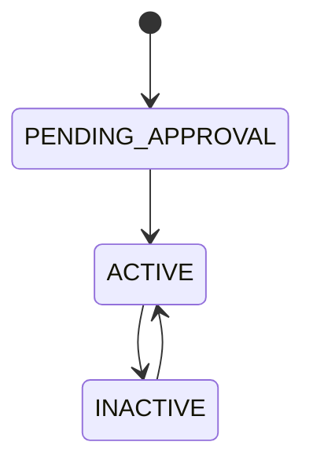
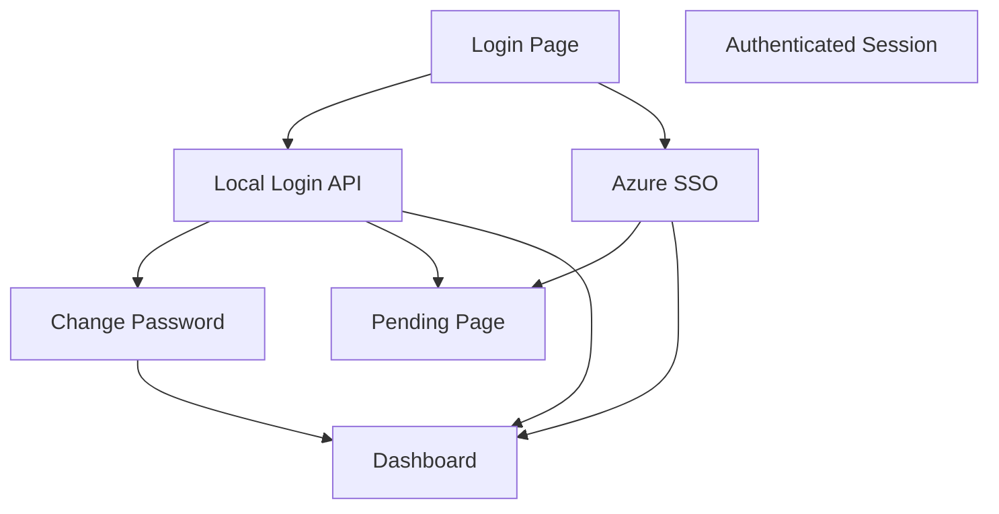

# Auth And RBAC

## Authentication Modes

The starter supports two primary authentication paths:

- local email/password
- Azure / Microsoft Entra SSO

The auth model is intentionally hybrid:

- some users are local-only
- some users are SSO-only
- some users may be linked across both modes

## Auth Components

- Better Auth for sessions and auth integration
- local login route under `src/app/api/auth/login/route.ts`
- logout and session routes under `src/app/api/auth`
- Azure SSO entry and callback routes under `src/app/api/auth/sso` and `src/app/api/auth/callback`

## Session Guards

### UI Access

- `requireSession()`
  - redirects unauthenticated users to login
  - redirects pending local users to the pending page

### API Access

- `requireApiUser()`
  - validates authenticated access for route handlers
  - returns an auth error response for unauthenticated calls

## Local Account Rules

- local users authenticate with email and password
- starter-seeded admin uses local login
- local users may be forced to change password on first login
- password changes are handled by the change-password route and page
- local credential hashes are stored on the Better Auth `Account` record for the `credential` provider
- password changes should revoke other active sessions for the same user

## SSO Rules

- Azure SSO is supported through Microsoft Entra / Azure AD config
- the system can provision or link SSO users
- revoked or unapproved users should not gain app access

## User Status Rules

- `PENDING_APPROVAL`
  - user can exist in the system but does not get normal app access
- `ACTIVE`
  - normal app access is allowed
- `INACTIVE`
  - session use should be blocked

## Role Model

### PLATFORM_ADMIN

- full administrative access
- can manage users
- can access audit trail
- can access background jobs dashboard

### SCOPE_ADMIN

- intended for scoped administration
- not equivalent to platform admin

### SCOPE_USER

- standard scoped access
- lowest built-in privilege level

## RBAC Expectations

- admin-only pages must enforce role checks on the server
- admin-only API routes must enforce role checks in handlers
- navigation can hide links, but hidden links are not the authorization mechanism
- dashboard and avatar navigation should reflect role visibility for convenience only
- route and server guard checks remain the source of truth

## Baseline Auth Flows

## Important Constraints

- auth must work with PostgreSQL in local and deployed environments
- login pages should remain resilient to browser autofill and extension interference
- account status and role checks must be enforced server-side

## Redirect Destination Contract (2026-10-29)

This maintenance clarification implements the trusted-origin policy in consolidated
FR-038 (original auth-hardening FR-004); existing requirement IDs remain stable.

- Local SSO outcomes, logout, CLI approval errors and Teams consent outcomes MUST
  use the configured auth origin (`AUTH_BASE_URL`, or Better Auth's explicit
  localhost/`PORT` development fallback). Request URLs and forwarded host/protocol
  headers MUST NOT choose these destinations.
- Local return paths MUST begin with one slash and MUST reject network paths,
  backslashes and TAB/CR/LF. The URL builder MUST reject invalid local paths and
  base paths; base paths MUST NOT contain query or fragment delimiters.
- Apply the configured base path once, including when a return path already
  contains it or a legacy `AUTH_BASE_URL` includes an app path. Extract the
  configured origin separately from that path. Preserve permitted query data and fragments. Use the existing
  `NEXT_PUBLIC_BASE_PATH`/`BASE_PATH` configuration precedence.
- A Microsoft SSO response with a redirect location MUST target HTTPS on
  `login.microsoftonline.com`, at the configured tenant's
  `/<tenant>/oauth2/v2.0/authorize` endpoint, without URL credentials. Malformed or
  unexpected locations MUST yield a controlled local sign-in error. Valid OAuth
  query data and state cookies MUST survive.
- Teams consent MUST keep its role and state checks. The state-cookie separator
  MUST NOT truncate colons in a local return query. Outcome parameters MUST merge
  with existing queries, rather than appending a second query delimiter.
- A successful CLI approval may redirect to its previously validated loopback
  callback. The local-destination rule does not remove that explicit CLI contract.

Acceptance checks: an untrusted request origin cannot change local redirect
authority; unsafe paths/configuration are rejected; a legitimate scoped path and
OAuth flow remain intact; invalid consent state cannot exchange a code or persist
a grant; diagnostics can report secret names without printing secret values.
